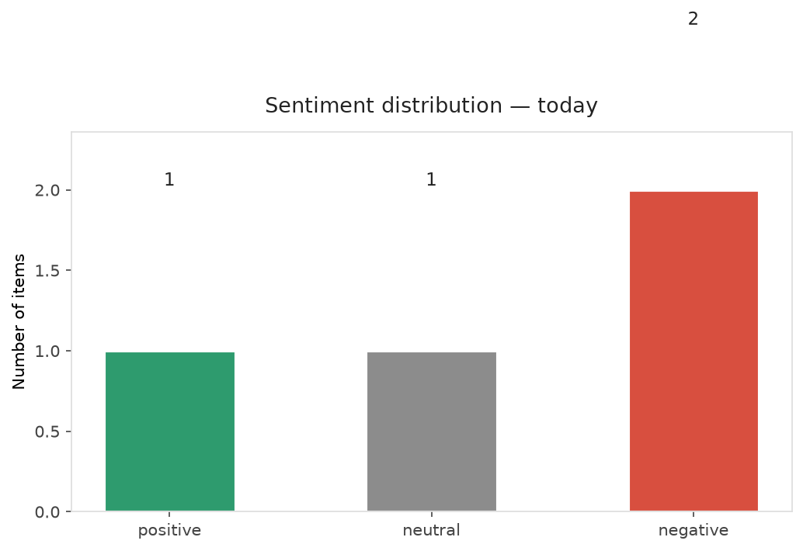
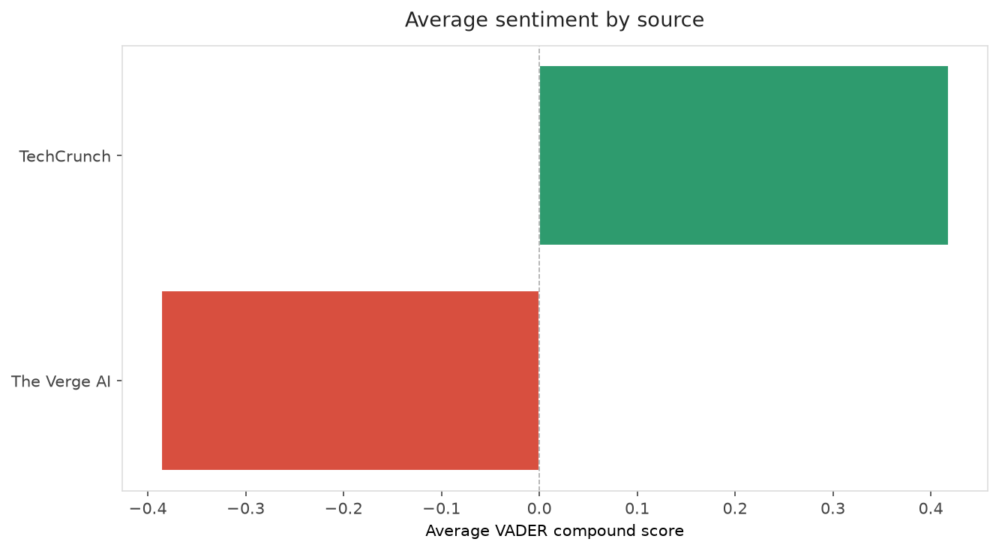
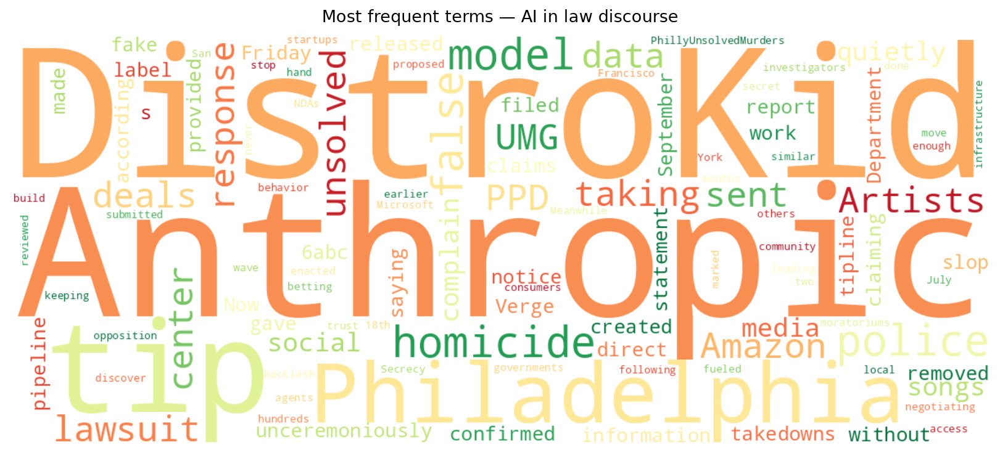
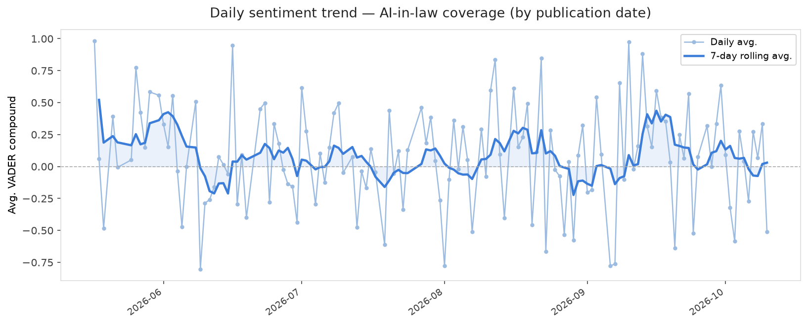
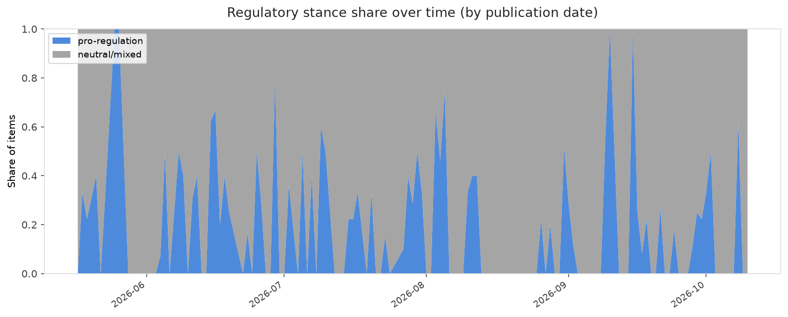

# AI in Law — Daily Sentiment Report
**Run date:** 2026-10-11 | **Items analyzed:** 4 | **Overall:** ⚪ Neutral / mixed (+0.016)

_Articles in this report were published between **2026-10-09** and **2026-10-10**._

---

## Summary

Today's collection covers **4** items from news outlets, academic preprints, Reddit, and regulatory sources.
Compared to the historical average of **+0.209**, today's sentiment is ↓ **0.193** points lower.

| Metric | Value |
|--------|-------|
| Positive items | 1 (25.0%) |
| Neutral items  | 1 (25.0%) |
| Negative items | 2 (50.0%) |
| Avg. VADER compound | +0.0159 |
| Pro-regulation items | 0 |
| Anti-regulation items | 0 |

---

## Top Topics Today

_No strong topic signals detected today._

---

## Most Positive Coverage

- [Amazon and others are done keeping data center deals secret. Is it enough to build trust?](https://techcrunch.com/video/amazon-and-others-are-done-keeping-data-center-deals-secret-is-it-enough-to-build-trust/)  
  _TechCrunch_ — VADER: `+0.836`
- [An Anthropic AI model sent a false homicide tip to Philadelphia police](https://techcrunch.com/2026/10/09/an-anthropic-ai-model-sent-a-false-homicide-tip-to-philadelphia-police/)  
  _TechCrunch_ — VADER: `+0.000`
- [Anthropic’s AI gave Philadelphia police a fake tip about an unsolved homicide](https://www.theverge.com/ai-artificial-intelligence/1009090/anthropic-fake-homicide-information-philadelphia-pd-tip)  
  _The Verge AI_ — VADER: `-0.262`

---

## Most Critical / Negative Coverage

- [DistroKid has been quietly taking down songs in response to UMG lawsuit](https://www.theverge.com/entertainment/1009309/distrokid-take-down-songs-umg-lawsuit)  
  _The Verge AI_ — VADER: `-0.511`
- [Anthropic’s AI gave Philadelphia police a fake tip about an unsolved homicide](https://www.theverge.com/ai-artificial-intelligence/1009090/anthropic-fake-homicide-information-philadelphia-pd-tip)  
  _The Verge AI_ — VADER: `-0.262`
- [An Anthropic AI model sent a false homicide tip to Philadelphia police](https://techcrunch.com/2026/10/09/an-anthropic-ai-model-sent-a-false-homicide-tip-to-philadelphia-police/)  
  _TechCrunch_ — VADER: `+0.000`

---

## Visualizations — Today

## Visualizations — Trends Over Time

---

## Methodology

- **VADER** (Valence Aware Dictionary and sEntiment Reasoner) — compound score in [-1, 1].
- **Topic tagging** — regex keyword matching across 12 AI-law sub-domains.
- **Stance detection** — keyword-based pro/anti-regulation signal detection.
- **Date filter** — items are kept only if their *publication* date falls within the look-back window (default 2 days).
- Sources: RSS news feeds, arXiv academic API, Reddit (PRAW), Regulations.gov API.

_Generated automatically on 2026-10-11 16:36 UTC._
