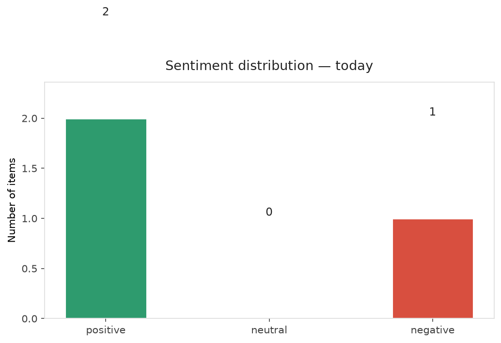
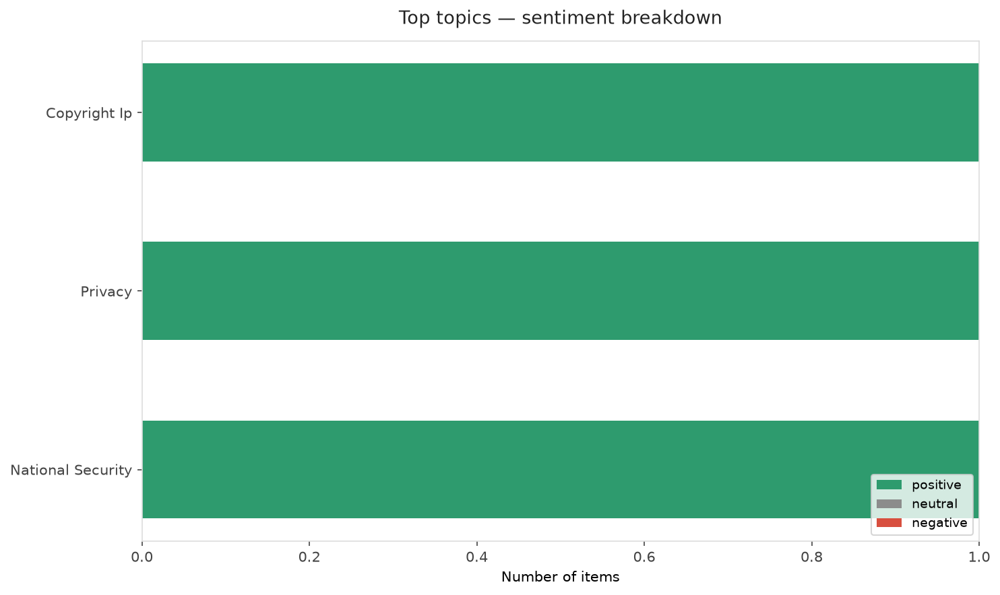
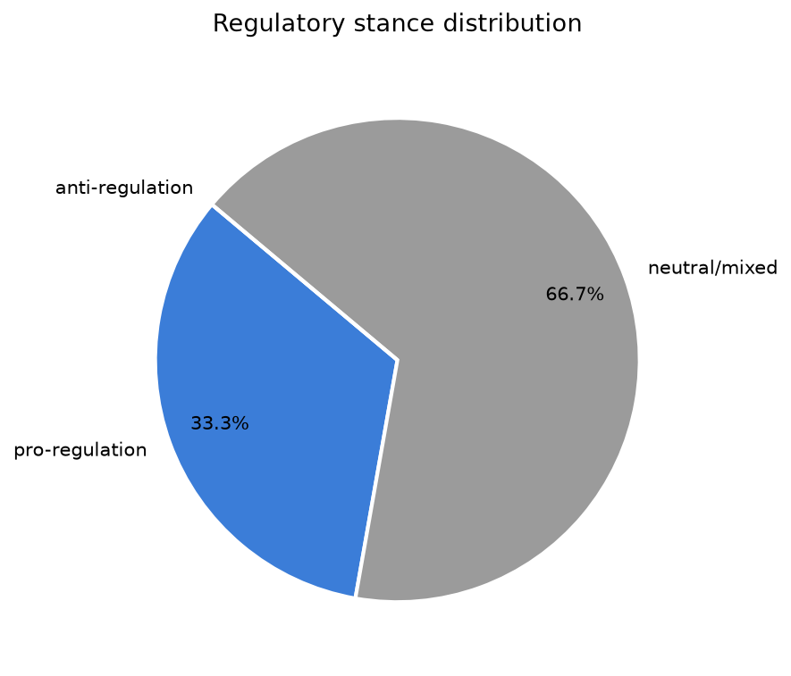
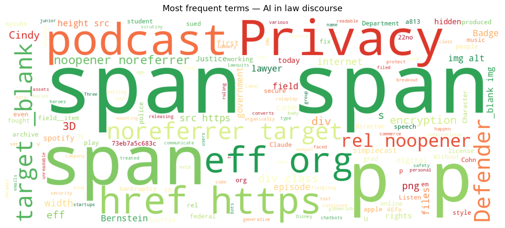
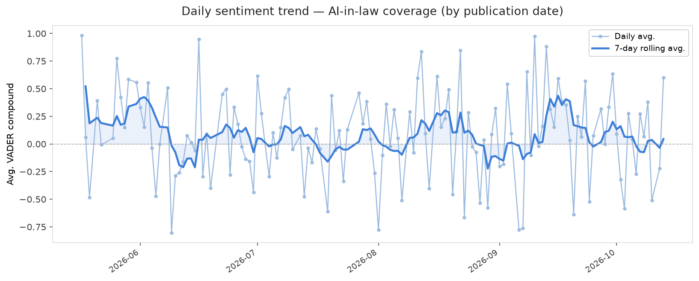
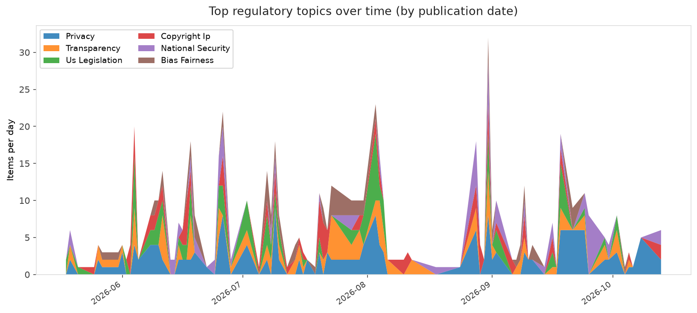
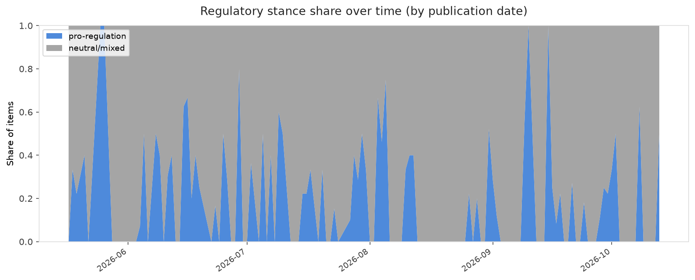

# AI in Law — Daily Sentiment Report
**Run date:** 2026-10-13 | **Items analyzed:** 3 | **Overall:** 🟢 Mildly positive (+0.170)

_Articles in this report were published between **2026-10-12** and **2026-10-13**._

---

## Summary

Today's collection covers **3** items from news outlets, academic preprints, Reddit, and regulatory sources.
Compared to the historical average of **+0.209**, today's sentiment is ↓ **0.039** points lower.

| Metric | Value |
|--------|-------|
| Positive items | 2 (66.7%) |
| Neutral items  | 0 (0.0%) |
| Negative items | 1 (33.3%) |
| Avg. VADER compound | +0.1702 |
| Pro-regulation items | 1 |
| Anti-regulation items | 0 |

---

## Top Topics Today

- **Copyright Ip** — 1 items
- **Privacy** — 1 items
- **National Security** — 1 items

---

## Most Positive Coverage

- [Privacy's Defenders Podcast: No Privacy Without Encryption](https://www.eff.org/deeplinks/2026/10/privacys-defenders-podcast-no-privacy-without-encryption)  
  _EFF DeepLinks_ — VADER: `+0.963`
- [Character.AI files for bankruptcy](https://www.theverge.com/ai-artificial-intelligence/1009802/character-ai-files-for-bankruptcy-disney)  
  _The Verge AI_ — VADER: `+0.238`
- [Anthropic's Claude AI submitted false murder tip to Philadelphia police](https://arstechnica.com/tech-policy/2026/10/anthropics-claude-ai-submitted-false-murder-tip-to-philadelphia-police/)  
  _Ars Technica Tech Policy_ — VADER: `-0.691`

---

## Most Critical / Negative Coverage

- [Anthropic's Claude AI submitted false murder tip to Philadelphia police](https://arstechnica.com/tech-policy/2026/10/anthropics-claude-ai-submitted-false-murder-tip-to-philadelphia-police/)  
  _Ars Technica Tech Policy_ — VADER: `-0.691`
- [Character.AI files for bankruptcy](https://www.theverge.com/ai-artificial-intelligence/1009802/character-ai-files-for-bankruptcy-disney)  
  _The Verge AI_ — VADER: `+0.238`
- [Privacy's Defenders Podcast: No Privacy Without Encryption](https://www.eff.org/deeplinks/2026/10/privacys-defenders-podcast-no-privacy-without-encryption)  
  _EFF DeepLinks_ — VADER: `+0.963`

---

## Visualizations — Today

## Visualizations — Trends Over Time

---

## Methodology

- **VADER** (Valence Aware Dictionary and sEntiment Reasoner) — compound score in [-1, 1].
- **Topic tagging** — regex keyword matching across 12 AI-law sub-domains.
- **Stance detection** — keyword-based pro/anti-regulation signal detection.
- **Date filter** — items are kept only if their *publication* date falls within the look-back window (default 2 days).
- Sources: RSS news feeds, arXiv academic API, Reddit (PRAW), Regulations.gov API.

_Generated automatically on 2026-10-13 17:59 UTC._
