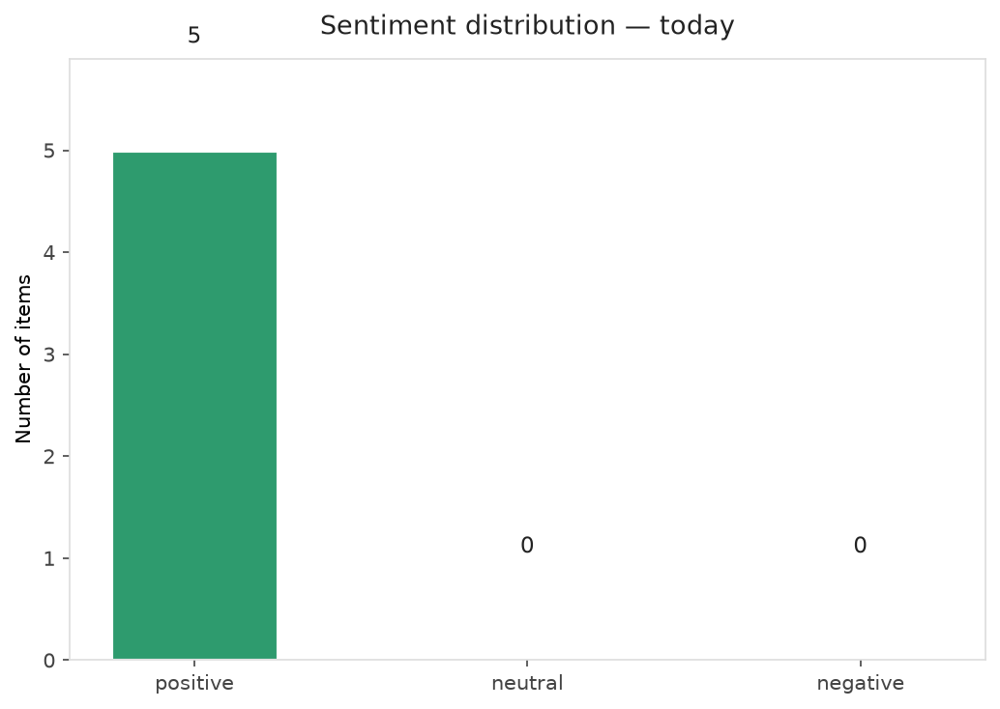
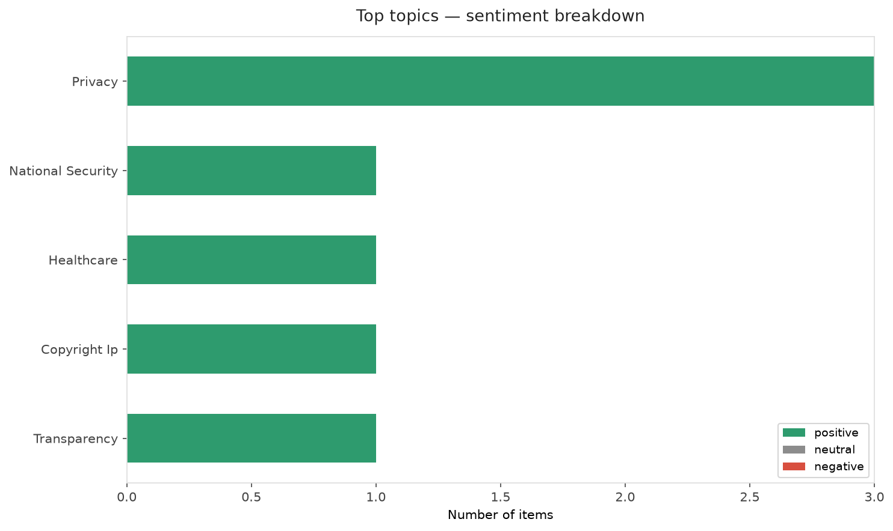
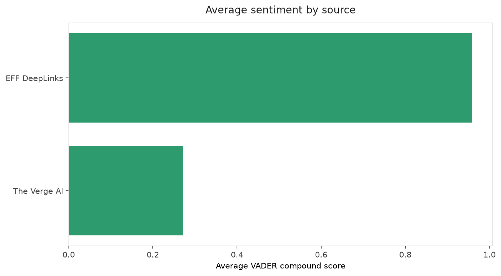
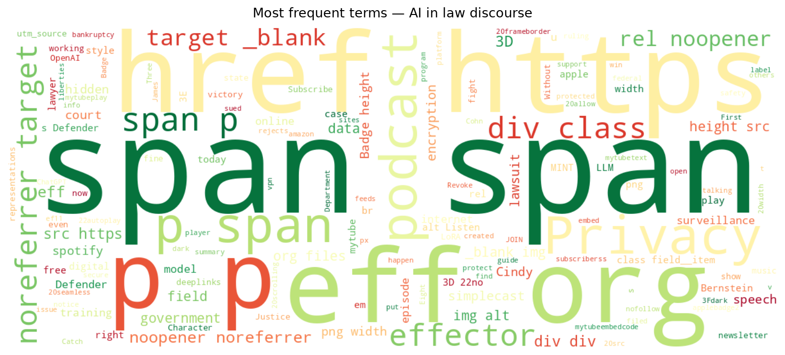
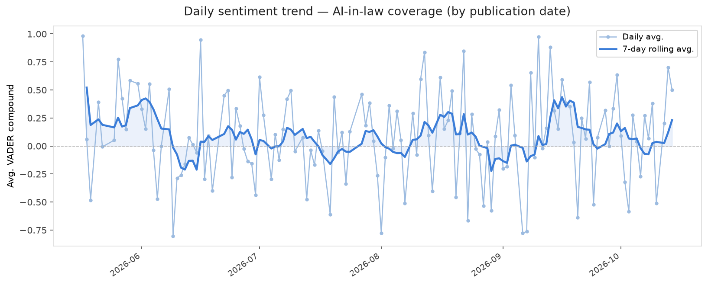
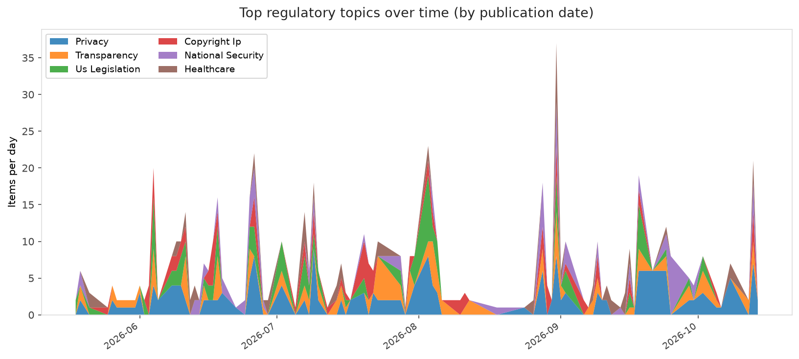
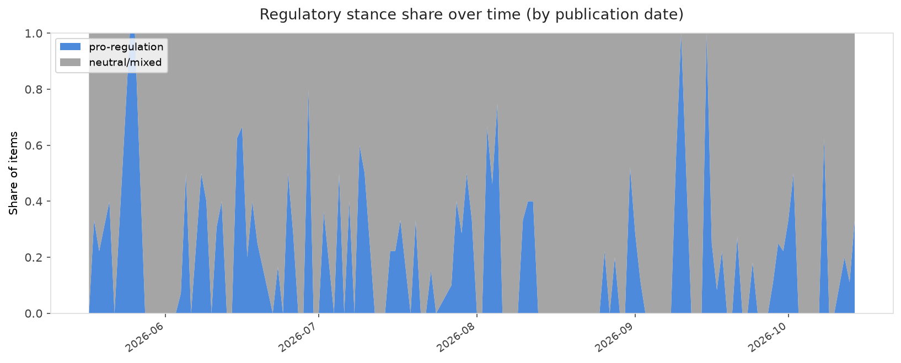

# AI in Law — Daily Sentiment Report
**Run date:** 2026-10-15 | **Items analyzed:** 5 | **Overall:** 🟢 Mildly positive (+0.623)

_Articles in this report were published between **2026-10-13** and **2026-10-14**._

---

## Summary

Today's collection covers **5** items from news outlets, academic preprints, Reddit, and regulatory sources.
Compared to the historical average of **+0.212**, today's sentiment is ↑ **0.411** points higher.

| Metric | Value |
|--------|-------|
| Positive items | 5 (100.0%) |
| Neutral items  | 0 (0.0%) |
| Negative items | 0 (0.0%) |
| Avg. VADER compound | +0.6228 |
| Pro-regulation items | 1 |
| Anti-regulation items | 0 |

---

## Top Topics Today

- **Privacy** — 3 items
- **National Security** — 1 items
- **Healthcare** — 1 items
- **Copyright Ip** — 1 items
- **Transparency** — 1 items

---

## Most Positive Coverage

- [Privacy's Defenders Podcast: No Privacy Without Encryption](https://www.eff.org/deeplinks/2026/10/privacys-defenders-podcast-no-privacy-without-encryption)  
  _EFF DeepLinks_ — VADER: `+0.963`
- [🗣 A Victory for Freedom of Speech Online | EFFector 38.18](https://www.eff.org/deeplinks/2026/10/victory-freedom-speech-online-effector-3818)  
  _EFF DeepLinks_ — VADER: `+0.956`
- [inLoRA-MINT: Internal Representations for Auditing Training Data in Domain-adapted LLMs](https://arxiv.org/abs/2610.18051v1)  
  _arXiv_ — VADER: `+0.649`

---

## Most Critical / Negative Coverage

- [Eight states sue OpenAI, saying ChatGPT isn&#8217;t safe for kids](https://www.theverge.com/ai-artificial-intelligence/1011500/openai-state-lawsuits-chatgpt-safety)  
  _The Verge AI_ — VADER: `+0.273`
- [Now that Character.AI is going bankrupt, what happens to all of its users&#8217; data?](https://www.theverge.com/policy/1011417/new-york-ag-characterai-bankruptcy)  
  _The Verge AI_ — VADER: `+0.273`
- [inLoRA-MINT: Internal Representations for Auditing Training Data in Domain-adapted LLMs](https://arxiv.org/abs/2610.18051v1)  
  _arXiv_ — VADER: `+0.649`

---

## Visualizations — Today

## Visualizations — Trends Over Time

---

## Methodology

- **VADER** (Valence Aware Dictionary and sEntiment Reasoner) — compound score in [-1, 1].
- **Topic tagging** — regex keyword matching across 12 AI-law sub-domains.
- **Stance detection** — keyword-based pro/anti-regulation signal detection.
- **Date filter** — items are kept only if their *publication* date falls within the look-back window (default 2 days).
- Sources: RSS news feeds, arXiv academic API, Reddit (PRAW), Regulations.gov API.

_Generated automatically on 2026-10-15 15:32 UTC._
