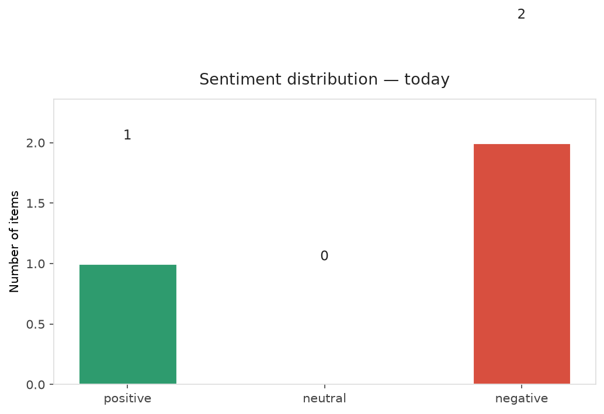
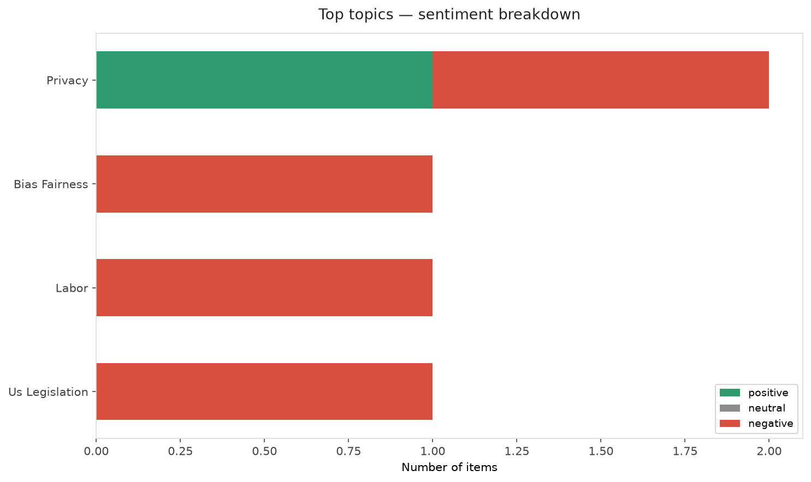
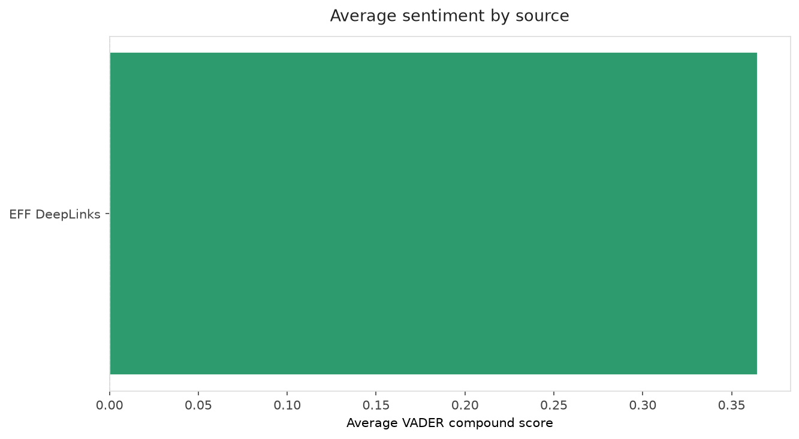
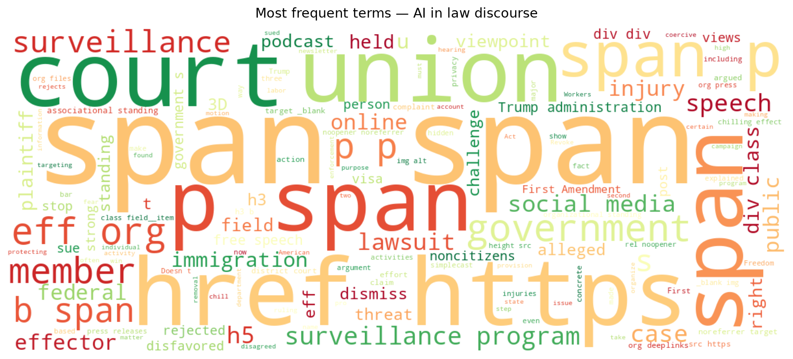
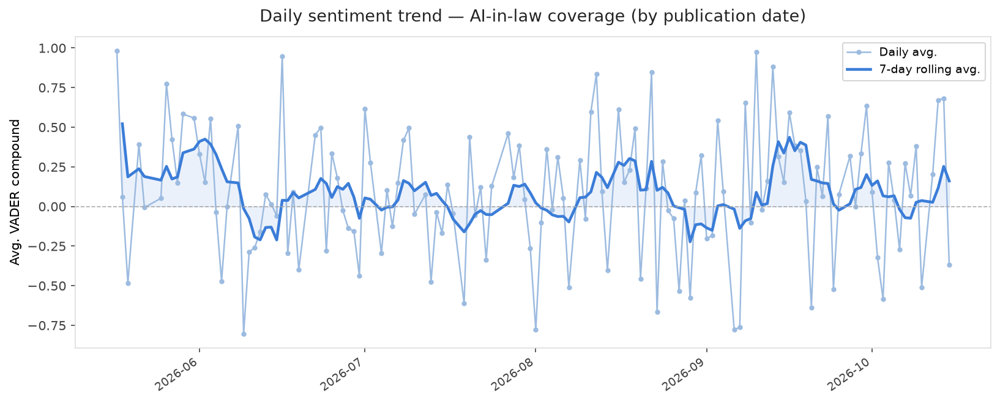
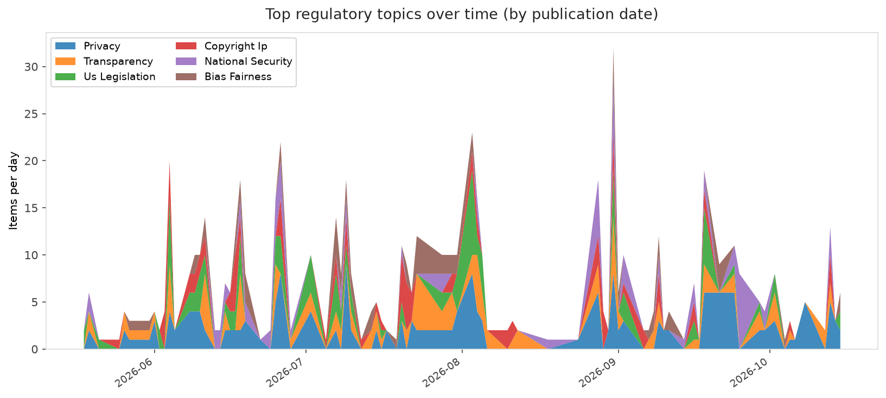
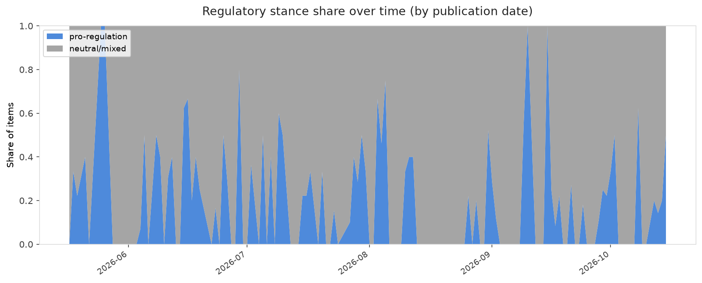

# AI in Law — Daily Sentiment Report
**Run date:** 2026-10-16 | **Items analyzed:** 3 | **Overall:** 🟢 Mildly positive (+0.073)

_Articles in this report were published between **2026-10-14** and **2026-10-15**._

---

## Summary

Today's collection covers **3** items from news outlets, academic preprints, Reddit, and regulatory sources.
Compared to the historical average of **+0.212**, today's sentiment is ↓ **0.139** points lower.

| Metric | Value |
|--------|-------|
| Positive items | 1 (33.3%) |
| Neutral items  | 0 (0.0%) |
| Negative items | 2 (66.7%) |
| Avg. VADER compound | +0.0730 |
| Pro-regulation items | 1 |
| Anti-regulation items | 0 |

---

## Top Topics Today

- **Privacy** — 2 items
- **Bias Fairness** — 1 items
- **Labor** — 1 items
- **Us Legislation** — 1 items

---

## Most Positive Coverage

- [🗣 A Victory for Freedom of Speech Online | EFFector 38.18](https://www.eff.org/deeplinks/2026/10/victory-freedom-speech-online-effector-3818)  
  _EFF DeepLinks_ — VADER: `+0.956`
- [Our Lawsuit Against the Trump Administration’s Social Media Surveillance Moves Forward. Here’s What ](https://www.eff.org/deeplinks/2026/10/our-lawsuit-against-trump-administrations-social-media-surveillance-moves-forward)  
  _EFF DeepLinks_ — VADER: `-0.226`
- [Report: FTC probes Anthropic, OpenAI after Trump dismissed AI fears as “hoax”](https://arstechnica.com/tech-policy/2026/10/ftc-probes-if-openai-anthropic-security-incidents-harmed-americans-report-says/)  
  _Ars Technica Tech Policy_ — VADER: `-0.511`

---

## Most Critical / Negative Coverage

- [Report: FTC probes Anthropic, OpenAI after Trump dismissed AI fears as “hoax”](https://arstechnica.com/tech-policy/2026/10/ftc-probes-if-openai-anthropic-security-incidents-harmed-americans-report-says/)  
  _Ars Technica Tech Policy_ — VADER: `-0.511`
- [Our Lawsuit Against the Trump Administration’s Social Media Surveillance Moves Forward. Here’s What ](https://www.eff.org/deeplinks/2026/10/our-lawsuit-against-trump-administrations-social-media-surveillance-moves-forward)  
  _EFF DeepLinks_ — VADER: `-0.226`
- [🗣 A Victory for Freedom of Speech Online | EFFector 38.18](https://www.eff.org/deeplinks/2026/10/victory-freedom-speech-online-effector-3818)  
  _EFF DeepLinks_ — VADER: `+0.956`

---

## Visualizations — Today

## Visualizations — Trends Over Time

---

## Methodology

- **VADER** (Valence Aware Dictionary and sEntiment Reasoner) — compound score in [-1, 1].
- **Topic tagging** — regex keyword matching across 12 AI-law sub-domains.
- **Stance detection** — keyword-based pro/anti-regulation signal detection.
- **Date filter** — items are kept only if their *publication* date falls within the look-back window (default 2 days).
- Sources: RSS news feeds, arXiv academic API, Reddit (PRAW), Regulations.gov API.

_Generated automatically on 2026-10-16 15:16 UTC._
