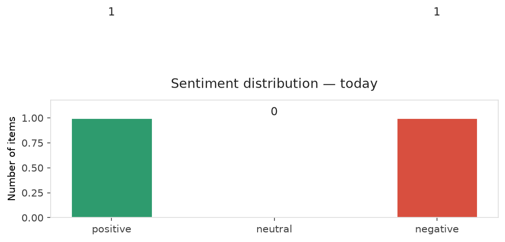
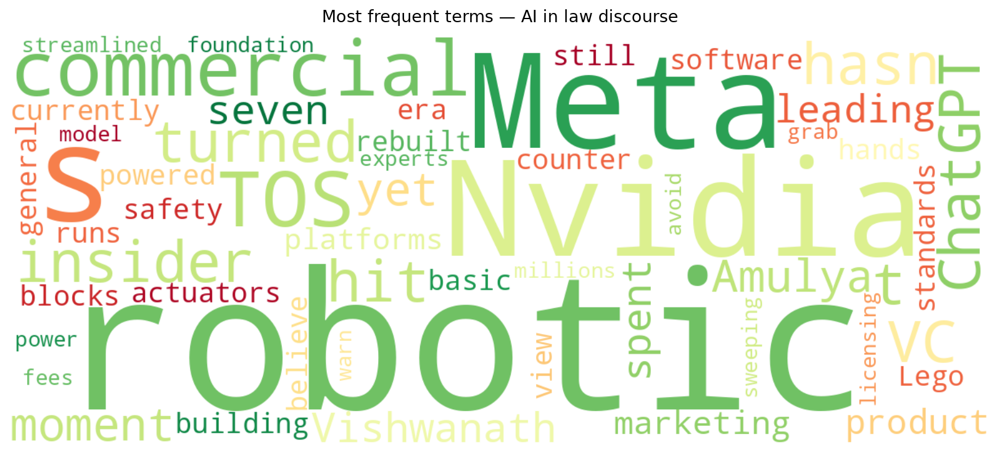
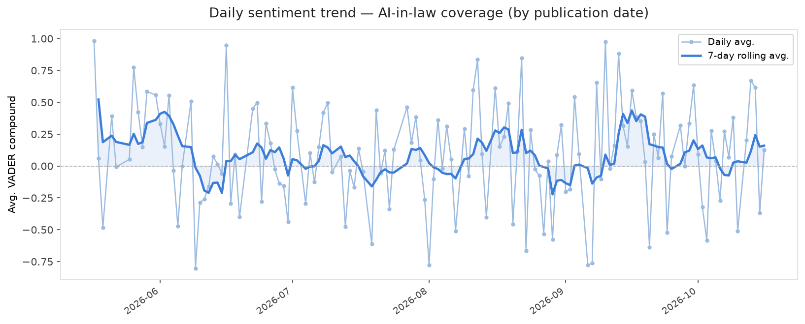
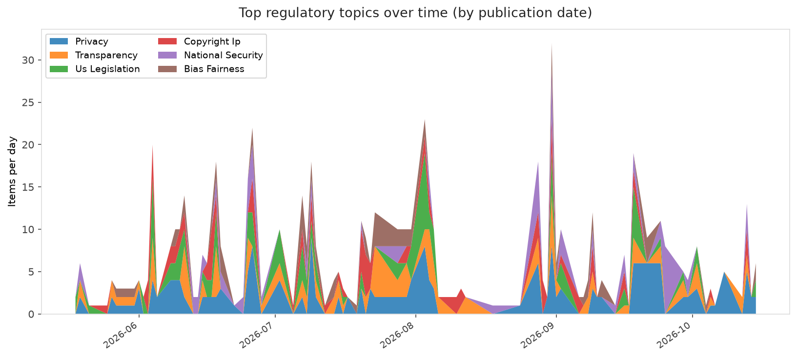
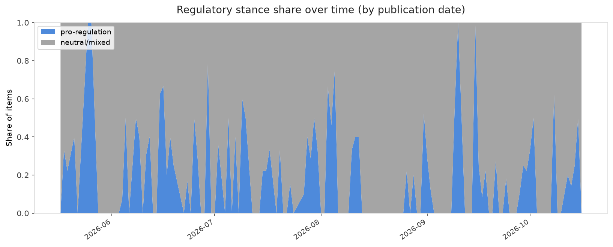

# AI in Law — Daily Sentiment Report
**Run date:** 2026-10-18 | **Items analyzed:** 2 | **Overall:** 🟢 Mildly positive (+0.127)

_Articles in this report were published between **2026-10-16** and **2026-10-16**._

---

## Summary

Today's collection covers **2** items from news outlets, academic preprints, Reddit, and regulatory sources.
Compared to the historical average of **+0.211**, today's sentiment is ↓ **0.084** points lower.

| Metric | Value |
|--------|-------|
| Positive items | 1 (50.0%) |
| Neutral items  | 0 (0.0%) |
| Negative items | 1 (50.0%) |
| Avg. VADER compound | +0.1267 |
| Pro-regulation items | 0 |
| Anti-regulation items | 0 |

---

## Top Topics Today

_No strong topic signals detected today._

---

## Most Positive Coverage

- [An Nvidia insider-turned-VC on why robotics hasn’t hit its ChatGPT moment, yet](https://techcrunch.com/video/a-nvidia-insider-turned-vc-on-why-robotics-hasnt-hit-its-chatgpt-moment-yet/)  
  _TechCrunch_ — VADER: `+0.527`
- [Meta may use sweeping new commercial TOS to avoid millions in AI licensing fees](https://arstechnica.com/tech-policy/2026/10/meta-may-use-sweeping-new-commercial-tos-to-avoid-millions-in-ai-licensing-fees/)  
  _Ars Technica Tech Policy_ — VADER: `-0.273`

---

## Most Critical / Negative Coverage

- [Meta may use sweeping new commercial TOS to avoid millions in AI licensing fees](https://arstechnica.com/tech-policy/2026/10/meta-may-use-sweeping-new-commercial-tos-to-avoid-millions-in-ai-licensing-fees/)  
  _Ars Technica Tech Policy_ — VADER: `-0.273`
- [An Nvidia insider-turned-VC on why robotics hasn’t hit its ChatGPT moment, yet](https://techcrunch.com/video/a-nvidia-insider-turned-vc-on-why-robotics-hasnt-hit-its-chatgpt-moment-yet/)  
  _TechCrunch_ — VADER: `+0.527`

---

## Visualizations — Today

## Visualizations — Trends Over Time

---

## Methodology

- **VADER** (Valence Aware Dictionary and sEntiment Reasoner) — compound score in [-1, 1].
- **Topic tagging** — regex keyword matching across 12 AI-law sub-domains.
- **Stance detection** — keyword-based pro/anti-regulation signal detection.
- **Date filter** — items are kept only if their *publication* date falls within the look-back window (default 2 days).
- Sources: RSS news feeds, arXiv academic API, Reddit (PRAW), Regulations.gov API.

_Generated automatically on 2026-10-18 14:21 UTC._
