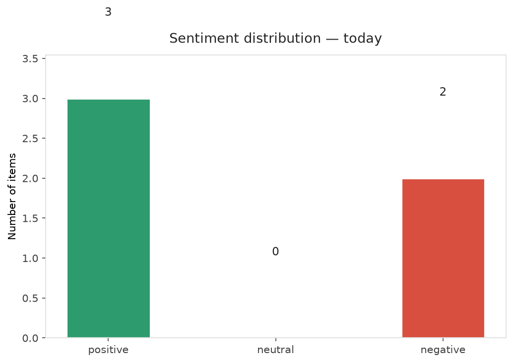
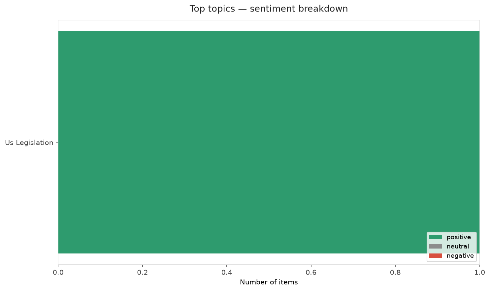
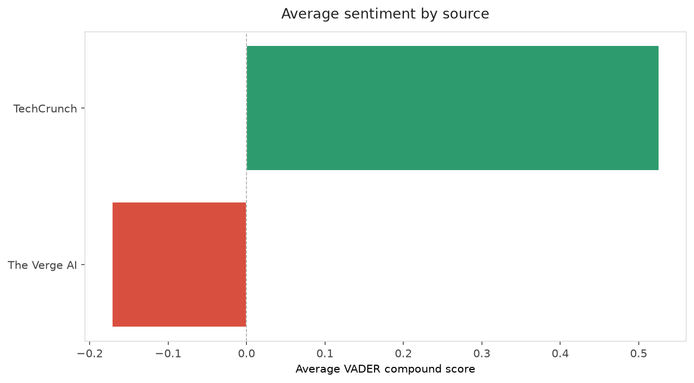
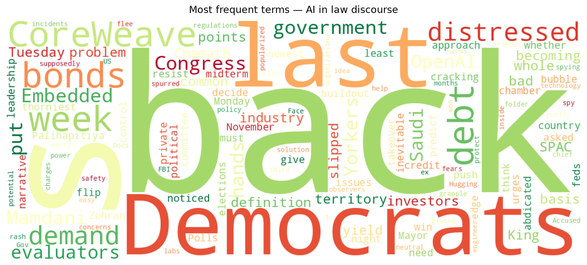
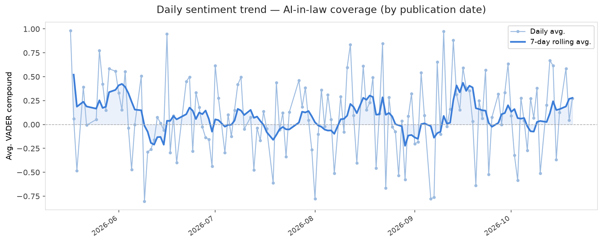
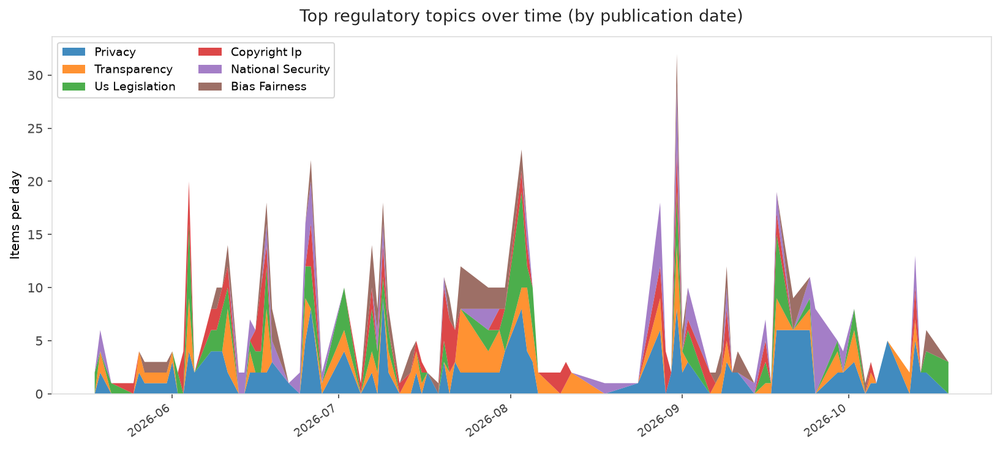
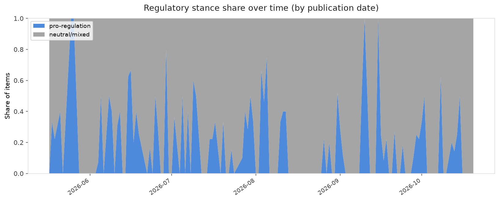

# AI in Law — Daily Sentiment Report
**Run date:** 2026-10-20 | **Items analyzed:** 5 | **Overall:** ⚪ Neutral / mixed (+0.036)

_Articles in this report were published between **2026-10-19** and **2026-10-20**._

---

## Summary

Today's collection covers **5** items from news outlets, academic preprints, Reddit, and regulatory sources.
Compared to the historical average of **+0.210**, today's sentiment is ↓ **0.174** points lower.

| Metric | Value |
|--------|-------|
| Positive items | 3 (60.0%) |
| Neutral items  | 0 (0.0%) |
| Negative items | 2 (40.0%) |
| Avg. VADER compound | +0.0364 |
| Pro-regulation items | 0 |
| Anti-regulation items | 0 |

---

## Top Topics Today

- **Us Legislation** — 1 items

---

## Most Positive Coverage

- [Embedded AI evaluators won’t be an easy solution, Hugging Face’s policy chief says](https://techcrunch.com/2026/10/19/embedded-ai-evaluators-wont-be-an-easy-solution-hugging-faces-policy-chief-says/)  
  _TechCrunch_ — VADER: `+0.778`
- [Democrats think cracking down on AI could give them an edge](https://www.theverge.com/policy/1013113/democrats-ai-midterms)  
  _The Verge AI_ — VADER: `+0.586`
- [Mamdani says feds have abdicated on AI, urges New Yorkers to push back](https://techcrunch.com/2026/10/19/mamdani-says-feds-have-abdicated-on-ai-urges-new-yorkers-to-push-back/)  
  _TechCrunch_ — VADER: `+0.273`

---

## Most Critical / Negative Coverage

- [CoreWeave&#8217;s debt is becoming the whole AI industry&#8217;s problem](https://www.theverge.com/ai-artificial-intelligence/1014045/coreweave-stock-debt-sector-ai)  
  _The Verge AI_ — VADER: `-0.929`
- [Accused OpenAI spy had folder called “Saudi Gov Docs,” FBI says](https://arstechnica.com/tech-policy/2026/10/accused-openai-spy-had-folder-called-saudi-gov-docs-fbi-says/)  
  _Ars Technica Tech Policy_ — VADER: `-0.527`
- [Mamdani says feds have abdicated on AI, urges New Yorkers to push back](https://techcrunch.com/2026/10/19/mamdani-says-feds-have-abdicated-on-ai-urges-new-yorkers-to-push-back/)  
  _TechCrunch_ — VADER: `+0.273`

---

## Visualizations — Today

## Visualizations — Trends Over Time

---

## Methodology

- **VADER** (Valence Aware Dictionary and sEntiment Reasoner) — compound score in [-1, 1].
- **Topic tagging** — regex keyword matching across 12 AI-law sub-domains.
- **Stance detection** — keyword-based pro/anti-regulation signal detection.
- **Date filter** — items are kept only if their *publication* date falls within the look-back window (default 2 days).
- Sources: RSS news feeds, arXiv academic API, Reddit (PRAW), Regulations.gov API.

_Generated automatically on 2026-10-20 15:35 UTC._
