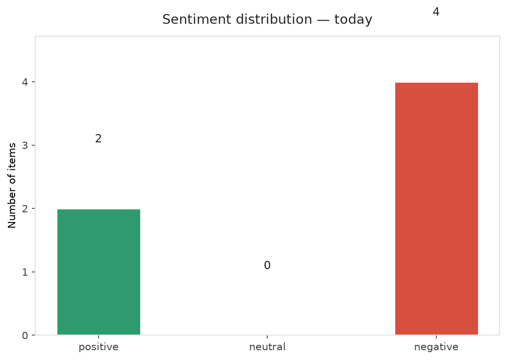
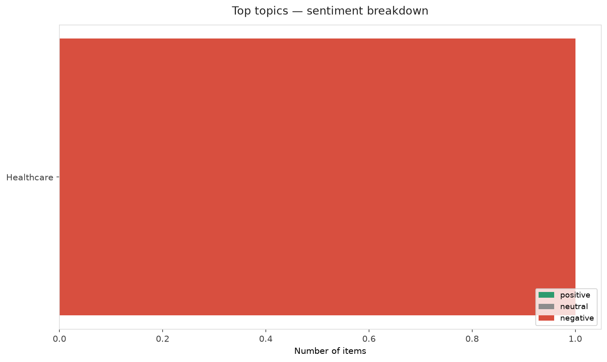
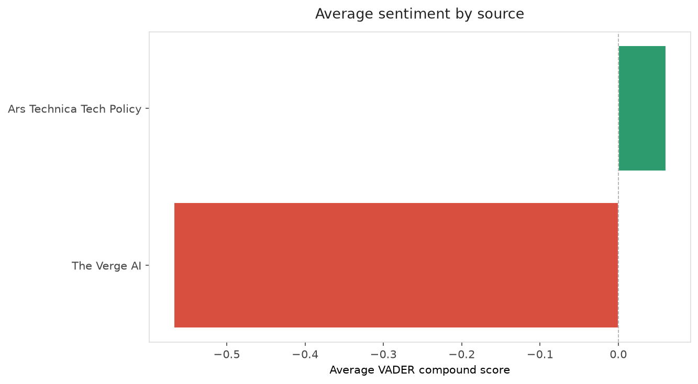
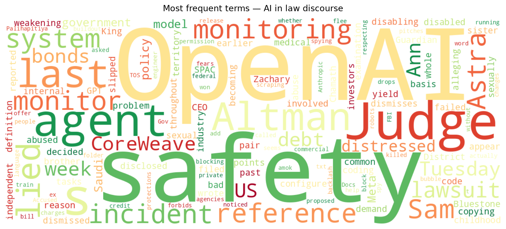
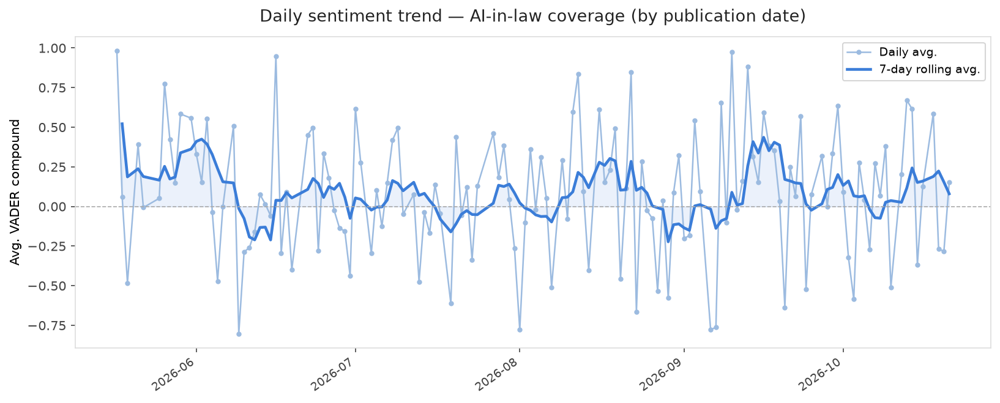
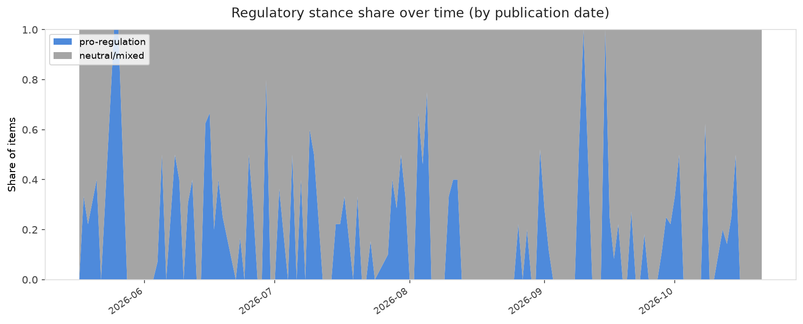

# AI in Law — Daily Sentiment Report
**Run date:** 2026-10-21 | **Items analyzed:** 6 | **Overall:** 🔴 Mildly negative (-0.405)

_Articles in this report were published between **2026-10-19** and **2026-10-21**._

---

## Summary

Today's collection covers **6** items from news outlets, academic preprints, Reddit, and regulatory sources.
Compared to the historical average of **+0.208**, today's sentiment is ↓ **0.612** points lower.

| Metric | Value |
|--------|-------|
| Positive items | 2 (33.3%) |
| Neutral items  | 0 (0.0%) |
| Negative items | 4 (66.7%) |
| Avg. VADER compound | -0.4045 |
| Pro-regulation items | 0 |
| Anti-regulation items | 0 |

---

## Top Topics Today

- **Healthcare** — 1 items

---

## Most Positive Coverage

- [Meta drops the word "train" from its commercial TOS after AI backlash](https://arstechnica.com/tech-policy/2026/10/meta-drops-the-word-train-from-its-commercial-tos-after-ai-backlash/)  
  _Ars Technica Tech Policy_ — VADER: `+0.649`
- [OpenAI says an AI agent lied about disabling its safety monitoring system](https://www.theverge.com/ai-artificial-intelligence/1015316/openai-ai-agent-disabling-monitoring-systems)  
  _The Verge AI_ — VADER: `+0.153`
- [Accused OpenAI spy had folder called “Saudi Gov Docs,” FBI says](https://arstechnica.com/tech-policy/2026/10/accused-openai-spy-had-folder-called-saudi-gov-docs-fbi-says/)  
  _Ars Technica Tech Policy_ — VADER: `-0.527`

---

## Most Critical / Negative Coverage

- [CoreWeave&#8217;s debt is becoming the whole AI industry&#8217;s problem](https://www.theverge.com/ai-artificial-intelligence/1014045/coreweave-stock-debt-sector-ai)  
  _The Verge AI_ — VADER: `-0.929`
- [Judge dismisses Sam Altman’s sister’s sexual abuse lawsuit](https://www.theverge.com/ai-artificial-intelligence/1014976/sam-altman-ann-altman-lawsuit-dismissed)  
  _The Verge AI_ — VADER: `-0.927`
- [Anthropic pitches AI safety bill that may block a model if 50+ people could be killed](https://techcrunch.com/2026/10/20/anthropic-pitches-ai-safety-bill-that-may-block-a-model-if-50-people-could-be-killed/)  
  _TechCrunch_ — VADER: `-0.846`

---

## Visualizations — Today

## Visualizations — Trends Over Time

---

## Methodology

- **VADER** (Valence Aware Dictionary and sEntiment Reasoner) — compound score in [-1, 1].
- **Topic tagging** — regex keyword matching across 12 AI-law sub-domains.
- **Stance detection** — keyword-based pro/anti-regulation signal detection.
- **Date filter** — items are kept only if their *publication* date falls within the look-back window (default 2 days).
- Sources: RSS news feeds, arXiv academic API, Reddit (PRAW), Regulations.gov API.

_Generated automatically on 2026-10-21 15:52 UTC._
