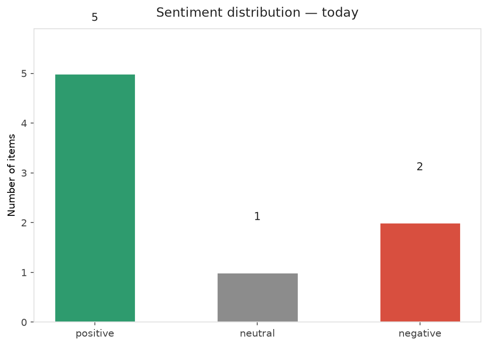
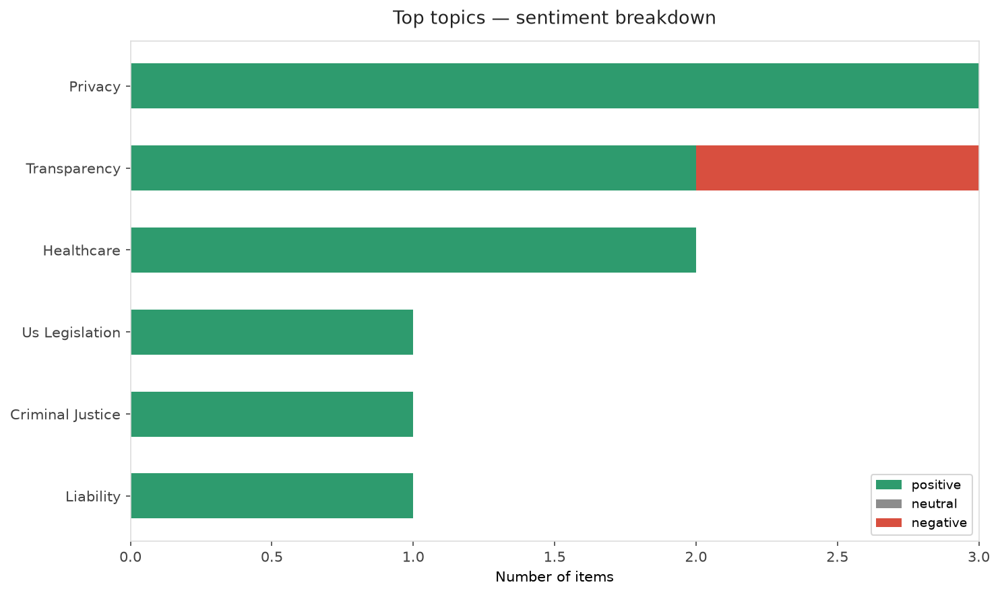
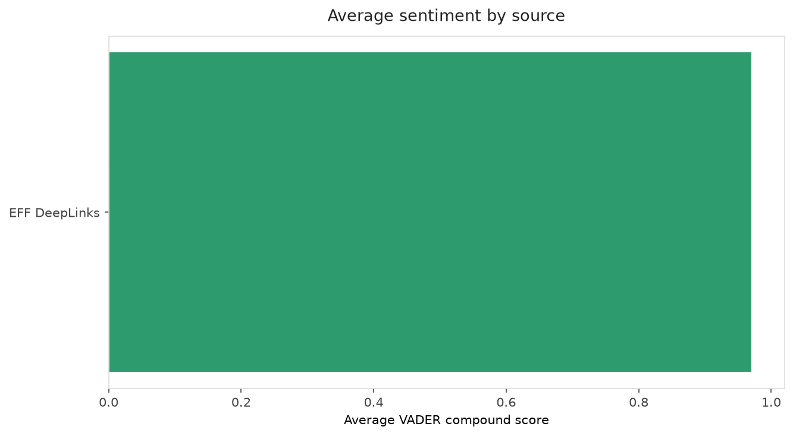
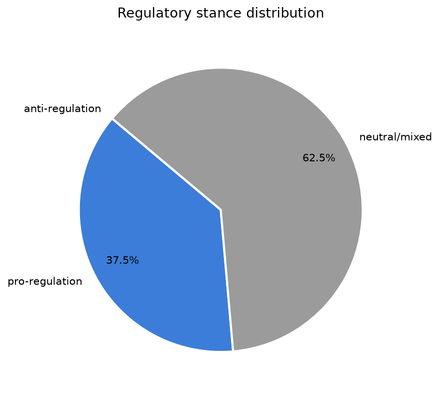
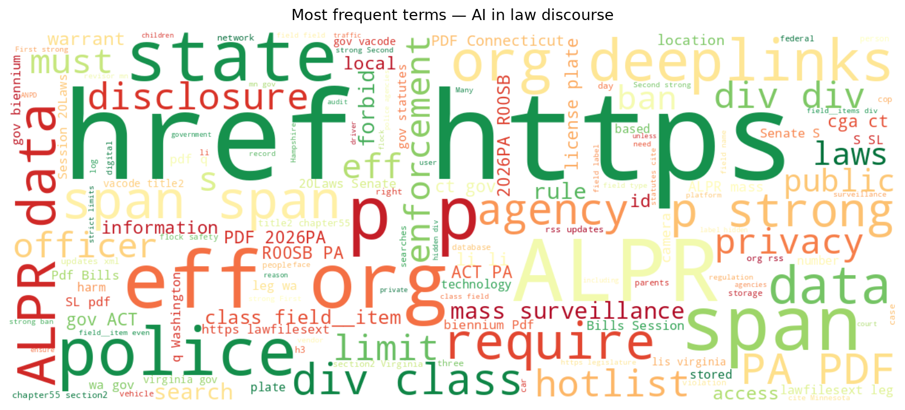
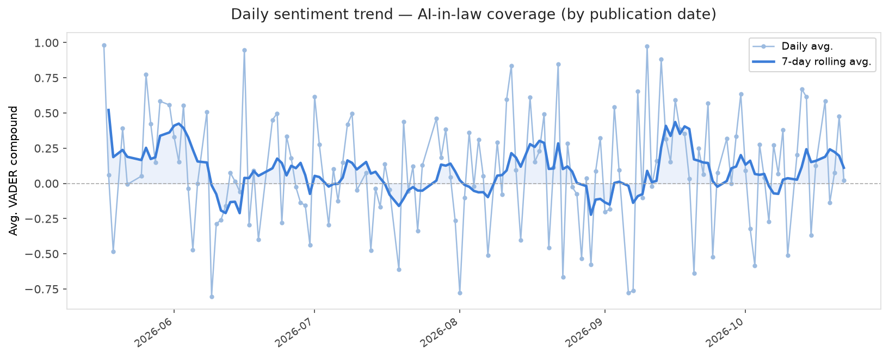
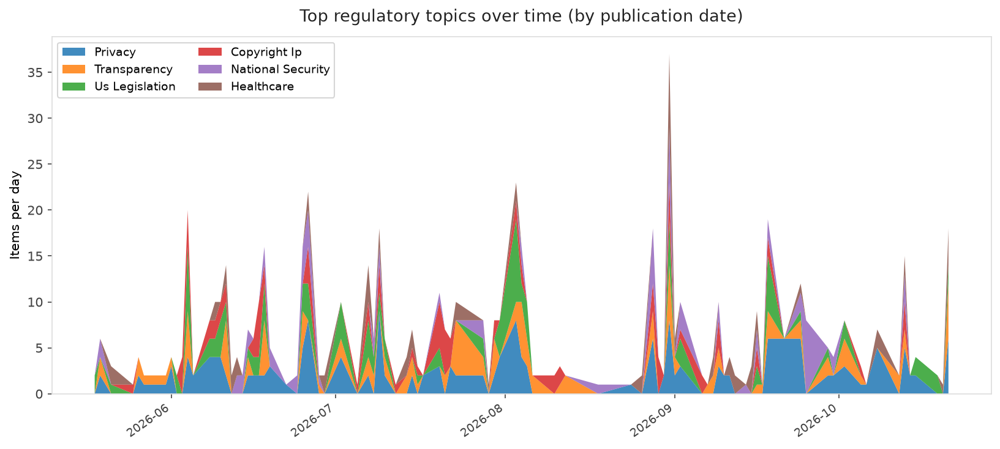
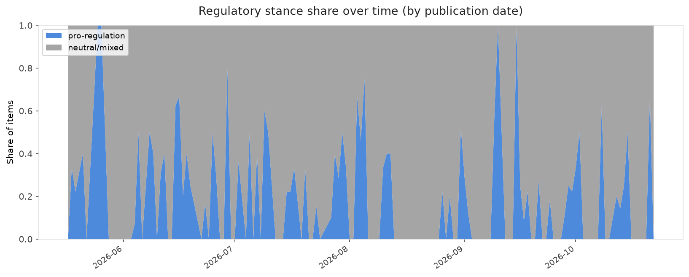

# AI in Law — Daily Sentiment Report
**Run date:** 2026-10-22 | **Items analyzed:** 8 | **Overall:** 🟢 Mildly positive (+0.348)

_Articles in this report were published between **2026-10-20** and **2026-10-22**._

---

## Summary

Today's collection covers **8** items from news outlets, academic preprints, Reddit, and regulatory sources.
Compared to the historical average of **+0.208**, today's sentiment is ↑ **0.139** points higher.

| Metric | Value |
|--------|-------|
| Positive items | 5 (62.5%) |
| Neutral items  | 1 (12.5%) |
| Negative items | 2 (25.0%) |
| Avg. VADER compound | +0.3476 |
| Pro-regulation items | 3 |
| Anti-regulation items | 0 |

---

## Top Topics Today

- **Privacy** — 3 items
- **Transparency** — 3 items
- **Healthcare** — 2 items
- **Us Legislation** — 1 items
- **Criminal Justice** — 1 items

---

## Most Positive Coverage

- [EFF Launches Guide to Help Parents and Youth Protect Privacy Online](https://www.eff.org/press/releases/eff-launches-guide-help-parents-and-youth-protect-privacy-online)  
  _EFF DeepLinks_ — VADER: `+0.996`
- [EFF to Brazil’s ANPD: Data Privacy and Free Expression Must Underpin Platform Regulations](https://www.eff.org/deeplinks/2026/10/eff-brazils-anpd-data-privacy-and-free-expression-must-underpin-platform)  
  _EFF DeepLinks_ — VADER: `+0.975`
- [EFF’s State Legislative Agenda to End ALPR Mass Surveillance](https://www.eff.org/deeplinks/2026/10/effs-state-legislative-agenda-end-alpr-mass-surveillance)  
  _EFF DeepLinks_ — VADER: `+0.944`

---

## Most Critical / Negative Coverage

- [Conflicted Records: Typed Adversarial Contracts for Auditable LLM Output Quality Enforcement](https://arxiv.org/abs/2610.29669v1)  
  _arXiv_ — VADER: `-0.842`
- [Bill Gates says to prepare for 20 years of ‘tumultuous’ AI disruption](https://www.theverge.com/podcast/1015408/bill-gates-ai-interview-microsoft-openai-anthropic-risk-policy-regulation)  
  _The Verge AI_ — VADER: `-0.361`
- [AI’s hidden storage bill: What inference leaves behind](https://www.technologyreview.com/2026/10/22/1146948/ais-hidden-storage-bill-what-inference-leaves-behind/)  
  _MIT Tech Review_ — VADER: `+0.000`

---

## Visualizations — Today

## Visualizations — Trends Over Time

---

## Methodology

- **VADER** (Valence Aware Dictionary and sEntiment Reasoner) — compound score in [-1, 1].
- **Topic tagging** — regex keyword matching across 12 AI-law sub-domains.
- **Stance detection** — keyword-based pro/anti-regulation signal detection.
- **Date filter** — items are kept only if their *publication* date falls within the look-back window (default 2 days).
- Sources: RSS news feeds, arXiv academic API, Reddit (PRAW), Regulations.gov API.

_Generated automatically on 2026-10-22 15:49 UTC._
