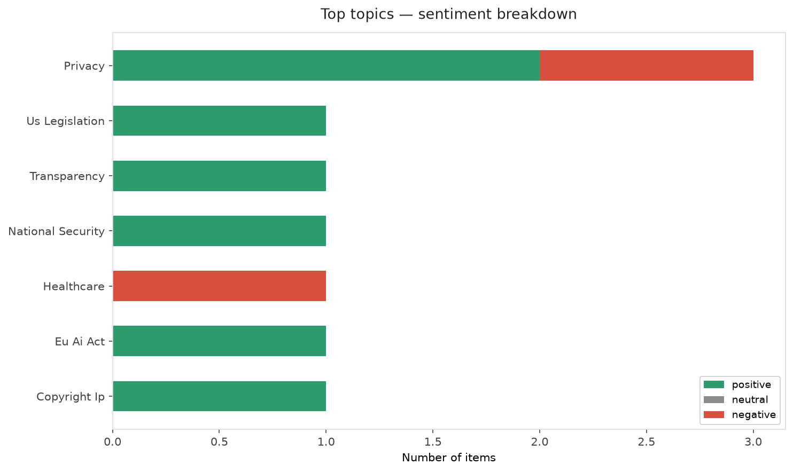
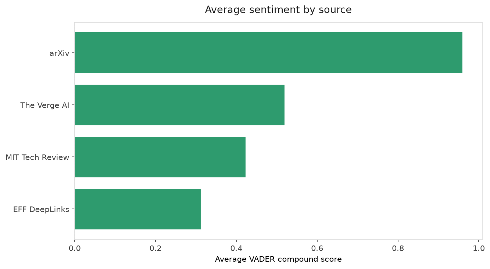
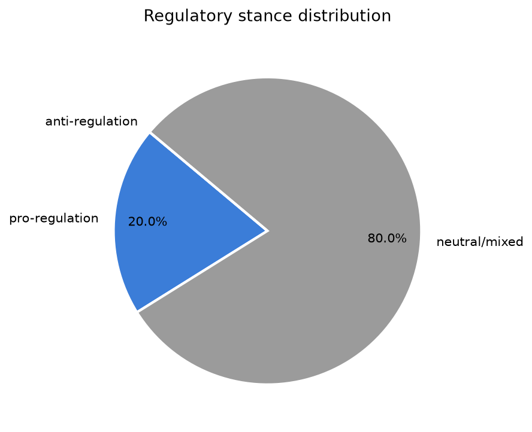
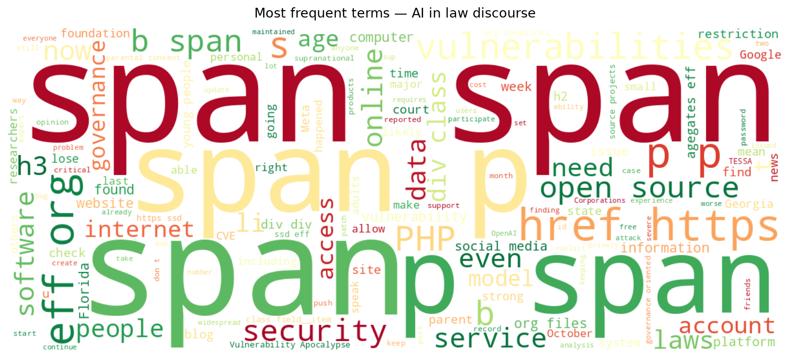
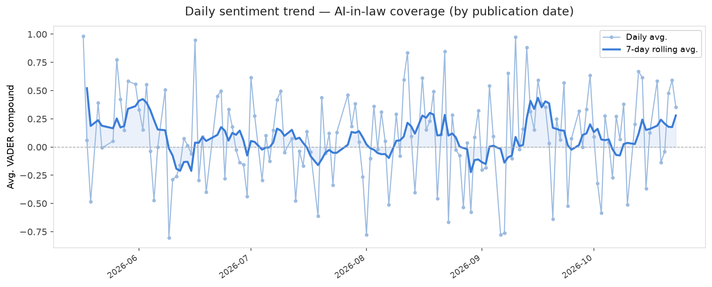
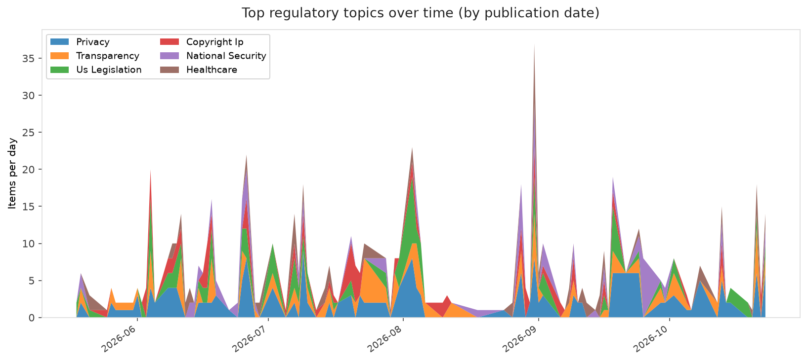
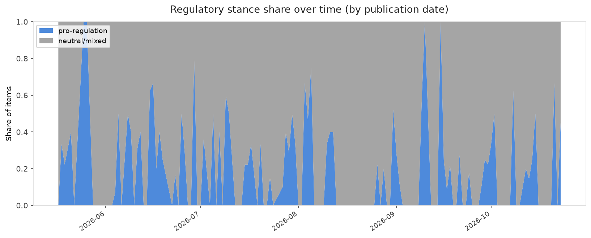

# AI in Law — Daily Sentiment Report
**Run date:** 2026-10-24 | **Items analyzed:** 10 | **Overall:** 🟢 Mildly positive (+0.527)

_Articles in this report were published between **2026-10-22** and **2026-10-23**._

---

## Summary

Today's collection covers **10** items from news outlets, academic preprints, Reddit, and regulatory sources.
Compared to the historical average of **+0.214**, today's sentiment is ↑ **0.313** points higher.

| Metric | Value |
|--------|-------|
| Positive items | 8 (80.0%) |
| Neutral items  | 1 (10.0%) |
| Negative items | 1 (10.0%) |
| Avg. VADER compound | +0.5267 |
| Pro-regulation items | 2 |
| Anti-regulation items | 0 |

---

## Top Topics Today

- **Privacy** — 3 items
- **Us Legislation** — 1 items
- **Transparency** — 1 items
- **National Security** — 1 items
- **Healthcare** — 1 items

---

## Most Positive Coverage

- [What Does AI Success Look Like? A Mixed-Methods Analysis of Supranational AI Governance Instruments](https://arxiv.org/abs/2610.31030v1)  
  _arXiv_ — VADER: `+0.967`
- [TESSA: A Governance-Oriented Custom GPT for SME Guidance under the EU AI Act: Design, Implementation](https://arxiv.org/abs/2610.30822v1)  
  _arXiv_ — VADER: `+0.954`
- [The Foundations of Scalable AI](https://www.technologyreview.com/2026/10/22/1146103/the-foundations-of-scalable-ai/)  
  _MIT Tech Review_ — VADER: `+0.848`

---

## Most Critical / Negative Coverage

- [Two States Can Now Restrict Social Media Access—Here’s What To Do Next](https://www.eff.org/deeplinks/2026/10/two-states-can-now-restrict-social-media-access-heres-what-do-next)  
  _EFF DeepLinks_ — VADER: `-0.523`
- [AI’s hidden storage bill: What inference leaves behind](https://www.technologyreview.com/2026/10/22/1146948/ais-hidden-storage-bill-what-inference-leaves-behind/)  
  _MIT Tech Review_ — VADER: `+0.000`
- [Now Google says it might use your Gmail and Google Photos data to target ads](https://www.theverge.com/tech/1017600/google-personal-intelligence-privacy-policy-ads-update)  
  _The Verge AI_ — VADER: `+0.382`

---

## Visualizations — Today

## Visualizations — Trends Over Time

---

## Methodology

- **VADER** (Valence Aware Dictionary and sEntiment Reasoner) — compound score in [-1, 1].
- **Topic tagging** — regex keyword matching across 12 AI-law sub-domains.
- **Stance detection** — keyword-based pro/anti-regulation signal detection.
- **Date filter** — items are kept only if their *publication* date falls within the look-back window (default 2 days).
- Sources: RSS news feeds, arXiv academic API, Reddit (PRAW), Regulations.gov API.

_Generated automatically on 2026-10-24 14:18 UTC._
