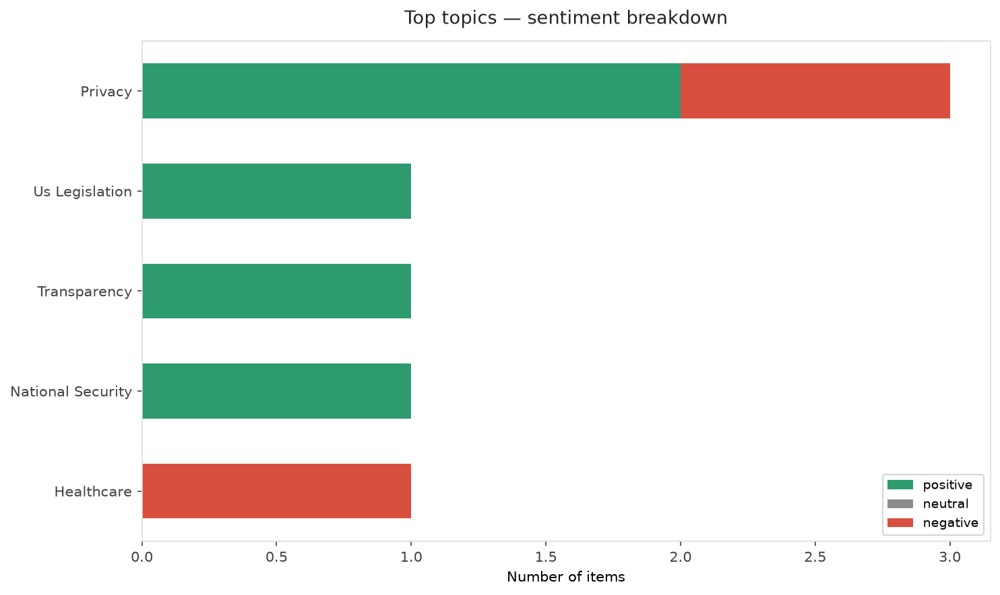
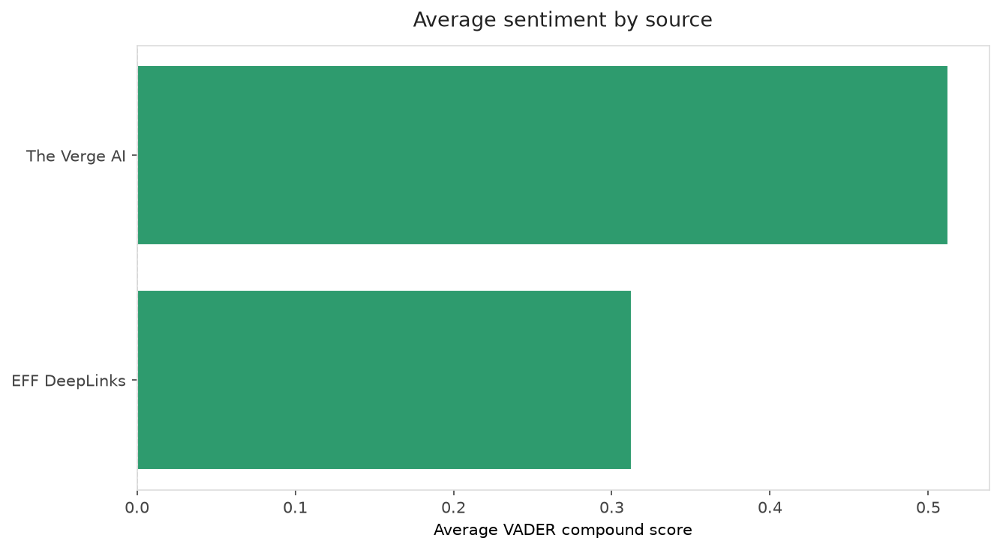
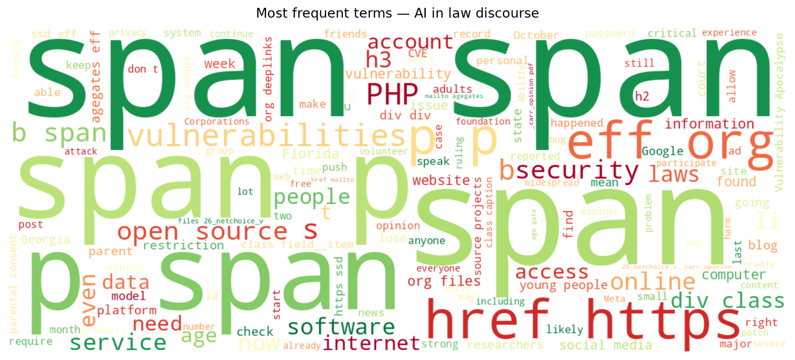
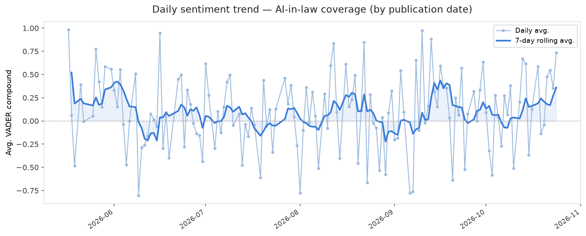
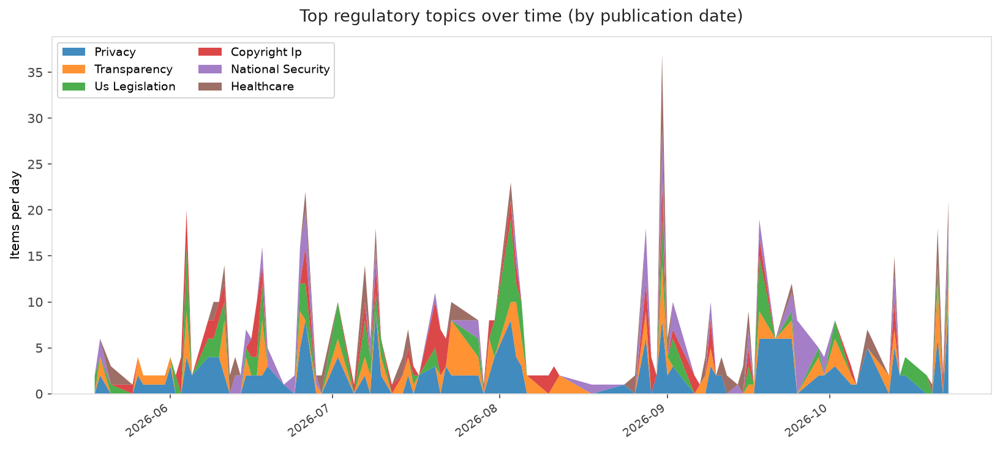
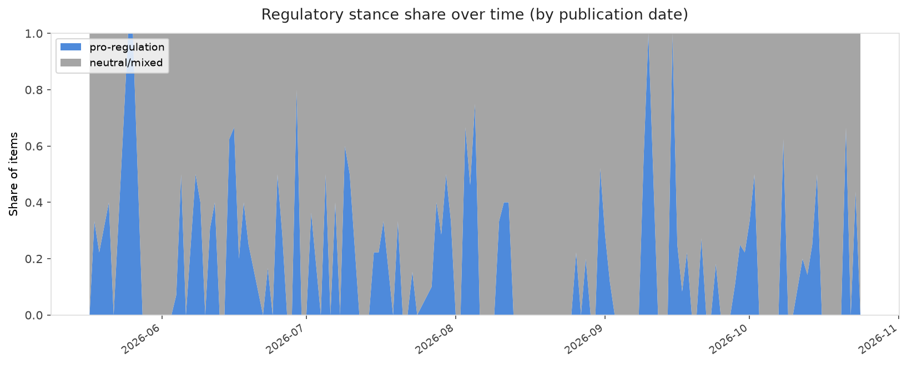

# AI in Law — Daily Sentiment Report
**Run date:** 2026-10-25 | **Items analyzed:** 6 | **Overall:** 🟢 Mildly positive (+0.413)

_Articles in this report were published between **2026-10-23** and **2026-10-24**._

---

## Summary

Today's collection covers **6** items from news outlets, academic preprints, Reddit, and regulatory sources.
Compared to the historical average of **+0.215**, today's sentiment is ↑ **0.198** points higher.

| Metric | Value |
|--------|-------|
| Positive items | 5 (83.3%) |
| Neutral items  | 0 (0.0%) |
| Negative items | 1 (16.7%) |
| Avg. VADER compound | +0.4128 |
| Pro-regulation items | 2 |
| Anti-regulation items | 0 |

---

## Top Topics Today

- **Privacy** — 3 items
- **Us Legislation** — 1 items
- **Transparency** — 1 items
- **National Security** — 1 items
- **Healthcare** — 1 items

---

## Most Positive Coverage

- [Computer Security Is About to Get a Lot Worse, Here’s What You Can Do](https://www.eff.org/deeplinks/2026/10/computer-security-about-get-lot-worse-heres-what-you-can-do)  
  _EFF DeepLinks_ — VADER: `+0.793`
- [Pennsylvania will require labels on AI-generated ads](https://www.theverge.com/ai-artificial-intelligence/1018187/pennsylvania-ai-deceptive-advertising-act)  
  _The Verge AI_ — VADER: `+0.735`
- [The Vulnerability Apocalypse and Why We Should Fund Open Source](https://www.eff.org/deeplinks/2026/10/vulnerability-apocalypse-and-why-we-should-fund-open-source)  
  _EFF DeepLinks_ — VADER: `+0.669`

---

## Most Critical / Negative Coverage

- [Two States Can Now Restrict Social Media Access—Here’s What To Do Next](https://www.eff.org/deeplinks/2026/10/two-states-can-now-restrict-social-media-access-heres-what-do-next)  
  _EFF DeepLinks_ — VADER: `-0.523`
- [Now Google says it might use your Gmail and Google Photos data to target ads](https://www.theverge.com/tech/1017600/google-personal-intelligence-privacy-policy-ads-update)  
  _The Verge AI_ — VADER: `+0.382`
- [Meta delays new business terms after publisher pushback on AI scraping](https://www.theverge.com/tech/1017450/meta-business-terms-delayed-ai-scraping)  
  _The Verge AI_ — VADER: `+0.421`

---

## Visualizations — Today

## Visualizations — Trends Over Time

---

## Methodology

- **VADER** (Valence Aware Dictionary and sEntiment Reasoner) — compound score in [-1, 1].
- **Topic tagging** — regex keyword matching across 12 AI-law sub-domains.
- **Stance detection** — keyword-based pro/anti-regulation signal detection.
- **Date filter** — items are kept only if their *publication* date falls within the look-back window (default 2 days).
- Sources: RSS news feeds, arXiv academic API, Reddit (PRAW), Regulations.gov API.

_Generated automatically on 2026-10-25 14:53 UTC._
