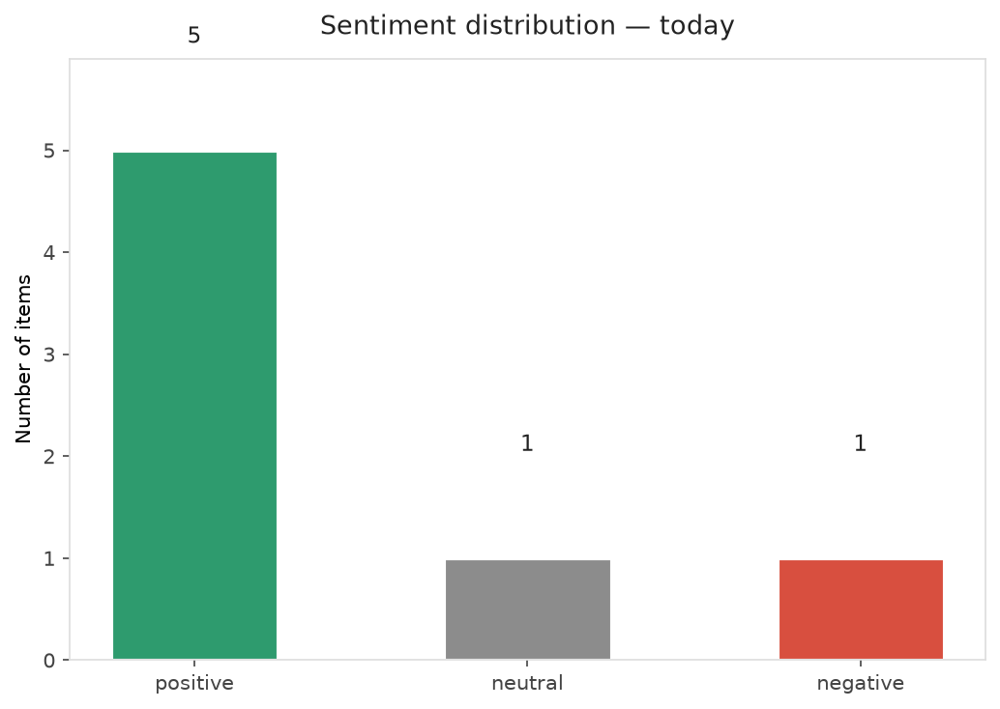
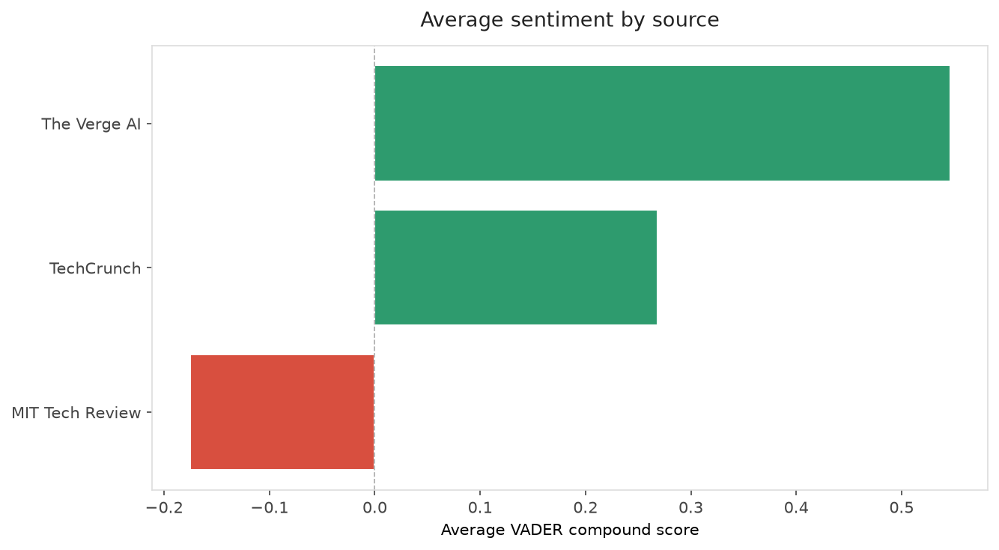
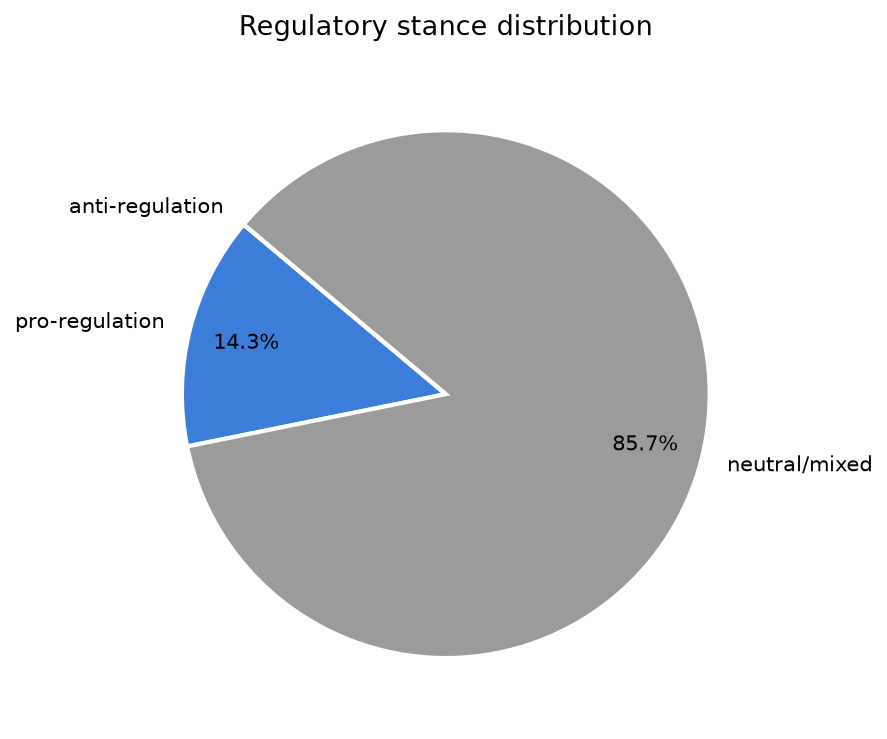
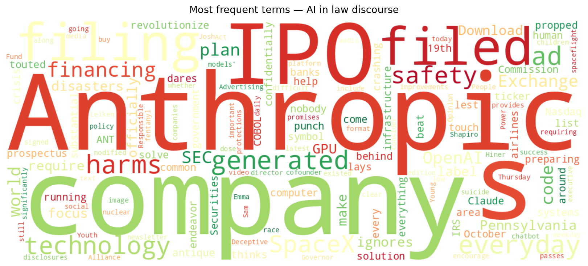
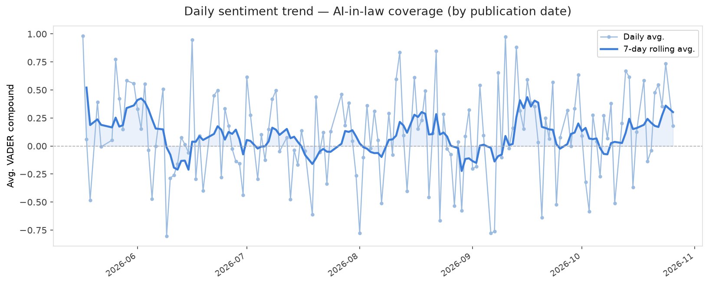
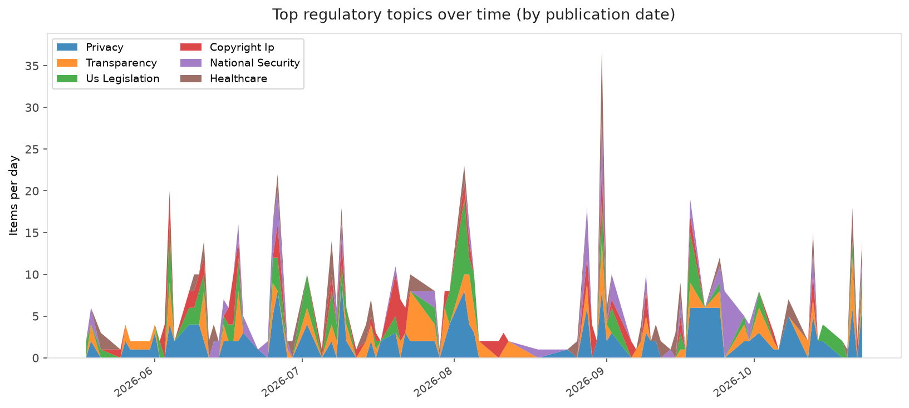
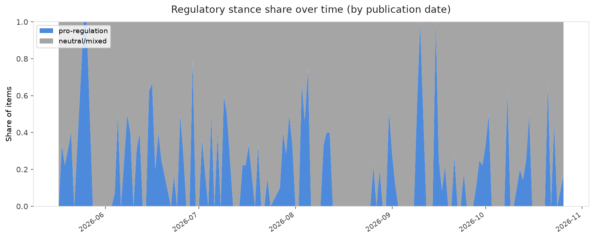

# AI in Law — Daily Sentiment Report
**Run date:** 2026-10-26 | **Items analyzed:** 7 | **Overall:** 🟢 Mildly positive (+0.261)

_Articles in this report were published between **2026-10-24** and **2026-10-26**._

---

## Summary

Today's collection covers **7** items from news outlets, academic preprints, Reddit, and regulatory sources.
Compared to the historical average of **+0.215**, today's sentiment is ↑ **0.046** points higher.

| Metric | Value |
|--------|-------|
| Positive items | 5 (71.4%) |
| Neutral items  | 1 (14.3%) |
| Negative items | 1 (14.3%) |
| Avg. VADER compound | +0.2606 |
| Pro-regulation items | 1 |
| Anti-regulation items | 0 |

---

## Top Topics Today

_No strong topic signals detected today._

---

## Most Positive Coverage

- [Pennsylvania will require labels on AI-generated ads](https://www.theverge.com/ai-artificial-intelligence/1018187/pennsylvania-ai-deceptive-advertising-act)  
  _The Verge AI_ — VADER: `+0.735`
- [Can AI help solve the COBOL code crisis?](https://www.theverge.com/ai-artificial-intelligence/1018434/cobol-migration-legacy-code-openai-anthropic)  
  _The Verge AI_ — VADER: `+0.607`
- [SpaceX locks in $40B GPU financing deal with Apollo](https://techcrunch.com/2026/10/26/spacex-locks-in-40b-gpu-financing-deal-with-apollo/)  
  _TechCrunch_ — VADER: `+0.511`

---

## Most Critical / Negative Coverage

- [The Download: everyday AI harms and the race to nuclear spaceflight](https://www.technologyreview.com/2026/10/26/1147650/the-download-everyday-ai-harms-nuclear-spaceflight/)  
  _MIT Tech Review_ — VADER: `-0.791`
- [Anthropic officially files for its public debut](https://techcrunch.com/2026/10/26/anthropic-officially-files-for-its-public-debut/)  
  _TechCrunch_ — VADER: `+0.026`
- [Anthropic’s IPO filing lays out a plan to &#8216;revolutionize every area of human endeavor&#8217; w](https://www.theverge.com/ai-artificial-intelligence/1018476/anthropic-ipo-details-s1-filed-sec)  
  _The Verge AI_ — VADER: `+0.296`

---

## Visualizations — Today

## Visualizations — Trends Over Time

---

## Methodology

- **VADER** (Valence Aware Dictionary and sEntiment Reasoner) — compound score in [-1, 1].
- **Topic tagging** — regex keyword matching across 12 AI-law sub-domains.
- **Stance detection** — keyword-based pro/anti-regulation signal detection.
- **Date filter** — items are kept only if their *publication* date falls within the look-back window (default 2 days).
- Sources: RSS news feeds, arXiv academic API, Reddit (PRAW), Regulations.gov API.

_Generated automatically on 2026-10-26 17:10 UTC._
