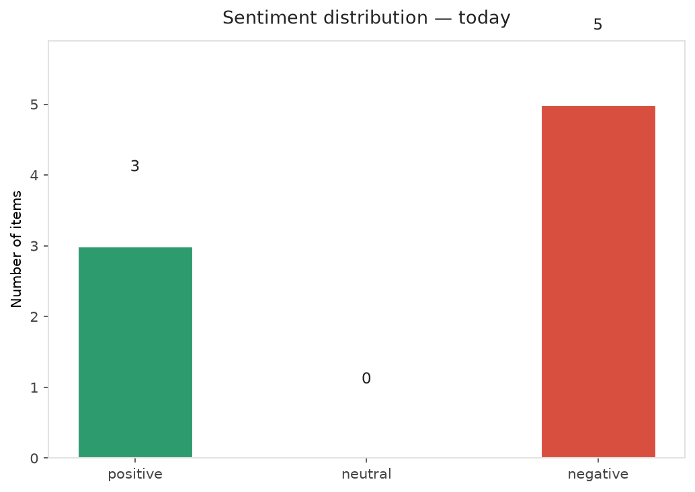
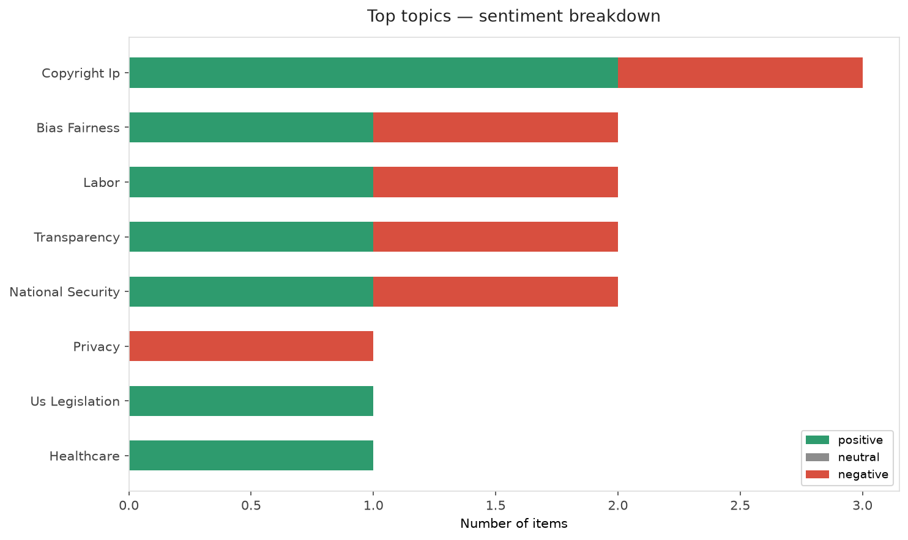
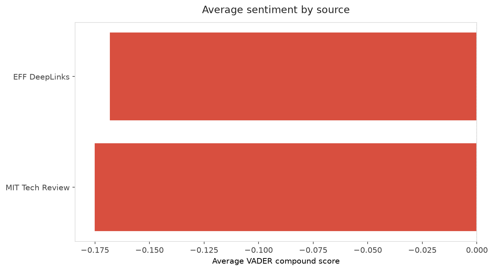
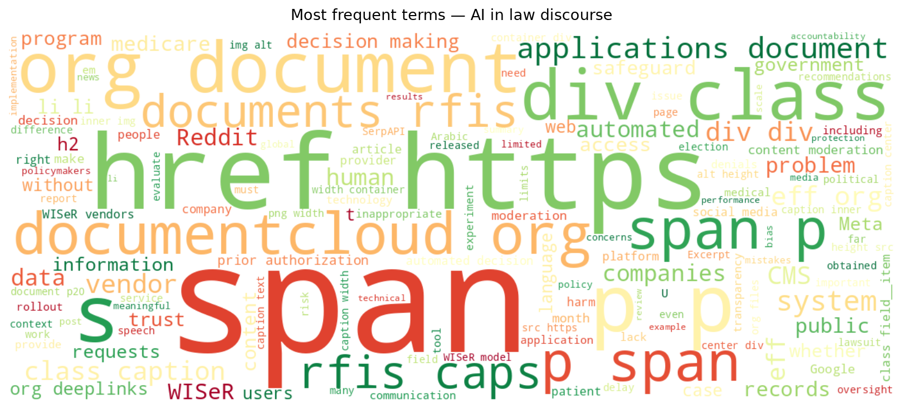
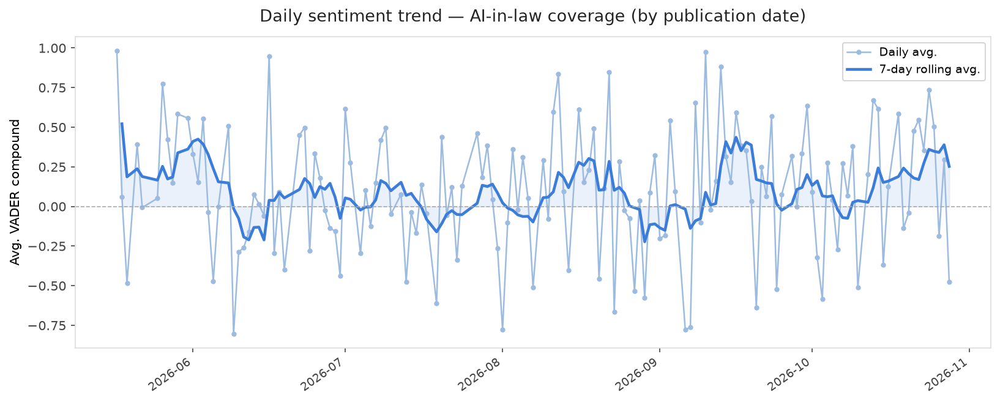
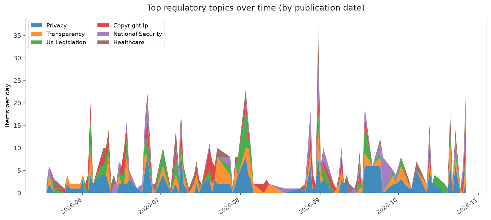
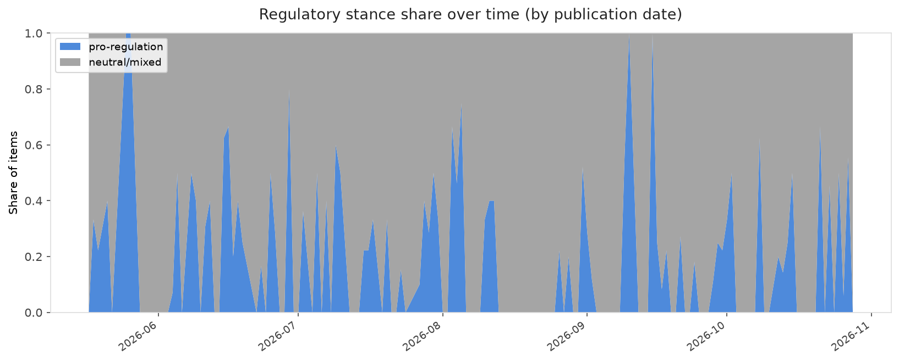

# AI in Law — Daily Sentiment Report
**Run date:** 2026-10-28 | **Items analyzed:** 8 | **Overall:** 🔴 Mildly negative (-0.110)

_Articles in this report were published between **2026-10-26** and **2026-10-28**._

---

## Summary

Today's collection covers **8** items from news outlets, academic preprints, Reddit, and regulatory sources.
Compared to the historical average of **+0.212**, today's sentiment is ↓ **0.322** points lower.

| Metric | Value |
|--------|-------|
| Positive items | 3 (37.5%) |
| Neutral items  | 0 (0.0%) |
| Negative items | 5 (62.5%) |
| Avg. VADER compound | -0.1101 |
| Pro-regulation items | 2 |
| Anti-regulation items | 0 |

---

## Top Topics Today

- **Copyright Ip** — 3 items
- **Bias Fairness** — 2 items
- **Labor** — 2 items
- **Transparency** — 2 items
- **National Security** — 2 items

---

## Most Positive Coverage

- [Uneven Use, Similar Trust Generative AI in Denmark and Romania](https://arxiv.org/abs/2610.37348v1)  
  _arXiv_ — VADER: `+0.994`
- [New Records Obtained by EFF Expose More Problems with Medicare’s AI Experiment](https://www.eff.org/deeplinks/2026/10/new-records-obtained-eff-expose-more-problems-medicares-ai-experiment)  
  _EFF DeepLinks_ — VADER: `+0.826`
- [The focus on AI safety disasters ignores everyday harms](https://www.technologyreview.com/2026/10/26/1147645/the-focus-on-ai-safety-disasters-ignores-everyday-harms/)  
  _MIT Tech Review_ — VADER: `+0.440`

---

## Most Critical / Negative Coverage

- [Anti-Circumvention Laws Raise the Cost of Knowledge](https://www.eff.org/deeplinks/2026/10/anti-circumvention-laws-raise-cost-knowledge)  
  _EFF DeepLinks_ — VADER: `-0.970`
- [The Download: everyday AI harms and the race to nuclear spaceflight](https://www.technologyreview.com/2026/10/26/1147650/the-download-everyday-ai-harms-nuclear-spaceflight/)  
  _MIT Tech Review_ — VADER: `-0.791`
- ["No human at the helm": Delaware plan would let AI agents run entire businesses](https://arstechnica.com/tech-policy/2026/10/no-human-at-the-helm-delaware-plan-would-let-ai-agents-run-entire-businesses/)  
  _Ars Technica Tech Policy_ — VADER: `-0.542`

---

## Visualizations — Today

## Visualizations — Trends Over Time

---

## Methodology

- **VADER** (Valence Aware Dictionary and sEntiment Reasoner) — compound score in [-1, 1].
- **Topic tagging** — regex keyword matching across 12 AI-law sub-domains.
- **Stance detection** — keyword-based pro/anti-regulation signal detection.
- **Date filter** — items are kept only if their *publication* date falls within the look-back window (default 2 days).
- Sources: RSS news feeds, arXiv academic API, Reddit (PRAW), Regulations.gov API.

_Generated automatically on 2026-10-28 17:02 UTC._
