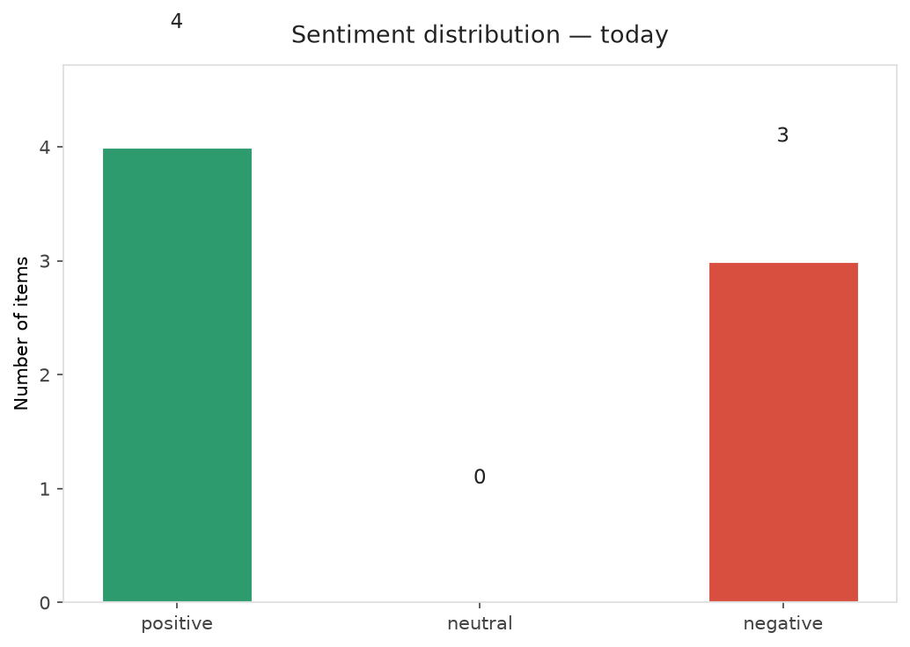
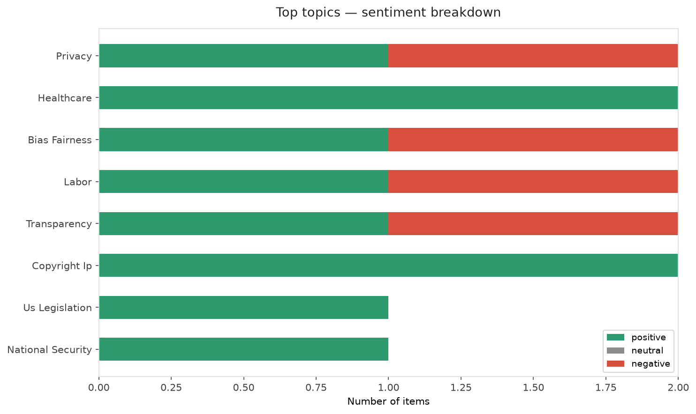
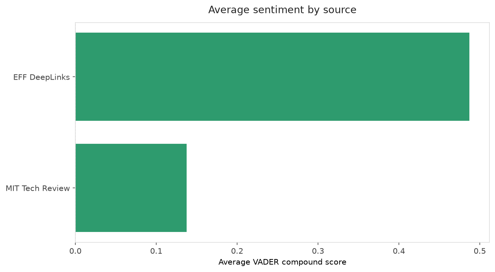
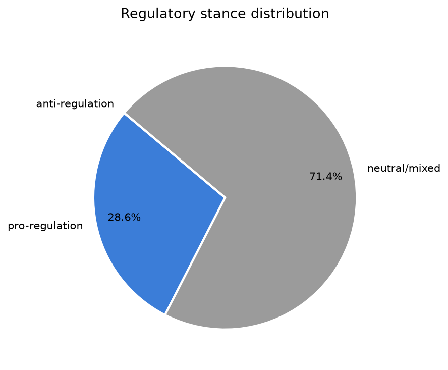
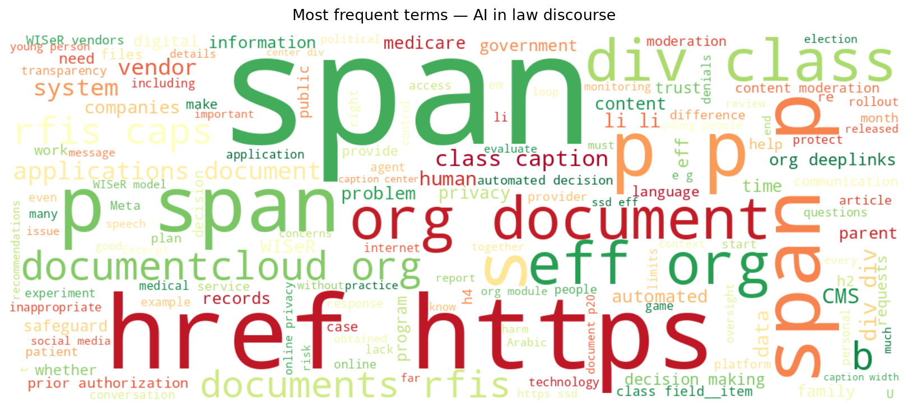
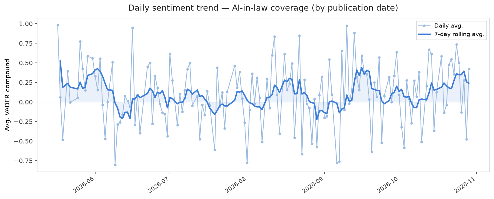
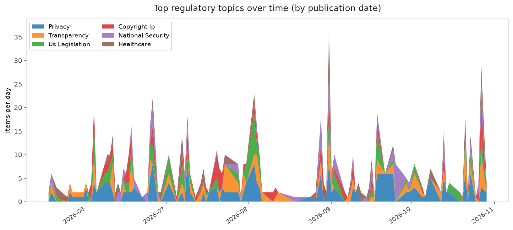
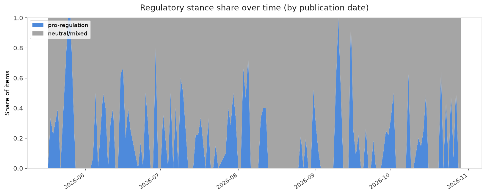

# AI in Law — Daily Sentiment Report
**Run date:** 2026-10-29 | **Items analyzed:** 7 | **Overall:** 🟢 Mildly positive (+0.313)

_Articles in this report were published between **2026-10-27** and **2026-10-29**._

---

## Summary

Today's collection covers **7** items from news outlets, academic preprints, Reddit, and regulatory sources.
Compared to the historical average of **+0.212**, today's sentiment is ↑ **0.100** points higher.

| Metric | Value |
|--------|-------|
| Positive items | 4 (57.1%) |
| Neutral items  | 0 (0.0%) |
| Negative items | 3 (42.9%) |
| Avg. VADER compound | +0.3129 |
| Pro-regulation items | 2 |
| Anti-regulation items | 0 |

---

## Top Topics Today

- **Privacy** — 2 items
- **Healthcare** — 2 items
- **Bias Fairness** — 2 items
- **Labor** — 2 items
- **Transparency** — 2 items

---

## Most Positive Coverage

- [Tech Tips for Parents this Digital Parenting Week](https://www.eff.org/deeplinks/2026/10/tech-tips-parents-digital-parenting-week)  
  _EFF DeepLinks_ — VADER: `+0.998`
- [Uneven Use, Similar Trust Generative AI in Denmark and Romania](https://arxiv.org/abs/2610.37348v1)  
  _arXiv_ — VADER: `+0.994`
- [New Records Obtained by EFF Expose More Problems with Medicare’s AI Experiment](https://www.eff.org/deeplinks/2026/10/new-records-obtained-eff-expose-more-problems-medicares-ai-experiment)  
  _EFF DeepLinks_ — VADER: `+0.826`

---

## Most Critical / Negative Coverage

- ["No human at the helm": Delaware plan would let AI agents run entire businesses](https://arstechnica.com/tech-policy/2026/10/no-human-at-the-helm-delaware-plan-would-let-ai-agents-run-entire-businesses/)  
  _Ars Technica Tech Policy_ — VADER: `-0.542`
- [We urgently need to monitor AI agents’ actions in real time](https://www.technologyreview.com/2026/10/29/1147824/monitor-ai-agents-actions-real-time/)  
  _MIT Tech Review_ — VADER: `-0.361`
- [Social Media When Elections Are Close: Doing the Impossible Better](https://www.eff.org/deeplinks/2026/10/social-media-when-elections-are-close-doing-impossible-better)  
  _EFF DeepLinks_ — VADER: `-0.360`

---

## Visualizations — Today

## Visualizations — Trends Over Time

---

## Methodology

- **VADER** (Valence Aware Dictionary and sEntiment Reasoner) — compound score in [-1, 1].
- **Topic tagging** — regex keyword matching across 12 AI-law sub-domains.
- **Stance detection** — keyword-based pro/anti-regulation signal detection.
- **Date filter** — items are kept only if their *publication* date falls within the look-back window (default 2 days).
- Sources: RSS news feeds, arXiv academic API, Reddit (PRAW), Regulations.gov API.

_Generated automatically on 2026-10-29 17:21 UTC._
