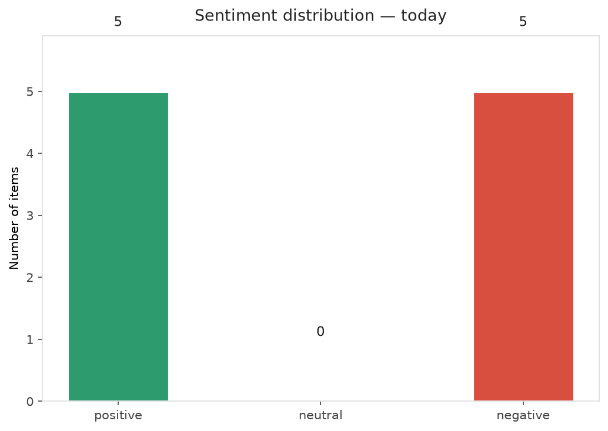
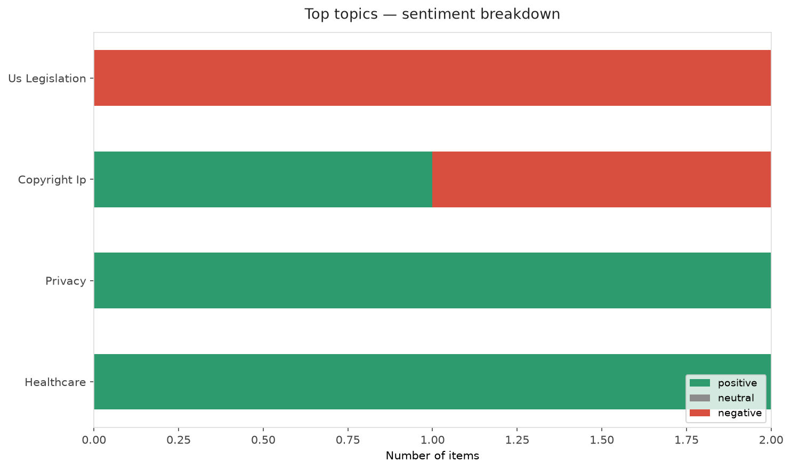
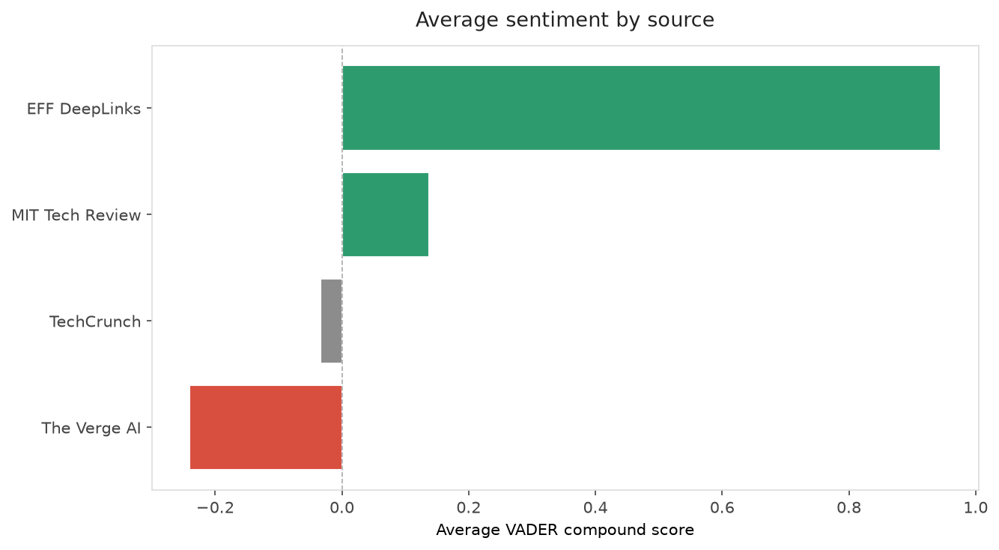
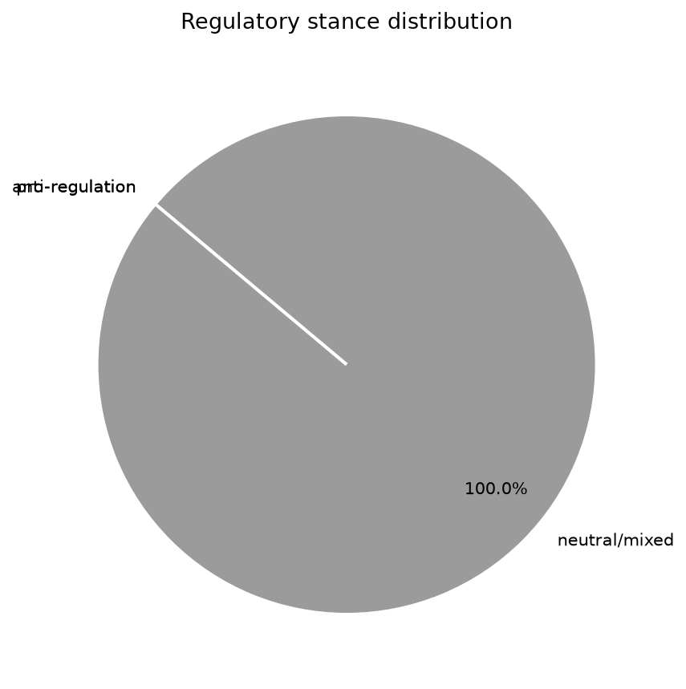
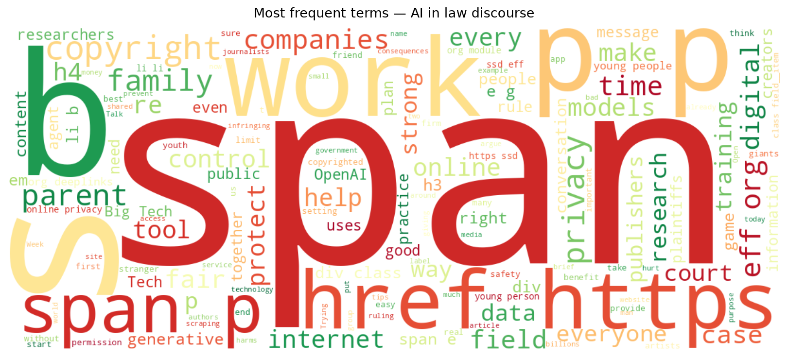
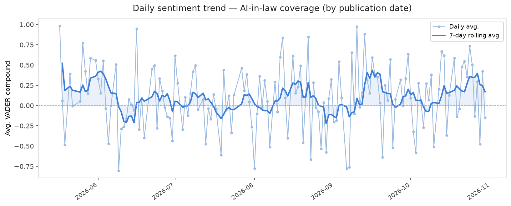
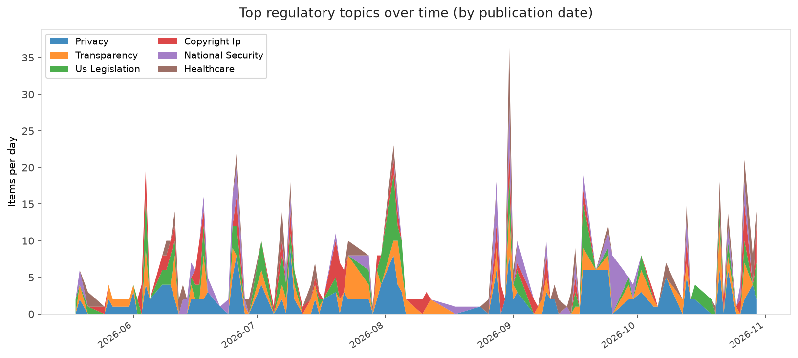
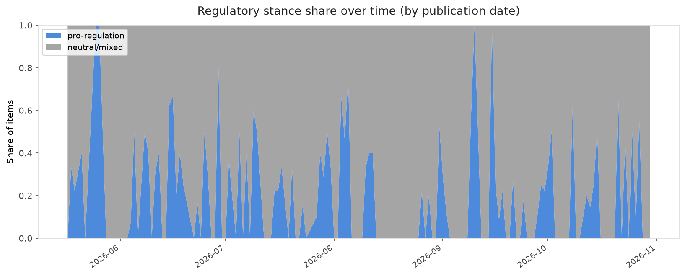

# AI in Law — Daily Sentiment Report
**Run date:** 2026-10-31 | **Items analyzed:** 10 | **Overall:** 🟢 Mildly positive (+0.069)

_Articles in this report were published between **2026-10-29** and **2026-10-30**._

---

## Summary

Today's collection covers **10** items from news outlets, academic preprints, Reddit, and regulatory sources.
Compared to the historical average of **+0.211**, today's sentiment is ↓ **0.142** points lower.

| Metric | Value |
|--------|-------|
| Positive items | 5 (50.0%) |
| Neutral items  | 0 (0.0%) |
| Negative items | 5 (50.0%) |
| Avg. VADER compound | +0.0687 |
| Pro-regulation items | 0 |
| Anti-regulation items | 0 |

---

## Top Topics Today

- **Us Legislation** — 2 items
- **Copyright Ip** — 2 items
- **Privacy** — 2 items
- **Healthcare** — 2 items

---

## Most Positive Coverage

- [Tech Tips for Parents this Digital Parenting Week](https://www.eff.org/deeplinks/2026/10/tech-tips-parents-digital-parenting-week)  
  _EFF DeepLinks_ — VADER: `+0.998`
- [Rewriting Copyright Law for Generative AI Would Hurt Everyone](https://www.eff.org/deeplinks/2026/10/rewriting-copyright-law-generative-ai-would-hurt-everyone)  
  _EFF DeepLinks_ — VADER: `+0.892`
- [The Download: AI agent tracking and climate feedback loops](https://www.technologyreview.com/2026/10/29/1147830/the-download-monitoring-ai-agents-climate-feedback-loops/)  
  _MIT Tech Review_ — VADER: `+0.637`

---

## Most Critical / Negative Coverage

- [Maine’s data center revolt will decide who controls the Senate](https://www.theverge.com/ai-artificial-intelligence/1021080/maine-senate-race-susan-collins-ai-data-centers)  
  _The Verge AI_ — VADER: `-0.919`
- [Thousands of “ghost students” use AI to steal millions in student loans, DOJ says](https://arstechnica.com/tech-policy/2026/10/doj-exposes-ghost-students-using-ai-to-complete-courses-steal-student-loans/)  
  _Ars Technica Tech Policy_ — VADER: `-0.691`
- [Intel’s stock crashes, knocking $12B from government’s stake](https://techcrunch.com/2026/10/30/intels-stock-crashes-knocking-12b-from-governments-stake/)  
  _TechCrunch_ — VADER: `-0.527`

---

## Visualizations — Today

## Visualizations — Trends Over Time

---

## Methodology

- **VADER** (Valence Aware Dictionary and sEntiment Reasoner) — compound score in [-1, 1].
- **Topic tagging** — regex keyword matching across 12 AI-law sub-domains.
- **Stance detection** — keyword-based pro/anti-regulation signal detection.
- **Date filter** — items are kept only if their *publication* date falls within the look-back window (default 2 days).
- Sources: RSS news feeds, arXiv academic API, Reddit (PRAW), Regulations.gov API.

_Generated automatically on 2026-10-31 15:59 UTC._
