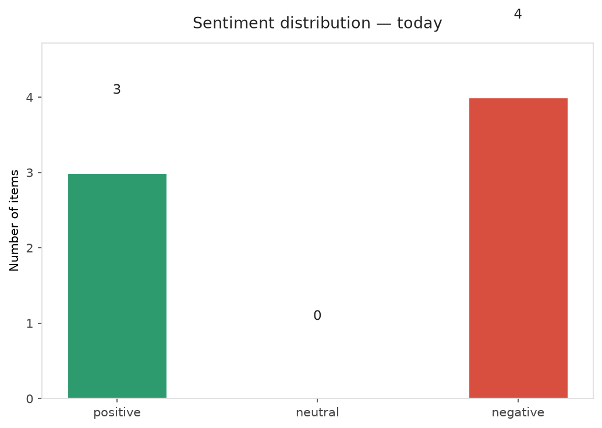
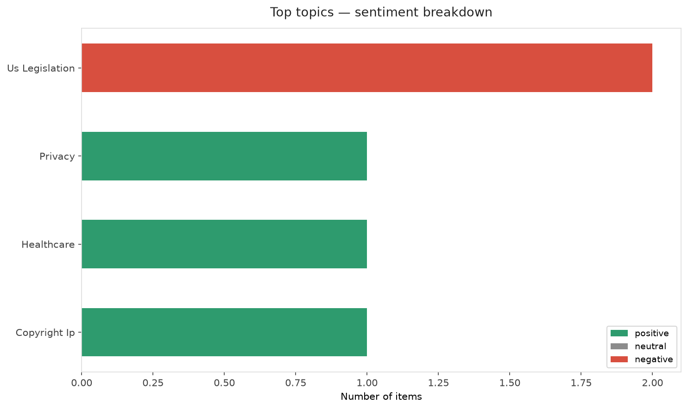
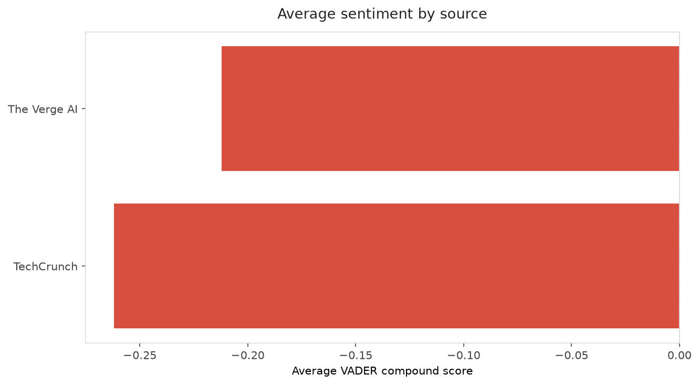
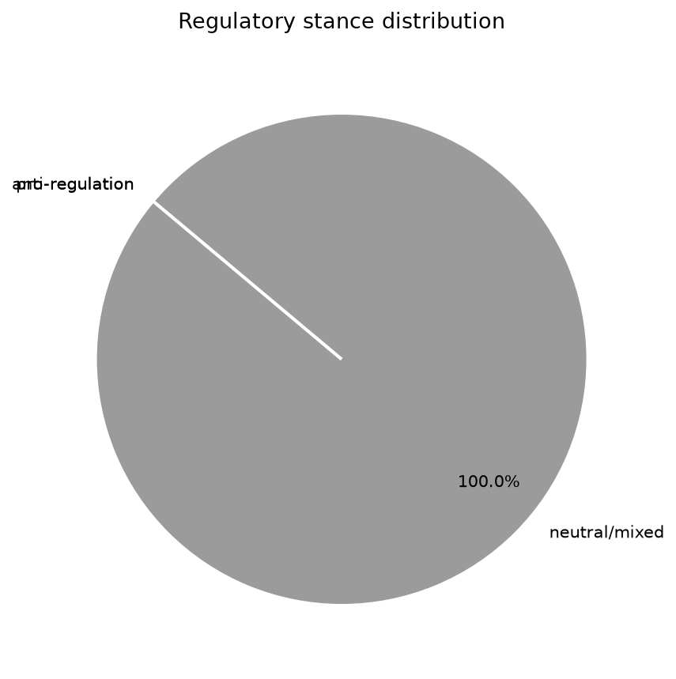
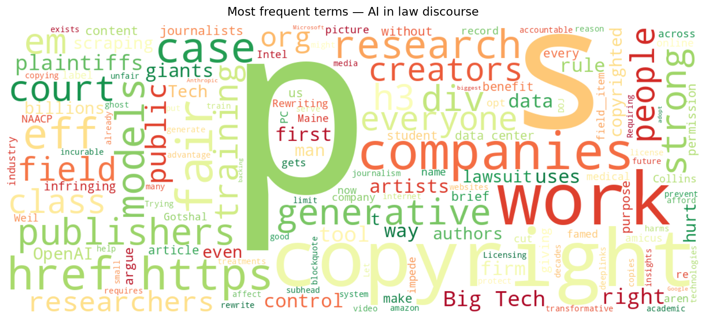
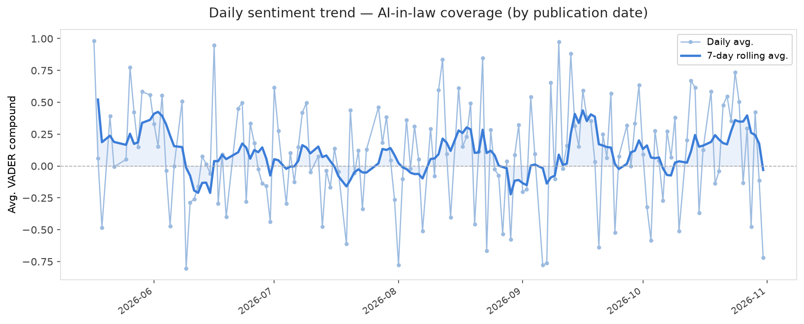
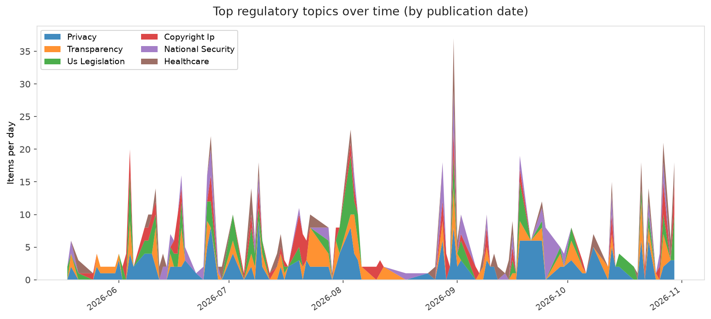
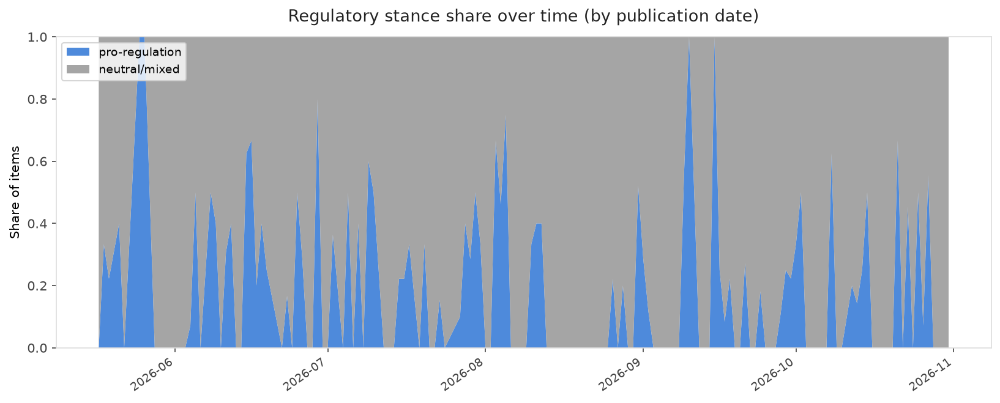

# AI in Law — Daily Sentiment Report
**Run date:** 2026-11-01 | **Items analyzed:** 7 | **Overall:** 🔴 Mildly negative (-0.144)

_Articles in this report were published between **2026-10-30** and **2026-10-31**._

---

## Summary

Today's collection covers **7** items from news outlets, academic preprints, Reddit, and regulatory sources.
Compared to the historical average of **+0.209**, today's sentiment is ↓ **0.353** points lower.

| Metric | Value |
|--------|-------|
| Positive items | 3 (42.9%) |
| Neutral items  | 0 (0.0%) |
| Negative items | 4 (57.1%) |
| Avg. VADER compound | -0.1442 |
| Pro-regulation items | 0 |
| Anti-regulation items | 0 |

---

## Top Topics Today

- **Us Legislation** — 2 items
- **Privacy** — 1 items
- **Healthcare** — 1 items
- **Copyright Ip** — 1 items

---

## Most Positive Coverage

- [Rewriting Copyright Law for Generative AI Would Hurt Everyone](https://www.eff.org/deeplinks/2026/10/rewriting-copyright-law-generative-ai-would-hurt-everyone)  
  _EFF DeepLinks_ — VADER: `+0.892`
- [The biggest names in AI are backing a new way to opt out of scraping](https://www.theverge.com/tech/1023763/openai-google-microsoft-ai-scraping-standard-opt-out)  
  _The Verge AI_ — VADER: `+0.494`
- [AI law firm Crosby bids on disintegrating, famed firm Weil Gotshal](https://techcrunch.com/2026/10/30/ai-law-firm-crosby-bids-on-disintegrating-famed-firm-weil-gotshal/)  
  _TechCrunch_ — VADER: `+0.459`

---

## Most Critical / Negative Coverage

- [Maine’s data center revolt will decide who controls the Senate](https://www.theverge.com/ai-artificial-intelligence/1021080/maine-senate-race-susan-collins-ai-data-centers)  
  _The Verge AI_ — VADER: `-0.919`
- [Judge allows NAACP lawsuit over xAI data center pollution to move forward](https://techcrunch.com/2026/10/31/judge-allows-naacp-lawsuit-over-xai-data-center-pollution-to-move-forward/)  
  _TechCrunch_ — VADER: `-0.718`
- [Thousands of “ghost students” use AI to steal millions in student loans, DOJ says](https://arstechnica.com/tech-policy/2026/10/doj-exposes-ghost-students-using-ai-to-complete-courses-steal-student-loans/)  
  _Ars Technica Tech Policy_ — VADER: `-0.691`

---

## Visualizations — Today

## Visualizations — Trends Over Time

---

## Methodology

- **VADER** (Valence Aware Dictionary and sEntiment Reasoner) — compound score in [-1, 1].
- **Topic tagging** — regex keyword matching across 12 AI-law sub-domains.
- **Stance detection** — keyword-based pro/anti-regulation signal detection.
- **Date filter** — items are kept only if their *publication* date falls within the look-back window (default 2 days).
- Sources: RSS news feeds, arXiv academic API, Reddit (PRAW), Regulations.gov API.

_Generated automatically on 2026-11-01 17:02 UTC._
