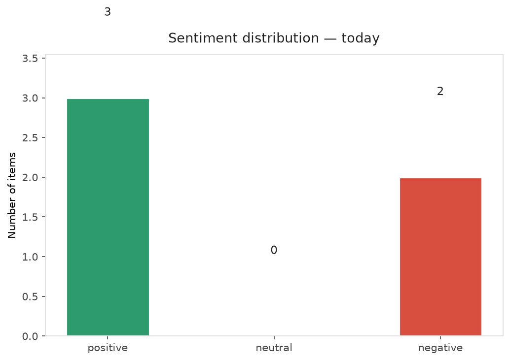
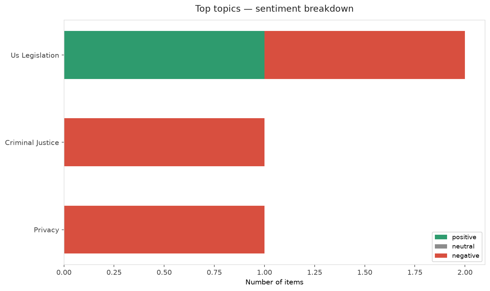
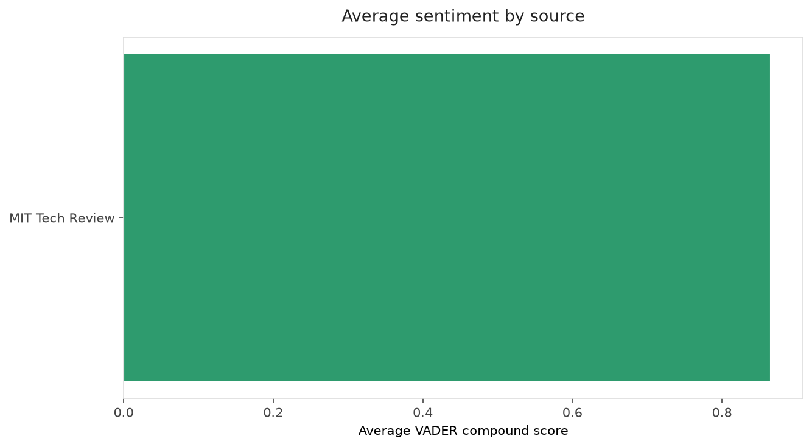
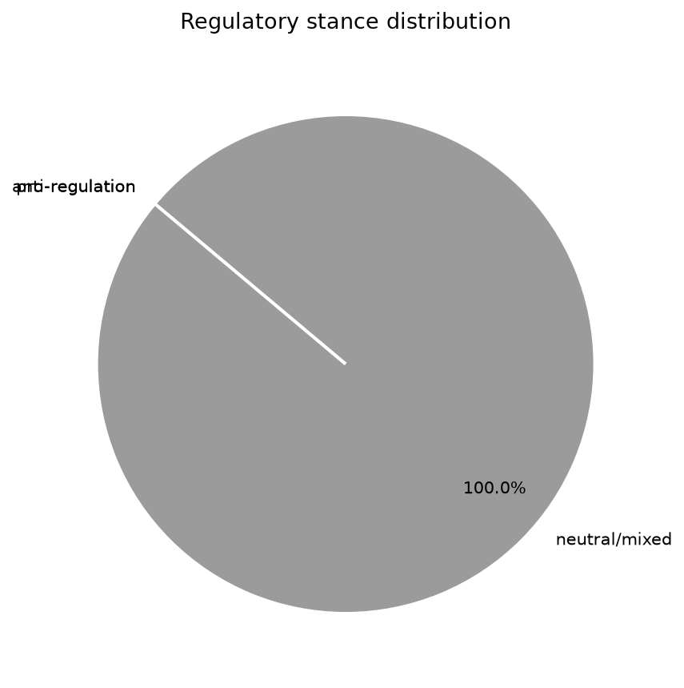
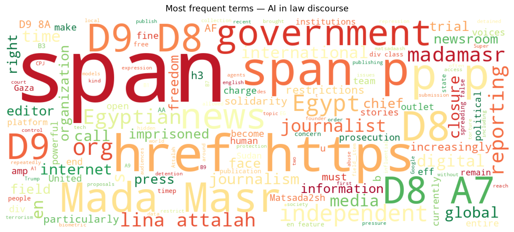
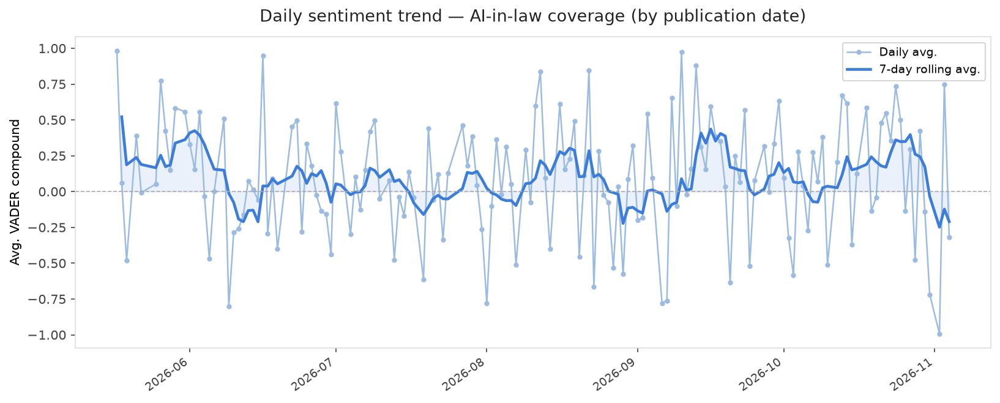
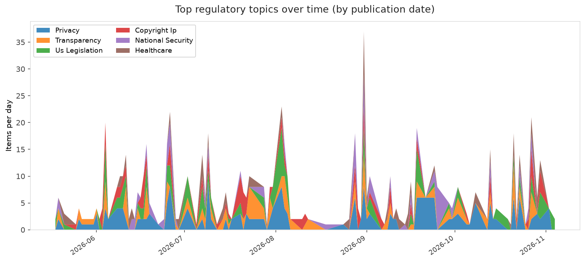
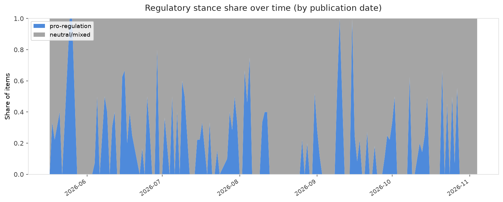

# AI in Law — Daily Sentiment Report
**Run date:** 2026-11-04 | **Items analyzed:** 5 | **Overall:** 🟢 Mildly positive (+0.164)

_Articles in this report were published between **2026-11-02** and **2026-11-04**._

---

## Summary

Today's collection covers **5** items from news outlets, academic preprints, Reddit, and regulatory sources.
Compared to the historical average of **+0.208**, today's sentiment is ↓ **0.043** points lower.

| Metric | Value |
|--------|-------|
| Positive items | 3 (60.0%) |
| Neutral items  | 0 (0.0%) |
| Negative items | 2 (40.0%) |
| Avg. VADER compound | +0.1645 |
| Pro-regulation items | 0 |
| Anti-regulation items | 0 |

---

## Top Topics Today

- **Us Legislation** — 2 items
- **Criminal Justice** — 1 items
- **Privacy** — 1 items

---

## Most Positive Coverage

- [How “reverse game theory” could keep AI agents in check](https://www.technologyreview.com/2026/11/03/1147934/reverse-game-theory-mechanism-design-ai-alignment/)  
  _MIT Tech Review_ — VADER: `+0.913`
- [Here’s who is falling in line for Trump’s “Super Intelligence” loyalty test](https://www.technologyreview.com/2026/11/02/1147932/heres-who-is-falling-in-line-for-trumps-super-intelligence-loyalty-test/)  
  _MIT Tech Review_ — VADER: `+0.818`
- [NYT demands Brave shut down its paywall blocker and end deals with AI firms](https://arstechnica.com/tech-policy/2026/11/nyt-demands-brave-shut-down-its-paywall-blocker-and-end-deals-with-ai-firms/)  
  _Ars Technica Tech Policy_ — VADER: `+0.402`

---

## Most Critical / Negative Coverage

- [Independent Digital Media Is Not a Privilege Governments Can Revoke: The Fight to Save Egypt’s Mada ](https://www.eff.org/deeplinks/2026/11/independent-digital-media-not-privilege-governments-can-revoke-fight-save-egypts)  
  _EFF DeepLinks_ — VADER: `-0.992`
- [Google faces backlash for plan that would turn off Search for schools that restrict AI](https://techcrunch.com/2026/11/04/google-faces-backlash-for-plan-that-would-turn-off-search-for-schools-that-restrict-ai/)  
  _TechCrunch_ — VADER: `-0.318`
- [NYT demands Brave shut down its paywall blocker and end deals with AI firms](https://arstechnica.com/tech-policy/2026/11/nyt-demands-brave-shut-down-its-paywall-blocker-and-end-deals-with-ai-firms/)  
  _Ars Technica Tech Policy_ — VADER: `+0.402`

---

## Visualizations — Today

## Visualizations — Trends Over Time

---

## Methodology

- **VADER** (Valence Aware Dictionary and sEntiment Reasoner) — compound score in [-1, 1].
- **Topic tagging** — regex keyword matching across 12 AI-law sub-domains.
- **Stance detection** — keyword-based pro/anti-regulation signal detection.
- **Date filter** — items are kept only if their *publication* date falls within the look-back window (default 2 days).
- Sources: RSS news feeds, arXiv academic API, Reddit (PRAW), Regulations.gov API.

_Generated automatically on 2026-11-04 18:31 UTC._
