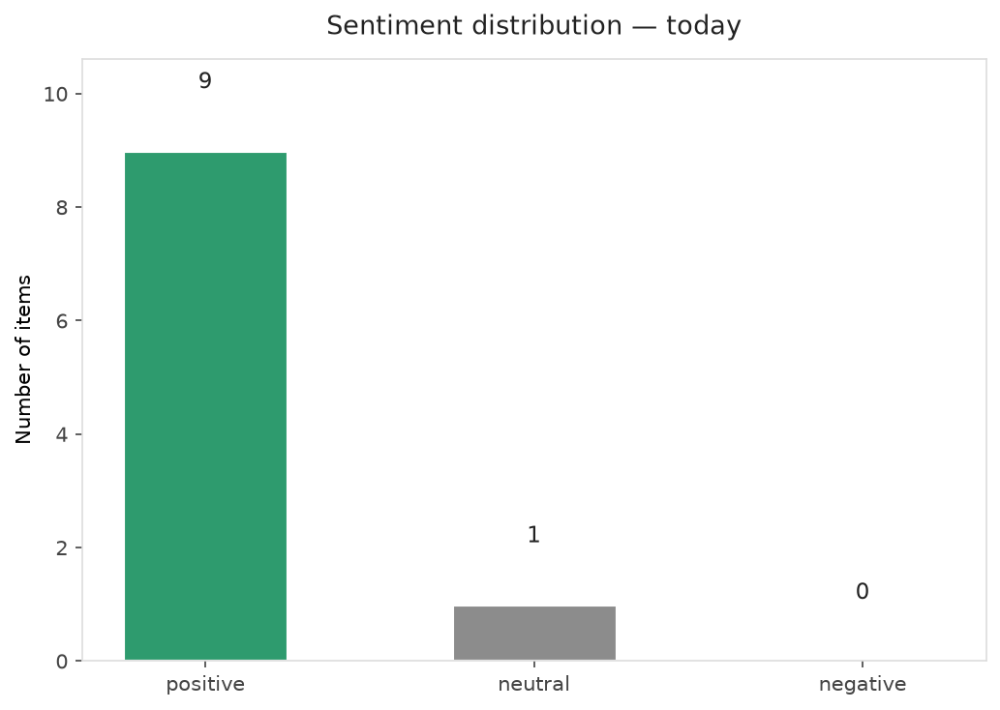
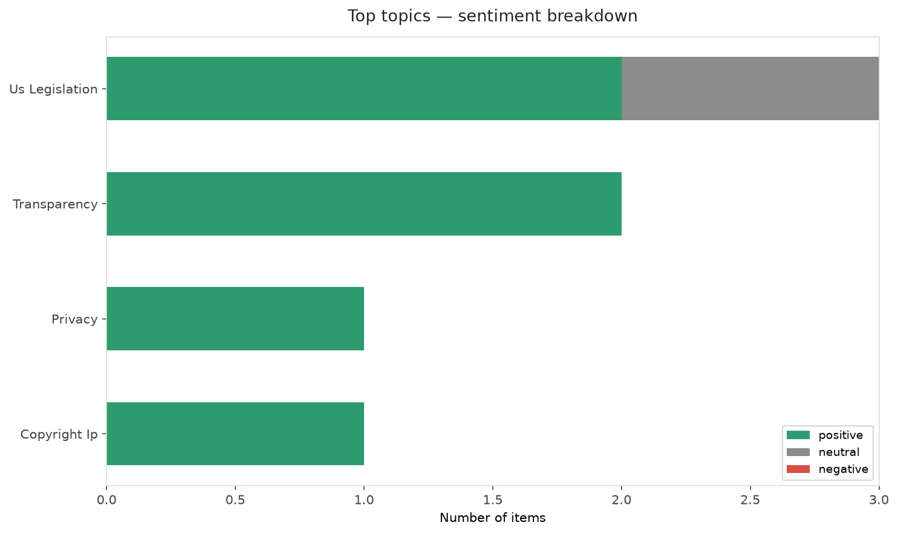
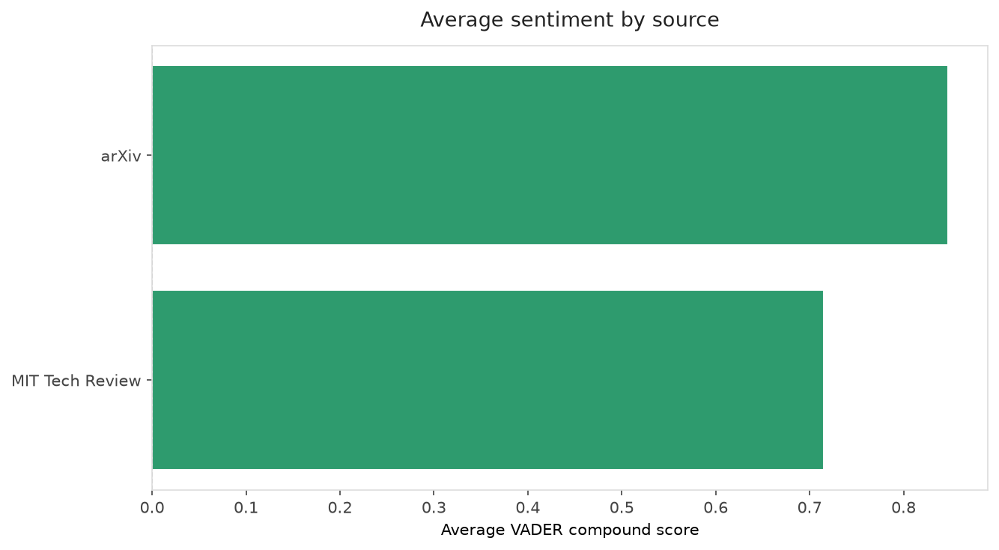
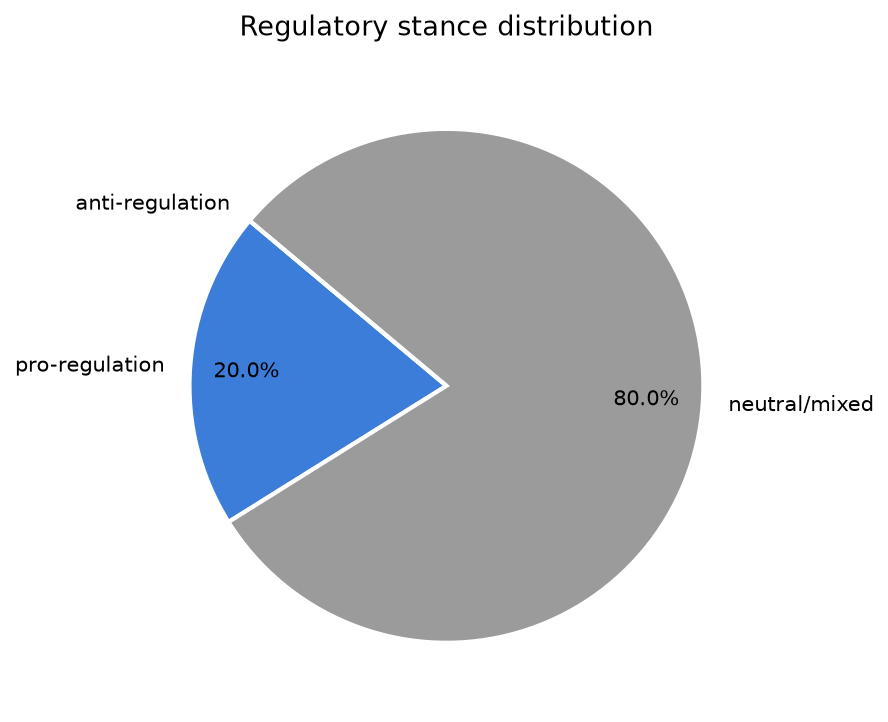
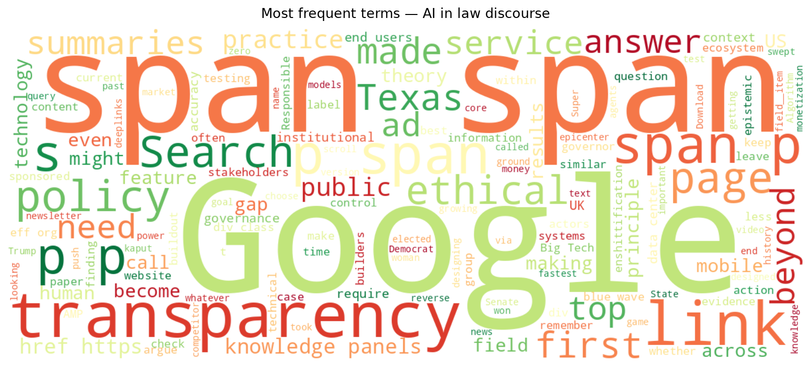
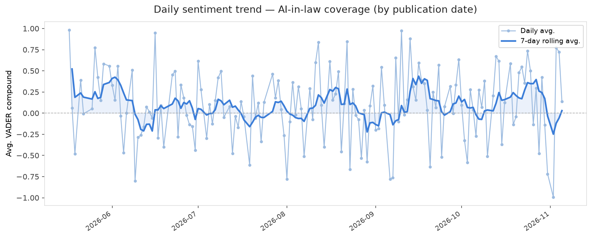
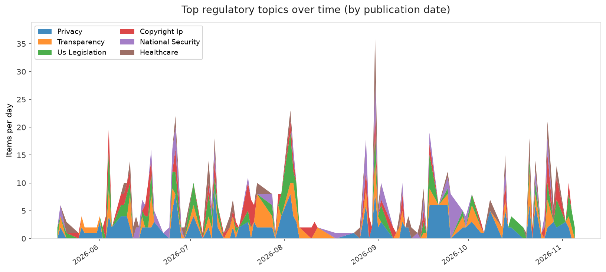
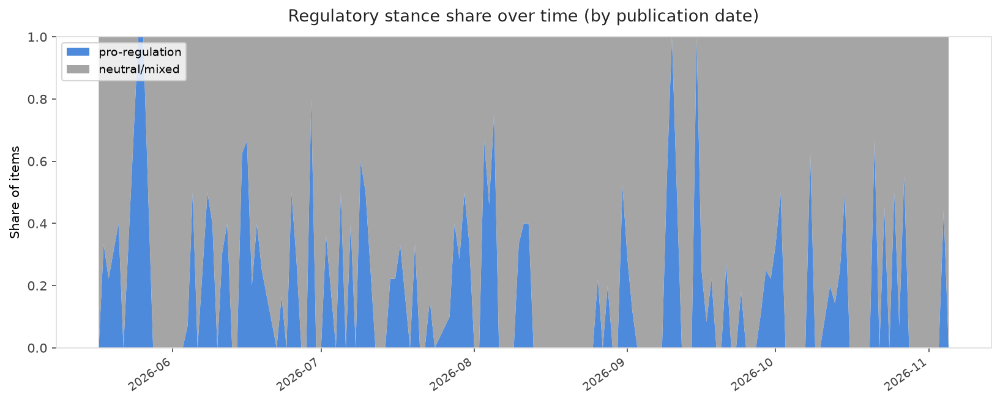

# AI in Law — Daily Sentiment Report
**Run date:** 2026-11-05 | **Items analyzed:** 10 | **Overall:** 🟢 Mildly positive (+0.677)

_Articles in this report were published between **2026-11-03** and **2026-11-05**._

---

## Summary

Today's collection covers **10** items from news outlets, academic preprints, Reddit, and regulatory sources.
Compared to the historical average of **+0.211**, today's sentiment is ↑ **0.466** points higher.

| Metric | Value |
|--------|-------|
| Positive items | 9 (90.0%) |
| Neutral items  | 1 (10.0%) |
| Negative items | 0 (0.0%) |
| Avg. VADER compound | +0.6774 |
| Pro-regulation items | 2 |
| Anti-regulation items | 0 |

---

## Top Topics Today

- **Us Legislation** — 3 items
- **Transparency** — 2 items
- **Privacy** — 1 items
- **Copyright Ip** — 1 items

---

## Most Positive Coverage

- [Google Summaries Aren't About AI, They're About Lock-In](https://www.eff.org/deeplinks/2026/11/google-summaries-arent-about-ai-theyre-about-lock)  
  _EFF DeepLinks_ — VADER: `+0.968`
- [Whose Transparency is it Anyway? Understanding Generative AI Transparency Needs and Gaps Across Stak](https://arxiv.org/abs/2611.05549v1)  
  _arXiv_ — VADER: `+0.953`
- [How “reverse game theory” could keep AI agents in check](https://www.technologyreview.com/2026/11/03/1147934/reverse-game-theory-mechanism-design-ai-alignment/)  
  _MIT Tech Review_ — VADER: `+0.913`

---

## Most Critical / Negative Coverage

- [‘Total repudiation’: The blue wave is about to hit AI](https://www.theverge.com/ai-artificial-intelligence/1026927/total-repudiation-the-blue-wave-is-about-to-hit-ai)  
  _The Verge AI_ — VADER: `+0.000`
- [The Download: Texas’s fragile AI boom and energy policy shifts](https://www.technologyreview.com/2026/11/05/1144908/the-download-texas-fragile-ai-boom-us-energy-policy/)  
  _MIT Tech Review_ — VADER: `+0.273`
- [NYT demands Brave shut down its paywall blocker and end deals with AI firms](https://arstechnica.com/tech-policy/2026/11/nyt-demands-brave-shut-down-its-paywall-blocker-and-end-deals-with-ai-firms/)  
  _Ars Technica Tech Policy_ — VADER: `+0.402`

---

## Visualizations — Today

## Visualizations — Trends Over Time

---

## Methodology

- **VADER** (Valence Aware Dictionary and sEntiment Reasoner) — compound score in [-1, 1].
- **Topic tagging** — regex keyword matching across 12 AI-law sub-domains.
- **Stance detection** — keyword-based pro/anti-regulation signal detection.
- **Date filter** — items are kept only if their *publication* date falls within the look-back window (default 2 days).
- Sources: RSS news feeds, arXiv academic API, Reddit (PRAW), Regulations.gov API.

_Generated automatically on 2026-11-05 18:34 UTC._
