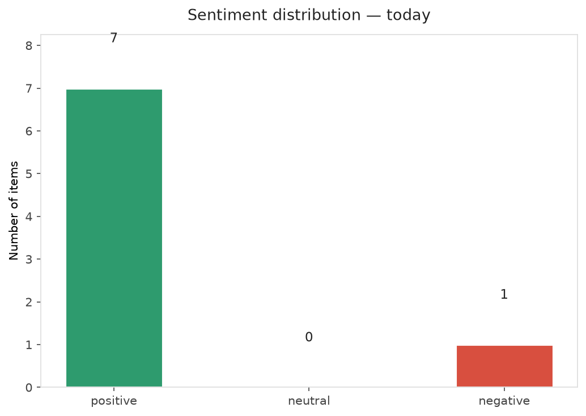
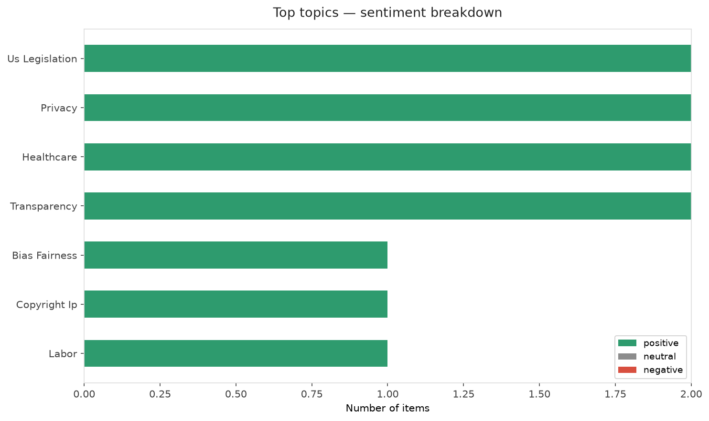
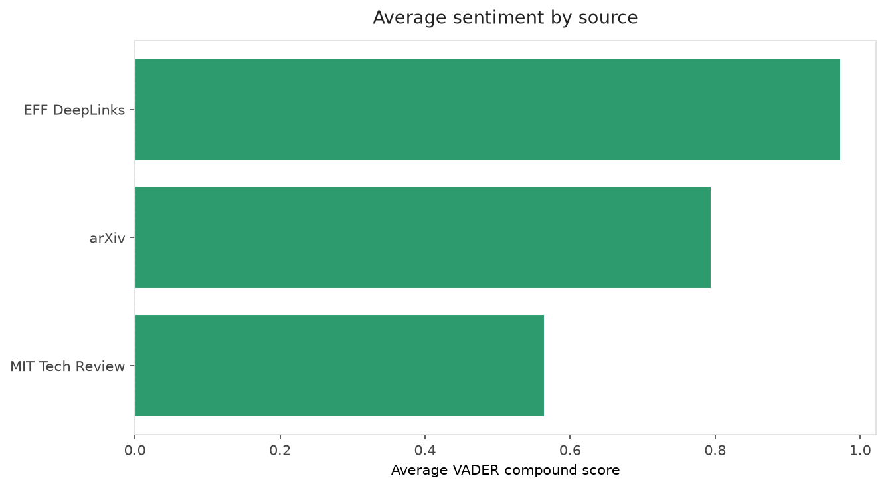
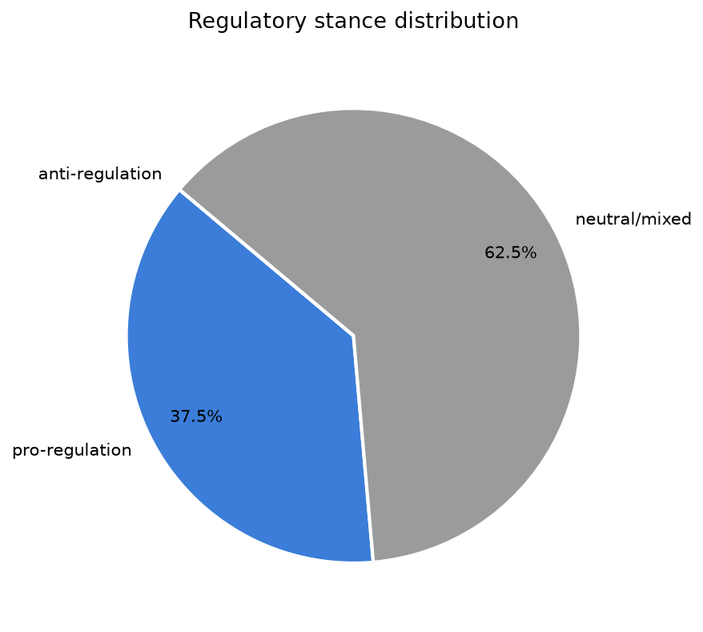
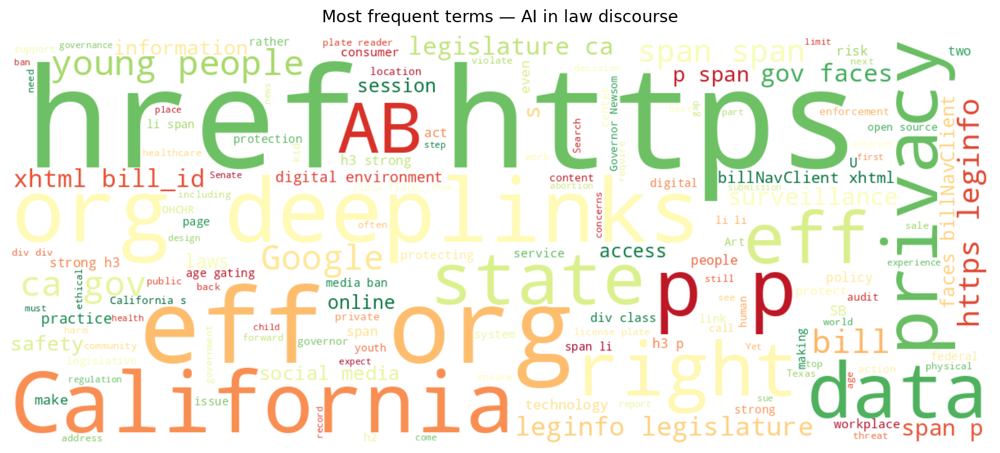
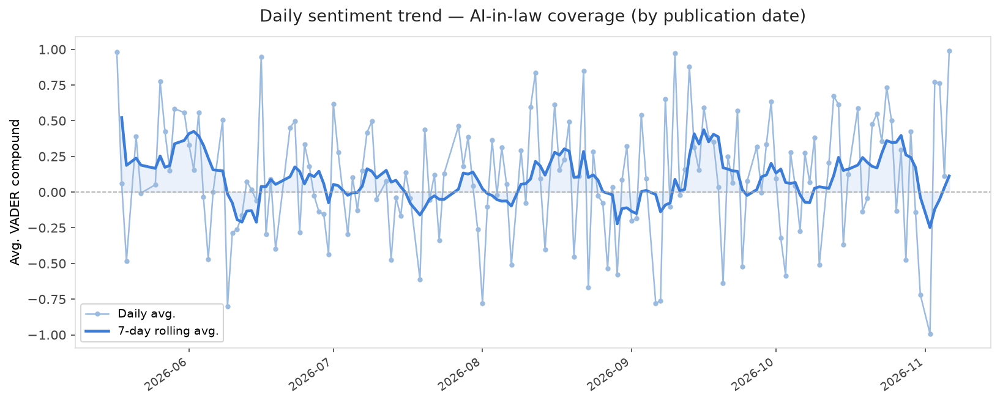
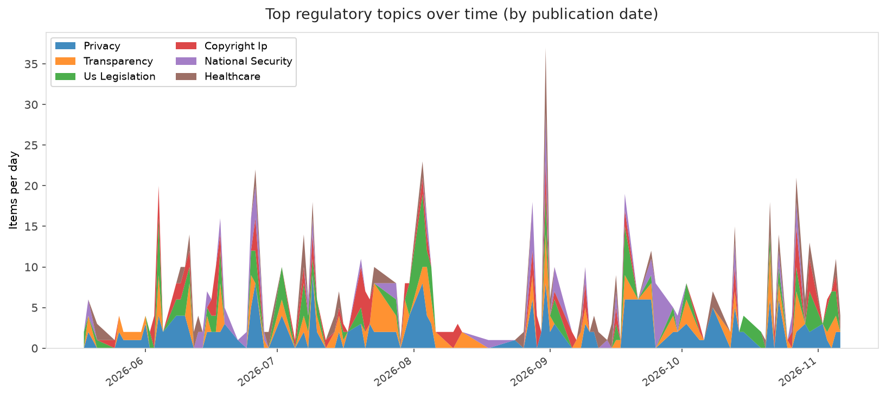
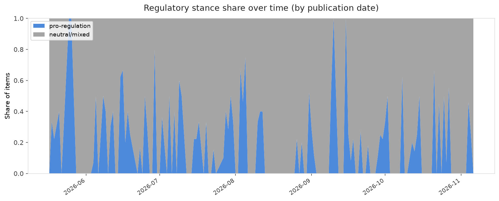

# AI in Law — Daily Sentiment Report
**Run date:** 2026-11-06 | **Items analyzed:** 8 | **Overall:** 🟢 Mildly positive (+0.590)

_Articles in this report were published between **2026-11-04** and **2026-11-06**._

---

## Summary

Today's collection covers **8** items from news outlets, academic preprints, Reddit, and regulatory sources.
Compared to the historical average of **+0.213**, today's sentiment is ↑ **0.377** points higher.

| Metric | Value |
|--------|-------|
| Positive items | 7 (87.5%) |
| Neutral items  | 0 (0.0%) |
| Negative items | 1 (12.5%) |
| Avg. VADER compound | +0.5904 |
| Pro-regulation items | 3 |
| Anti-regulation items | 0 |

---

## Top Topics Today

- **Us Legislation** — 2 items
- **Privacy** — 2 items
- **Healthcare** — 2 items
- **Transparency** — 2 items
- **Bias Fairness** — 1 items

---

## Most Positive Coverage

- [EFF Submission to OHCHR Consultation on Child Rights and Safety in the Digital Environment](https://www.eff.org/deeplinks/2026/11/eff-submission-ohchr-consultation-child-rights-and-safety-digital-environment)  
  _EFF DeepLinks_ — VADER: `+0.989`
- [Google Summaries Aren't About AI, They're About Lock-In](https://www.eff.org/deeplinks/2026/11/google-summaries-arent-about-ai-theyre-about-lock)  
  _EFF DeepLinks_ — VADER: `+0.968`
- [Reflecting on Digital Rights Wins and Losses in Sacramento](https://www.eff.org/deeplinks/2026/11/reflecting-digital-rights-wins-and-losses-sacramento)  
  _EFF DeepLinks_ — VADER: `+0.965`

---

## Most Critical / Negative Coverage

- [Lawsuit: Man introduced his wife to ChatGPT. She used it to plan his murder.](https://arstechnica.com/tech-policy/2026/11/lawsuit-man-introduced-his-wife-to-chatgpt-she-used-it-to-plan-his-murder/)  
  _Ars Technica Tech Policy_ — VADER: `-0.919`
- [The Download: Texas’s fragile AI boom and energy policy shifts](https://www.technologyreview.com/2026/11/05/1144908/the-download-texas-fragile-ai-boom-us-energy-policy/)  
  _MIT Tech Review_ — VADER: `+0.273`
- [Beyond the principle-practice gap: Responsible AI as situated epistemic and ethical practice](https://arxiv.org/abs/2611.06709v1)  
  _arXiv_ — VADER: `+0.685`

---

## Visualizations — Today

## Visualizations — Trends Over Time

---

## Methodology

- **VADER** (Valence Aware Dictionary and sEntiment Reasoner) — compound score in [-1, 1].
- **Topic tagging** — regex keyword matching across 12 AI-law sub-domains.
- **Stance detection** — keyword-based pro/anti-regulation signal detection.
- **Date filter** — items are kept only if their *publication* date falls within the look-back window (default 2 days).
- Sources: RSS news feeds, arXiv academic API, Reddit (PRAW), Regulations.gov API.

_Generated automatically on 2026-11-06 17:51 UTC._
