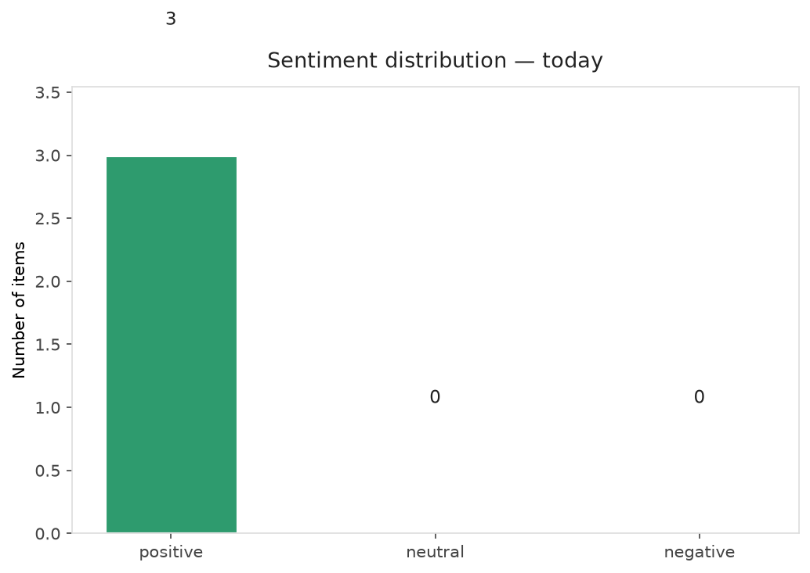
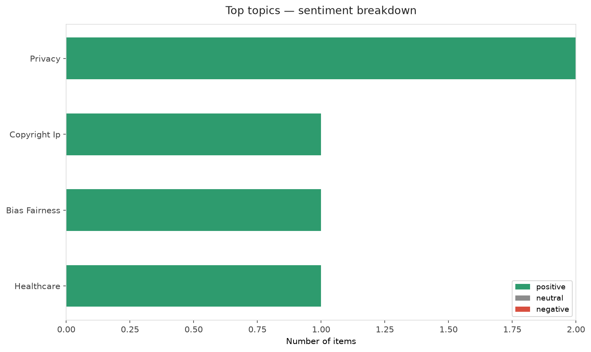
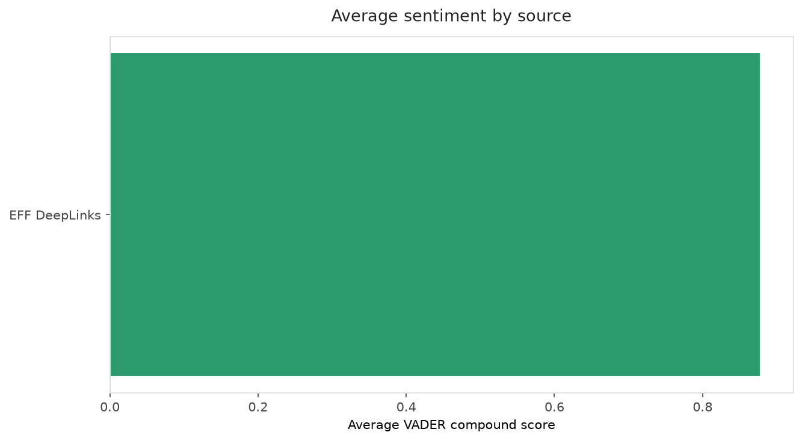
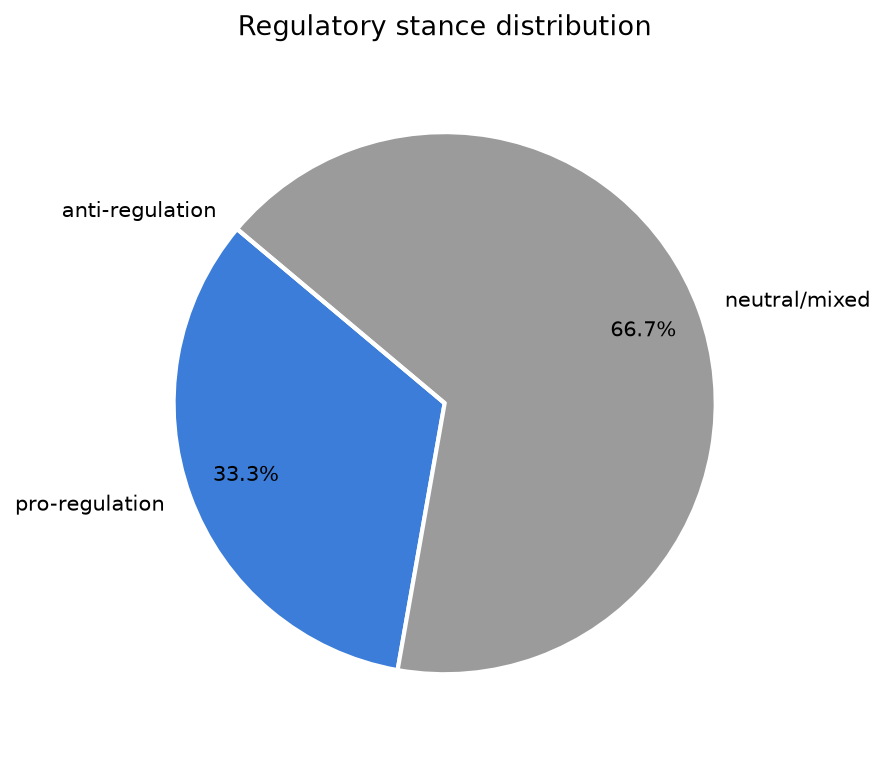
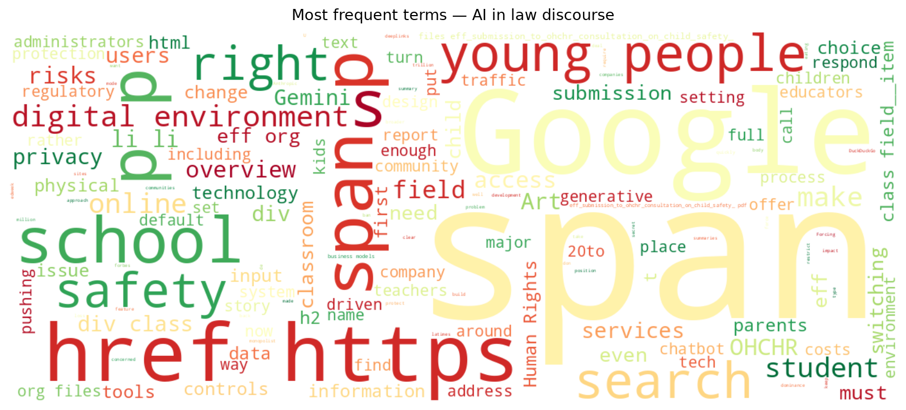
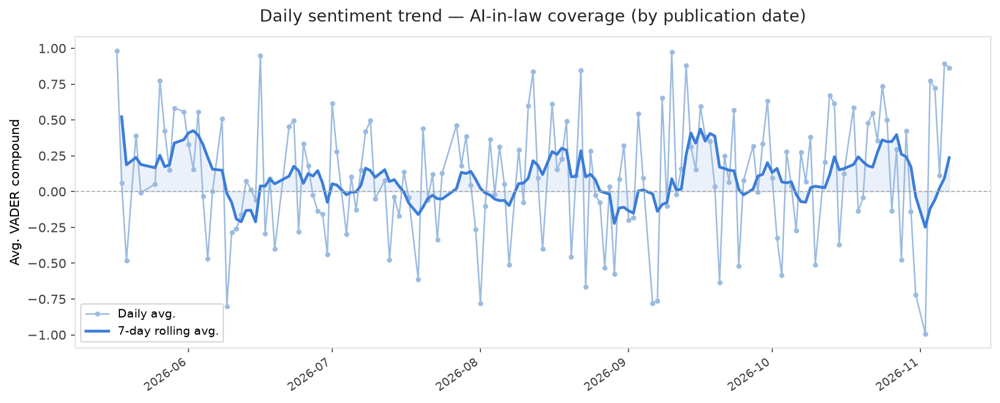
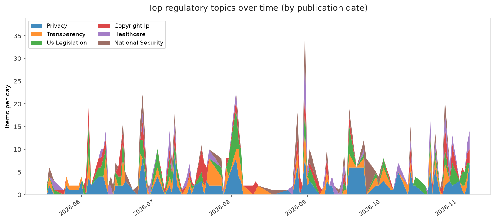
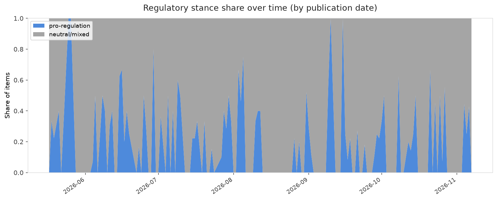

# AI in Law — Daily Sentiment Report
**Run date:** 2026-11-08 | **Items analyzed:** 3 | **Overall:** 🟢 Mildly positive (+0.873)

_Articles in this report were published between **2026-11-06** and **2026-11-07**._

---

## Summary

Today's collection covers **3** items from news outlets, academic preprints, Reddit, and regulatory sources.
Compared to the historical average of **+0.216**, today's sentiment is ↑ **0.657** points higher.

| Metric | Value |
|--------|-------|
| Positive items | 3 (100.0%) |
| Neutral items  | 0 (0.0%) |
| Negative items | 0 (0.0%) |
| Avg. VADER compound | +0.8730 |
| Pro-regulation items | 1 |
| Anti-regulation items | 0 |

---

## Top Topics Today

- **Privacy** — 2 items
- **Copyright Ip** — 1 items
- **Bias Fairness** — 1 items
- **Healthcare** — 1 items

---

## Most Positive Coverage

- [EFF Submission to OHCHR Consultation on Child Rights and Safety in the Digital Environment](https://www.eff.org/deeplinks/2026/11/eff-submission-ohchr-consultation-child-rights-and-safety-digital-environment)  
  _EFF DeepLinks_ — VADER: `+0.989`
- [Why a new report on Anthropic automating AI development is alarming researchers](https://www.theverge.com/ai-artificial-intelligence/1029126/anthropic-metr-report-accelerating-ai-development)  
  _The Verge AI_ — VADER: `+0.862`
- [Google Forcing AI on Students Is BS](https://www.eff.org/deeplinks/2026/11/google-forcing-ai-students-bs)  
  _EFF DeepLinks_ — VADER: `+0.768`

---

## Most Critical / Negative Coverage

- [Google Forcing AI on Students Is BS](https://www.eff.org/deeplinks/2026/11/google-forcing-ai-students-bs)  
  _EFF DeepLinks_ — VADER: `+0.768`
- [Why a new report on Anthropic automating AI development is alarming researchers](https://www.theverge.com/ai-artificial-intelligence/1029126/anthropic-metr-report-accelerating-ai-development)  
  _The Verge AI_ — VADER: `+0.862`
- [EFF Submission to OHCHR Consultation on Child Rights and Safety in the Digital Environment](https://www.eff.org/deeplinks/2026/11/eff-submission-ohchr-consultation-child-rights-and-safety-digital-environment)  
  _EFF DeepLinks_ — VADER: `+0.989`

---

## Visualizations — Today

## Visualizations — Trends Over Time

---

## Methodology

- **VADER** (Valence Aware Dictionary and sEntiment Reasoner) — compound score in [-1, 1].
- **Topic tagging** — regex keyword matching across 12 AI-law sub-domains.
- **Stance detection** — keyword-based pro/anti-regulation signal detection.
- **Date filter** — items are kept only if their *publication* date falls within the look-back window (default 2 days).
- Sources: RSS news feeds, arXiv academic API, Reddit (PRAW), Regulations.gov API.

_Generated automatically on 2026-11-08 16:57 UTC._
