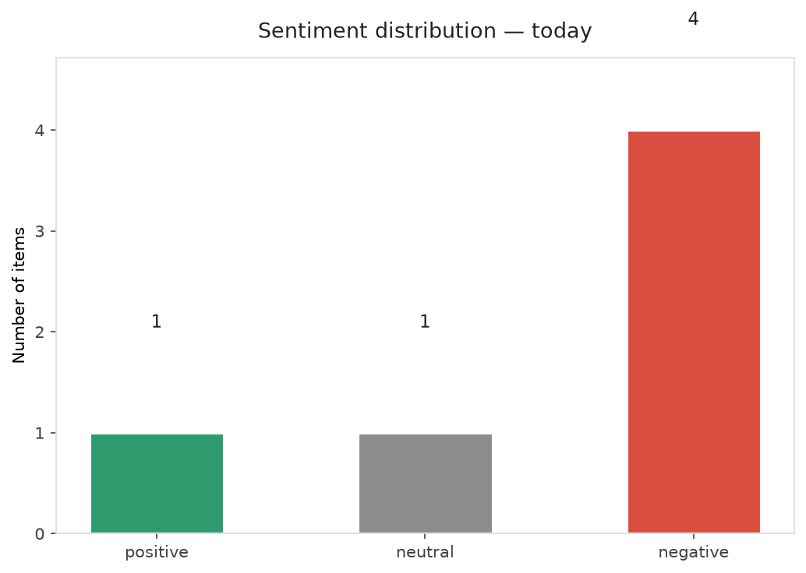
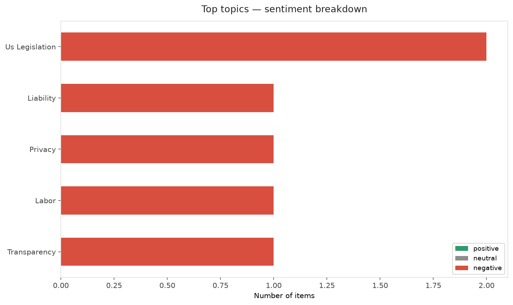
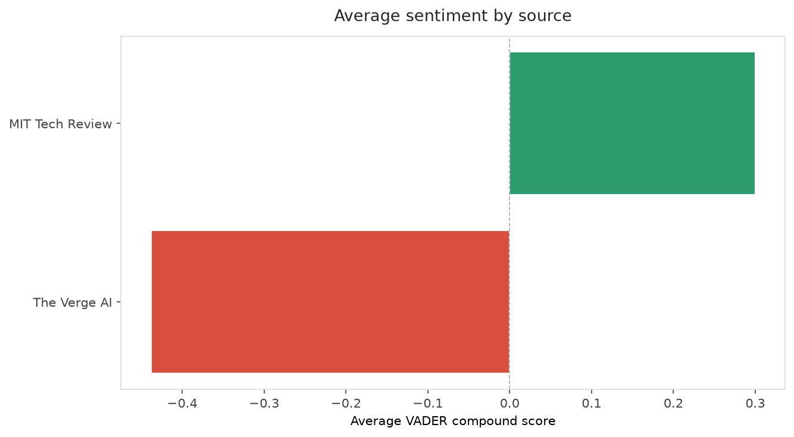
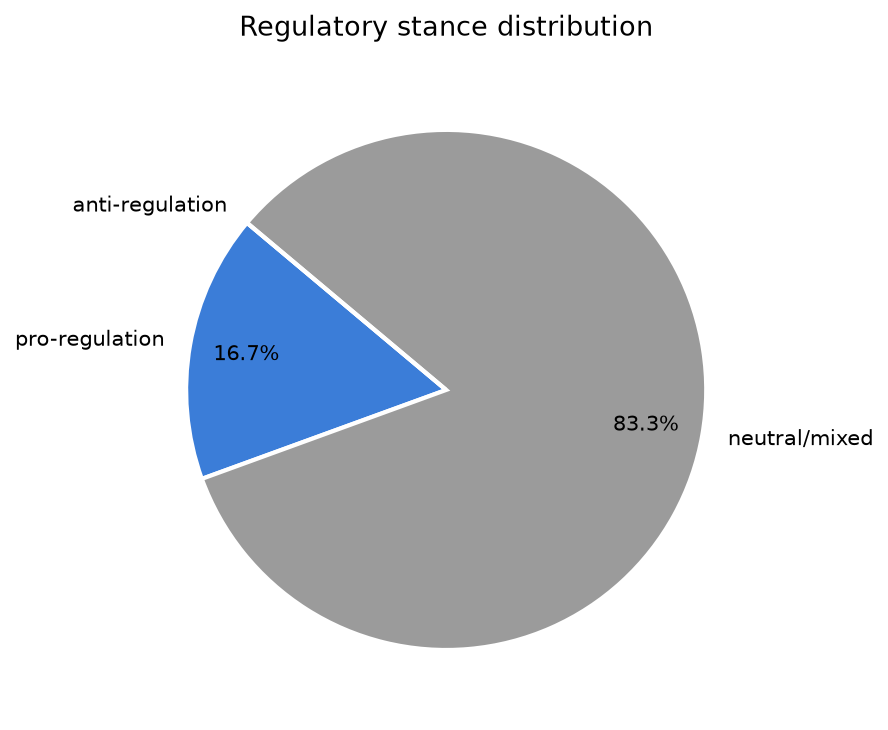
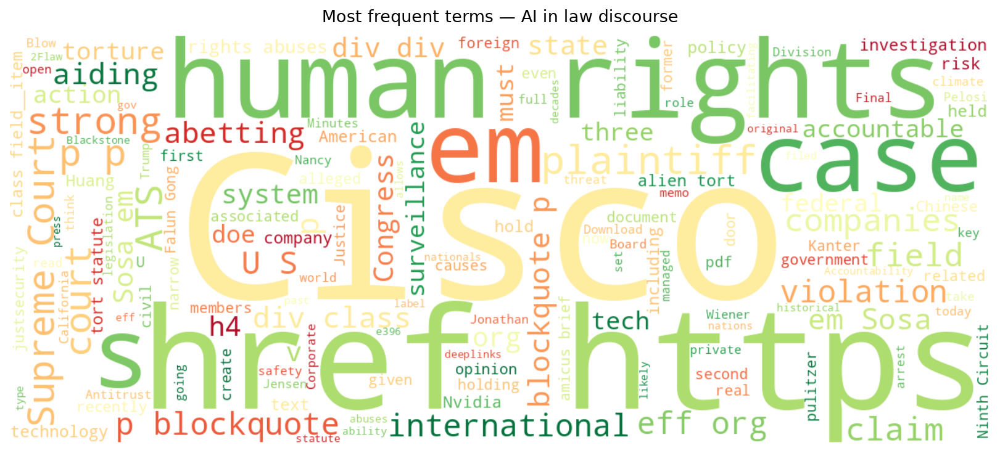
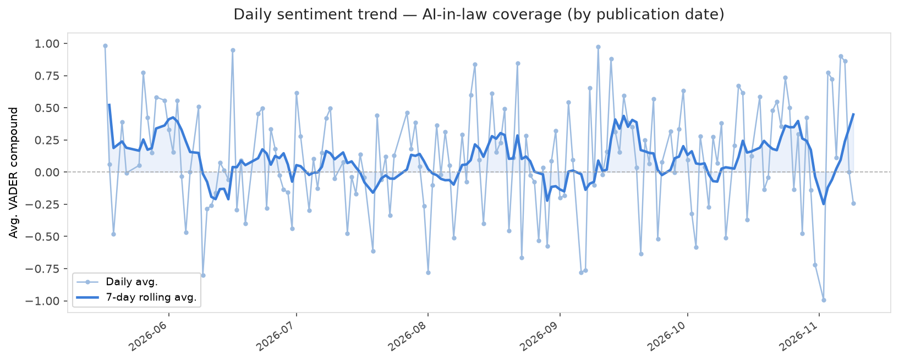
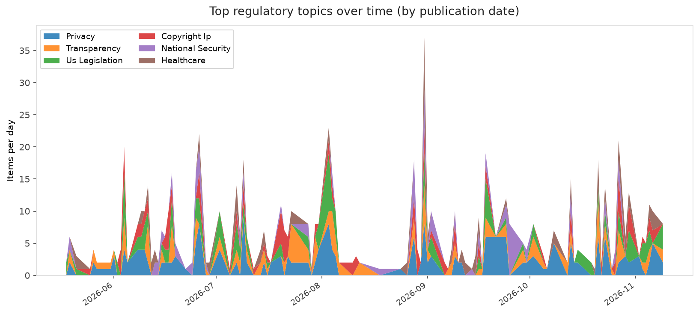
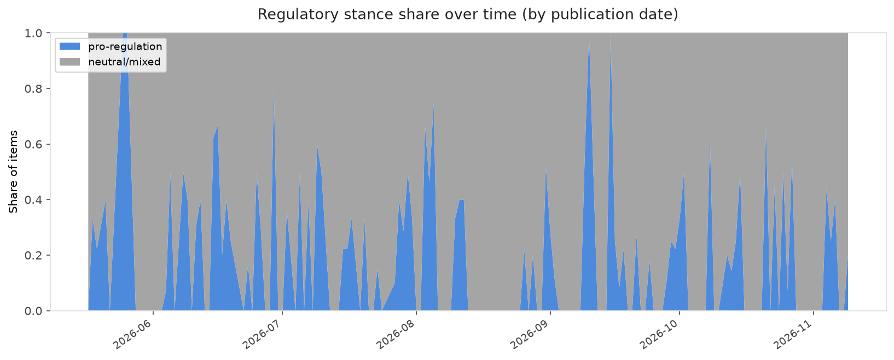

# AI in Law — Daily Sentiment Report
**Run date:** 2026-11-09 | **Items analyzed:** 6 | **Overall:** 🔴 Mildly negative (-0.200)

_Articles in this report were published between **2026-11-08** and **2026-11-09**._

---

## Summary

Today's collection covers **6** items from news outlets, academic preprints, Reddit, and regulatory sources.
Compared to the historical average of **+0.214**, today's sentiment is ↓ **0.415** points lower.

| Metric | Value |
|--------|-------|
| Positive items | 1 (16.7%) |
| Neutral items  | 1 (16.7%) |
| Negative items | 4 (66.7%) |
| Avg. VADER compound | -0.2002 |
| Pro-regulation items | 1 |
| Anti-regulation items | 0 |

---

## Top Topics Today

- **Us Legislation** — 2 items
- **Liability** — 1 items
- **Privacy** — 1 items
- **Labor** — 1 items
- **Transparency** — 1 items

---

## Most Positive Coverage

- [Nancy Pelosi’s replacement is ready to regulate AI](https://www.technologyreview.com/2026/11/09/1148182/nancy-pelosis-replacement-is-ready-to-regulate-ai/)  
  _MIT Tech Review_ — VADER: `+0.802`
- [Here’s the full text of Jensen Huang’s memo to Nvidia](https://www.theverge.com/ai-artificial-intelligence/1029595/full-text-jensen-huang-affair-memo-nvidia)  
  _The Verge AI_ — VADER: `+0.000`
- [The Download: empty AI climate claims, and an Nvidia investigation](https://www.technologyreview.com/2026/11/09/1148176/the-download-empty-ai-climate-claims-and-an-nvidia-investigation/)  
  _MIT Tech Review_ — VADER: `-0.202`

---

## Most Critical / Negative Coverage

- [Trump’s 60 Minutes interview touched on AI safety, threat to arrest an AI exec](https://www.theverge.com/ai-artificial-intelligence/1029802/trump-60-minutes-ai)  
  _The Verge AI_ — VADER: `-0.772`
- [Jonathan Kanter is using AI to take on Big Tech](https://www.theverge.com/policy/1029652/kanter-doj-biden-legal-tech)  
  _The Verge AI_ — VADER: `-0.542`
- [U.S. Supreme Court Deals Final Blow to Corporate Human Rights Accountability](https://www.eff.org/deeplinks/2026/11/us-supreme-court-deals-final-blow-corporate-human-rights-accountability)  
  _EFF DeepLinks_ — VADER: `-0.487`

---

## Visualizations — Today

## Visualizations — Trends Over Time

---

## Methodology

- **VADER** (Valence Aware Dictionary and sEntiment Reasoner) — compound score in [-1, 1].
- **Topic tagging** — regex keyword matching across 12 AI-law sub-domains.
- **Stance detection** — keyword-based pro/anti-regulation signal detection.
- **Date filter** — items are kept only if their *publication* date falls within the look-back window (default 2 days).
- Sources: RSS news feeds, arXiv academic API, Reddit (PRAW), Regulations.gov API.

_Generated automatically on 2026-11-09 21:20 UTC._
