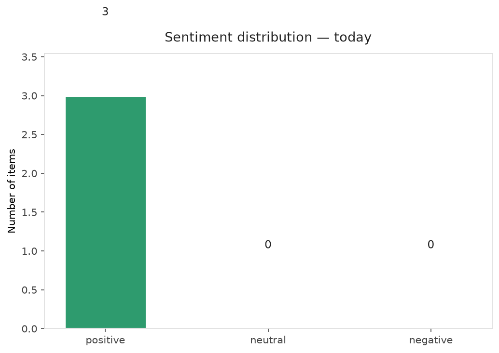
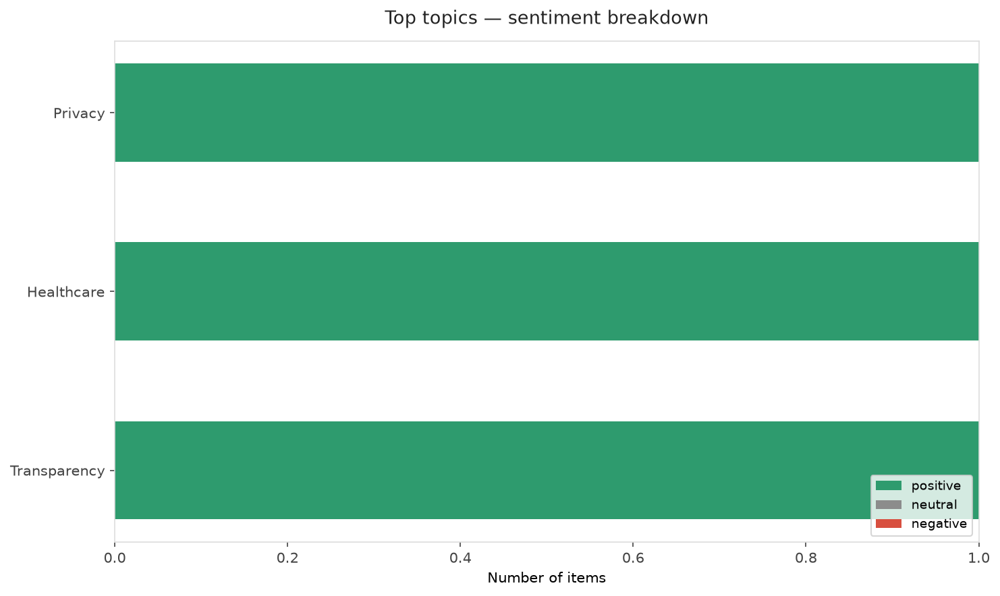
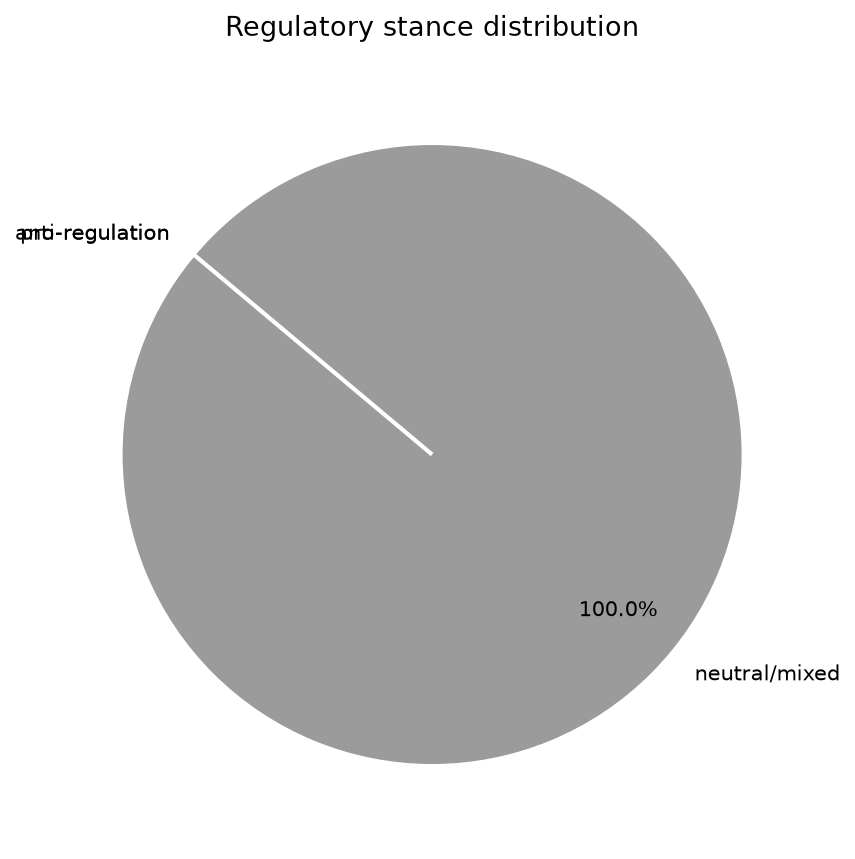
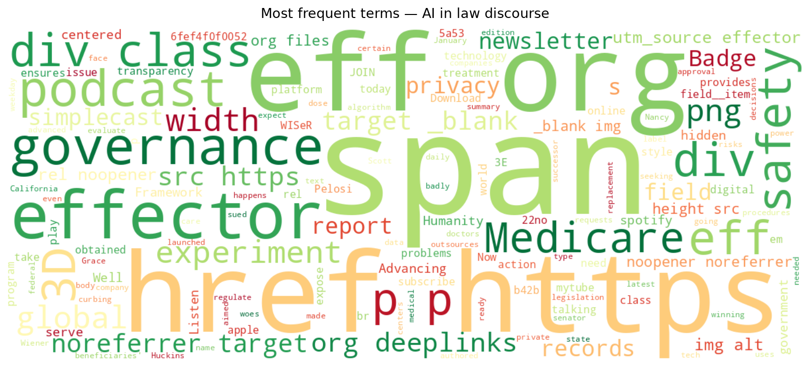
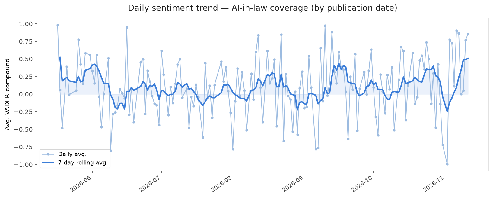
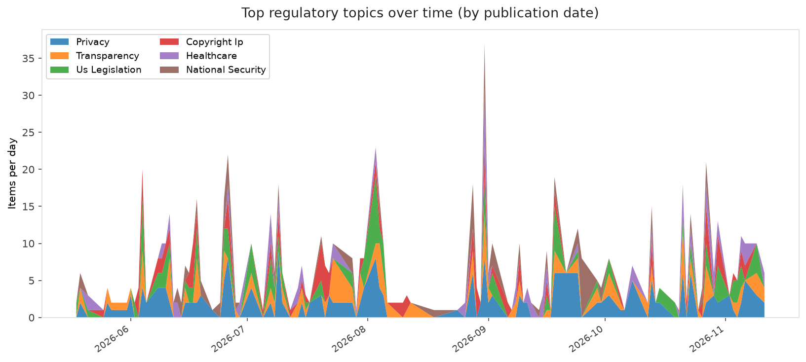
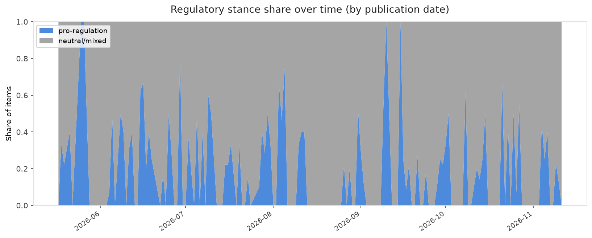

# AI in Law — Daily Sentiment Report
**Run date:** 2026-11-12 | **Items analyzed:** 3 | **Overall:** 🟢 Mildly positive (+0.811)

_Articles in this report were published between **2026-11-10** and **2026-11-11**._

---

## Summary

Today's collection covers **3** items from news outlets, academic preprints, Reddit, and regulatory sources.
Compared to the historical average of **+0.217**, today's sentiment is ↑ **0.594** points higher.

| Metric | Value |
|--------|-------|
| Positive items | 3 (100.0%) |
| Neutral items  | 0 (0.0%) |
| Negative items | 0 (0.0%) |
| Avg. VADER compound | +0.8113 |
| Pro-regulation items | 0 |
| Anti-regulation items | 0 |

---

## Top Topics Today

- **Privacy** — 1 items
- **Healthcare** — 1 items
- **Transparency** — 1 items

---

## Most Positive Coverage

- [Advancing a Global Framework for AI Safety and Governance for the Well-being of Humanity](https://arxiv.org/abs/2611.13968v1)  
  _arXiv_ — VADER: `+0.994`
- [🤕 Medicare's AI Experiment | EFFector 38.20](https://www.eff.org/deeplinks/2026/11/medicares-ai-experiment-effector-3820)  
  _EFF DeepLinks_ — VADER: `+0.854`
- [The Download: Pelosi’s successor targets AI and data centers face power woes](https://www.technologyreview.com/2026/11/10/1148150/the-download-pelosi-successor-ai-regulation-data-center-backlash/)  
  _MIT Tech Review_ — VADER: `+0.586`

---

## Most Critical / Negative Coverage

- [The Download: Pelosi’s successor targets AI and data centers face power woes](https://www.technologyreview.com/2026/11/10/1148150/the-download-pelosi-successor-ai-regulation-data-center-backlash/)  
  _MIT Tech Review_ — VADER: `+0.586`
- [🤕 Medicare's AI Experiment | EFFector 38.20](https://www.eff.org/deeplinks/2026/11/medicares-ai-experiment-effector-3820)  
  _EFF DeepLinks_ — VADER: `+0.854`
- [Advancing a Global Framework for AI Safety and Governance for the Well-being of Humanity](https://arxiv.org/abs/2611.13968v1)  
  _arXiv_ — VADER: `+0.994`

---

## Visualizations — Today

## Visualizations — Trends Over Time

---

## Methodology

- **VADER** (Valence Aware Dictionary and sEntiment Reasoner) — compound score in [-1, 1].
- **Topic tagging** — regex keyword matching across 12 AI-law sub-domains.
- **Stance detection** — keyword-based pro/anti-regulation signal detection.
- **Date filter** — items are kept only if their *publication* date falls within the look-back window (default 2 days).
- Sources: RSS news feeds, arXiv academic API, Reddit (PRAW), Regulations.gov API.

_Generated automatically on 2026-11-12 18:45 UTC._
