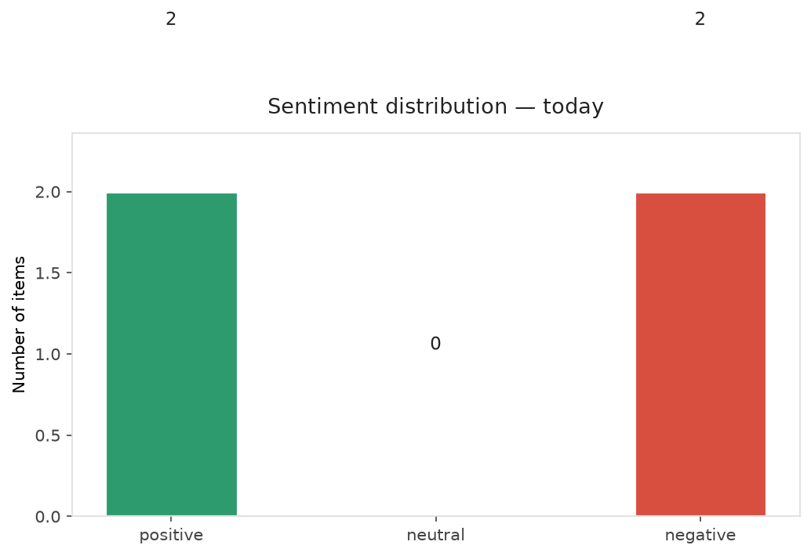
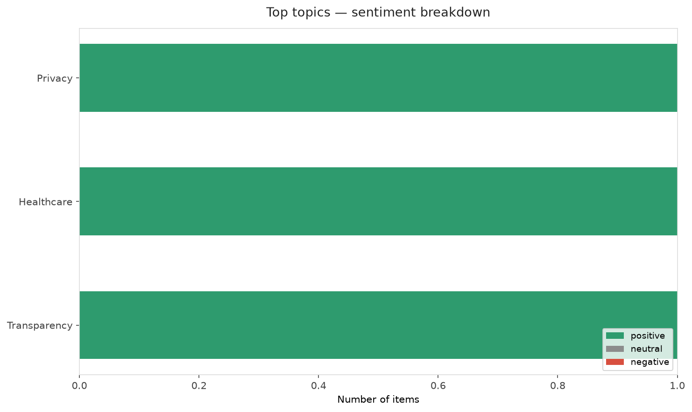
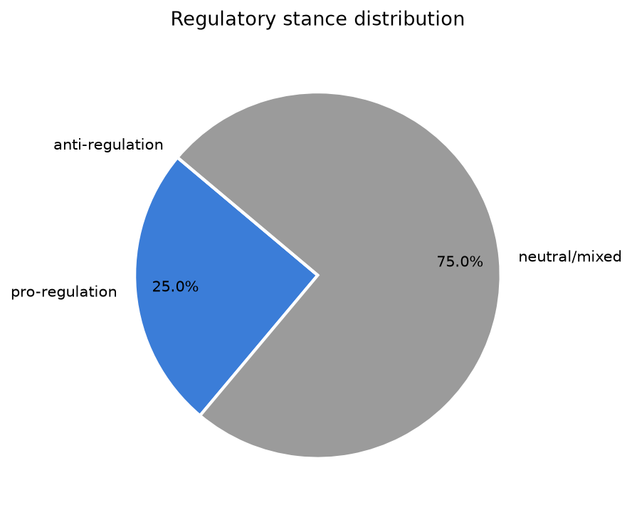
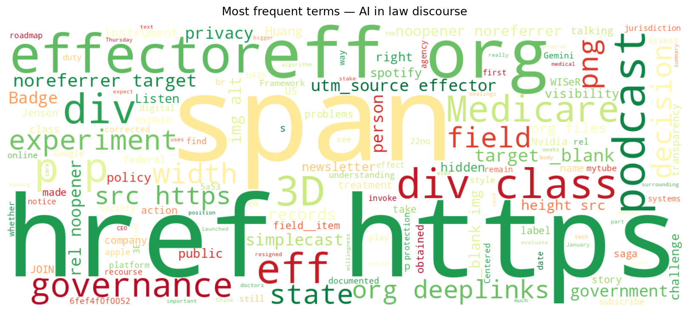
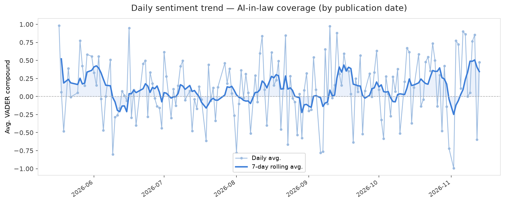
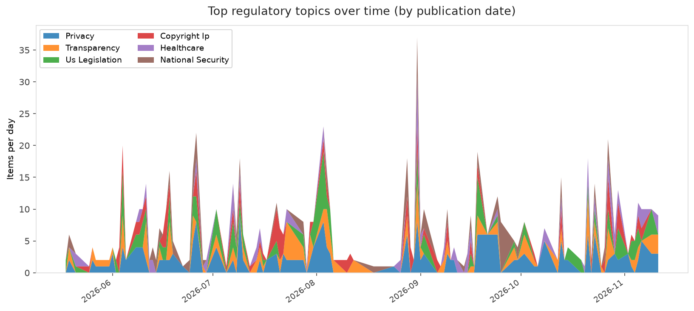
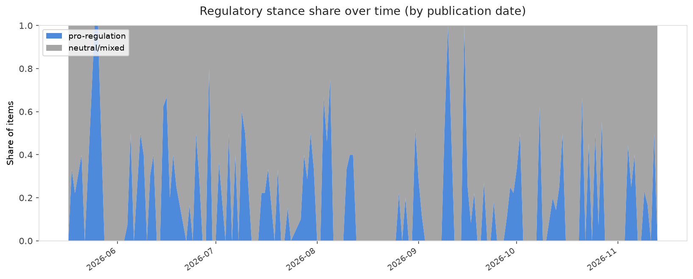

# AI in Law — Daily Sentiment Report
**Run date:** 2026-11-13 | **Items analyzed:** 4 | **Overall:** ⚪ Neutral / mixed (+0.035)

_Articles in this report were published between **2026-11-11** and **2026-11-13**._

---

## Summary

Today's collection covers **4** items from news outlets, academic preprints, Reddit, and regulatory sources.
Compared to the historical average of **+0.217**, today's sentiment is ↓ **0.181** points lower.

| Metric | Value |
|--------|-------|
| Positive items | 2 (50.0%) |
| Neutral items  | 0 (0.0%) |
| Negative items | 2 (50.0%) |
| Avg. VADER compound | +0.0352 |
| Pro-regulation items | 1 |
| Anti-regulation items | 0 |

---

## Top Topics Today

- **Privacy** — 1 items
- **Healthcare** — 1 items
- **Transparency** — 1 items

---

## Most Positive Coverage

- [🤕 Medicare's AI Experiment | EFFector 38.20](https://www.eff.org/deeplinks/2026/11/medicares-ai-experiment-effector-3820)  
  _EFF DeepLinks_ — VADER: `+0.854`
- [What&#8217;s really at stake in the Jensen Huang saga](https://www.theverge.com/podcast/1032866/jensen-huang-nvidia-china-trump-vergecast)  
  _The Verge AI_ — VADER: `+0.476`
- [Google faces calls for AI moratoriums in schools after Gemini pilot backlash](https://arstechnica.com/tech-policy/2026/11/families-fight-to-keep-googles-disturbing-ai-off-school-issued-chromebooks/)  
  _Ars Technica Tech Policy_ — VADER: `-0.382`

---

## Most Critical / Negative Coverage

- [Between Niti and Nyaya: A Society-Centered Framework for AI Governance](https://arxiv.org/abs/2611.16173v1)  
  _arXiv_ — VADER: `-0.807`
- [Google faces calls for AI moratoriums in schools after Gemini pilot backlash](https://arstechnica.com/tech-policy/2026/11/families-fight-to-keep-googles-disturbing-ai-off-school-issued-chromebooks/)  
  _Ars Technica Tech Policy_ — VADER: `-0.382`
- [What&#8217;s really at stake in the Jensen Huang saga](https://www.theverge.com/podcast/1032866/jensen-huang-nvidia-china-trump-vergecast)  
  _The Verge AI_ — VADER: `+0.476`

---

## Visualizations — Today

## Visualizations — Trends Over Time

---

## Methodology

- **VADER** (Valence Aware Dictionary and sEntiment Reasoner) — compound score in [-1, 1].
- **Topic tagging** — regex keyword matching across 12 AI-law sub-domains.
- **Stance detection** — keyword-based pro/anti-regulation signal detection.
- **Date filter** — items are kept only if their *publication* date falls within the look-back window (default 2 days).
- Sources: RSS news feeds, arXiv academic API, Reddit (PRAW), Regulations.gov API.

_Generated automatically on 2026-11-13 18:27 UTC._
