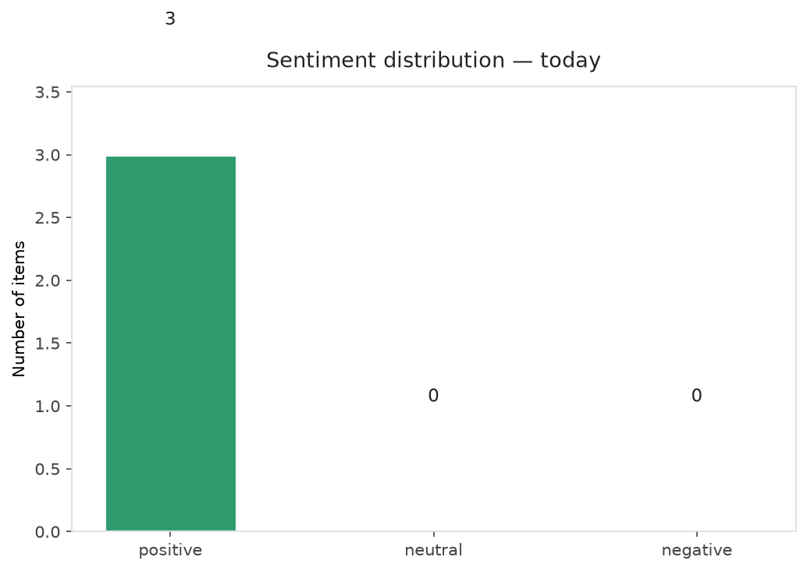
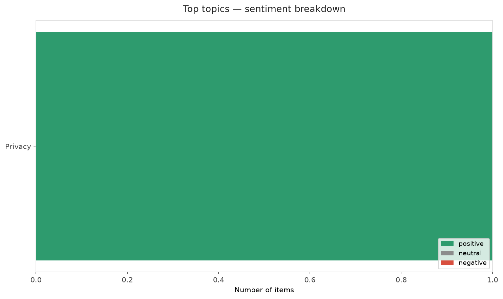
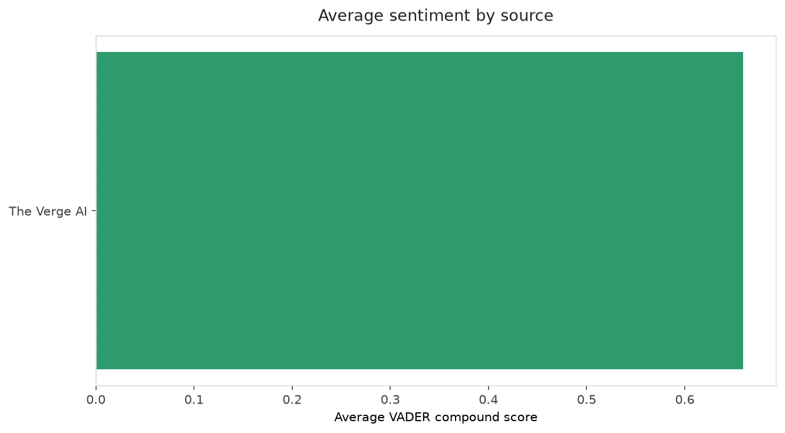
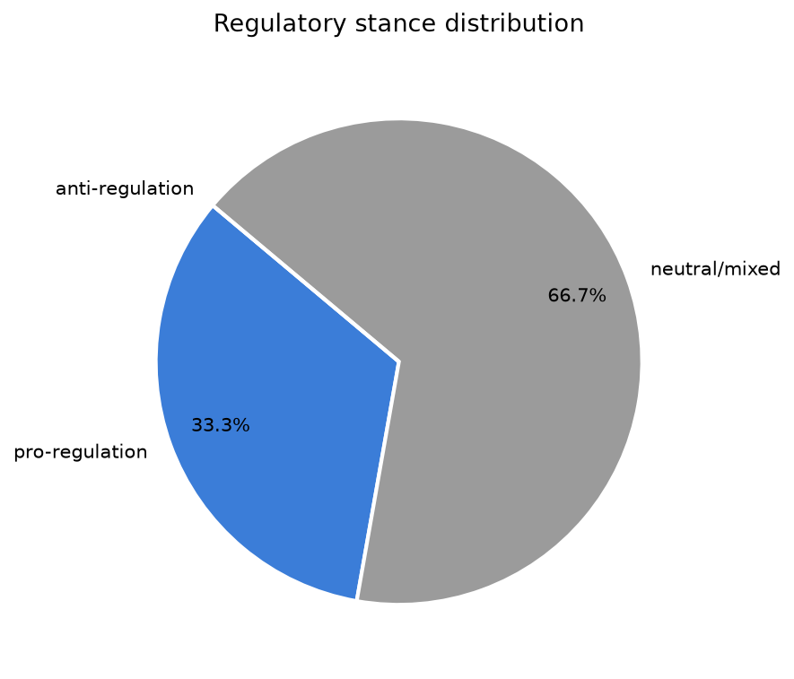
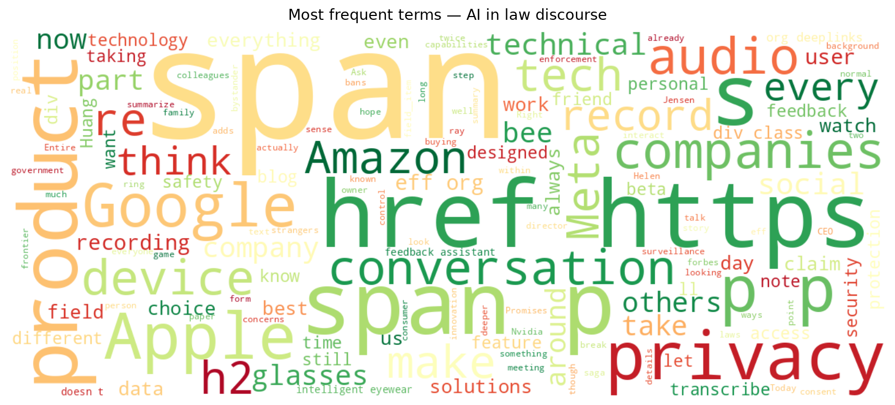
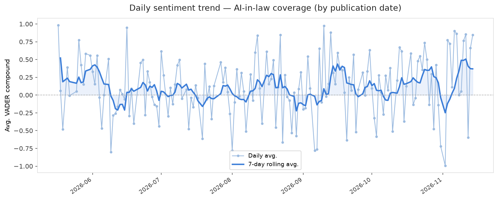
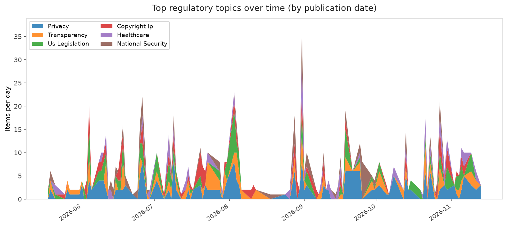
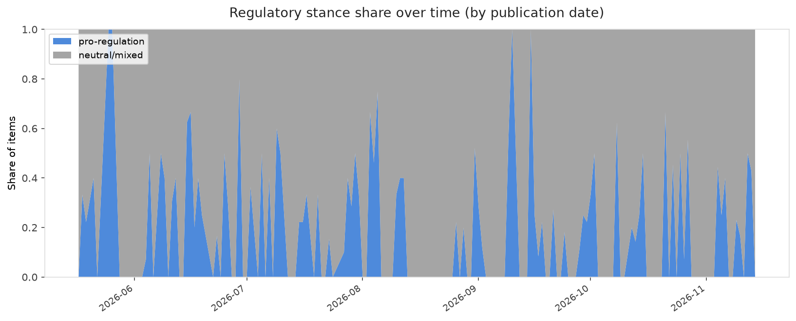

# AI in Law — Daily Sentiment Report
**Run date:** 2026-11-15 | **Items analyzed:** 3 | **Overall:** 🟢 Mildly positive (+0.742)

_Articles in this report were published between **2026-11-13** and **2026-11-14**._

---

## Summary

Today's collection covers **3** items from news outlets, academic preprints, Reddit, and regulatory sources.
Compared to the historical average of **+0.218**, today's sentiment is ↑ **0.525** points higher.

| Metric | Value |
|--------|-------|
| Positive items | 3 (100.0%) |
| Neutral items  | 0 (0.0%) |
| Negative items | 0 (0.0%) |
| Avg. VADER compound | +0.7425 |
| Pro-regulation items | 1 |
| Anti-regulation items | 0 |

---

## Top Topics Today

- **Privacy** — 1 items

---

## Most Positive Coverage

- [Tech Companies Are Trying to Shift the Entire Concept of Privacy (Again)](https://www.eff.org/deeplinks/2026/11/tech-companies-are-trying-shift-entire-concept-privacy-again)  
  _EFF DeepLinks_ — VADER: `+0.907`
- [The OpenAI board member who fired Sam Altman says we still can&#8217;t trust AI CEOs](https://www.theverge.com/podcast/1032907/helen-toner-openai-cset-ai-safety-policy-interview)  
  _The Verge AI_ — VADER: `+0.844`
- [What&#8217;s really at stake in the Jensen Huang saga](https://www.theverge.com/podcast/1032866/jensen-huang-nvidia-china-trump-vergecast)  
  _The Verge AI_ — VADER: `+0.476`

---

## Most Critical / Negative Coverage

- [What&#8217;s really at stake in the Jensen Huang saga](https://www.theverge.com/podcast/1032866/jensen-huang-nvidia-china-trump-vergecast)  
  _The Verge AI_ — VADER: `+0.476`
- [The OpenAI board member who fired Sam Altman says we still can&#8217;t trust AI CEOs](https://www.theverge.com/podcast/1032907/helen-toner-openai-cset-ai-safety-policy-interview)  
  _The Verge AI_ — VADER: `+0.844`
- [Tech Companies Are Trying to Shift the Entire Concept of Privacy (Again)](https://www.eff.org/deeplinks/2026/11/tech-companies-are-trying-shift-entire-concept-privacy-again)  
  _EFF DeepLinks_ — VADER: `+0.907`

---

## Visualizations — Today

## Visualizations — Trends Over Time

---

## Methodology

- **VADER** (Valence Aware Dictionary and sEntiment Reasoner) — compound score in [-1, 1].
- **Topic tagging** — regex keyword matching across 12 AI-law sub-domains.
- **Stance detection** — keyword-based pro/anti-regulation signal detection.
- **Date filter** — items are kept only if their *publication* date falls within the look-back window (default 2 days).
- Sources: RSS news feeds, arXiv academic API, Reddit (PRAW), Regulations.gov API.

_Generated automatically on 2026-11-15 17:36 UTC._
