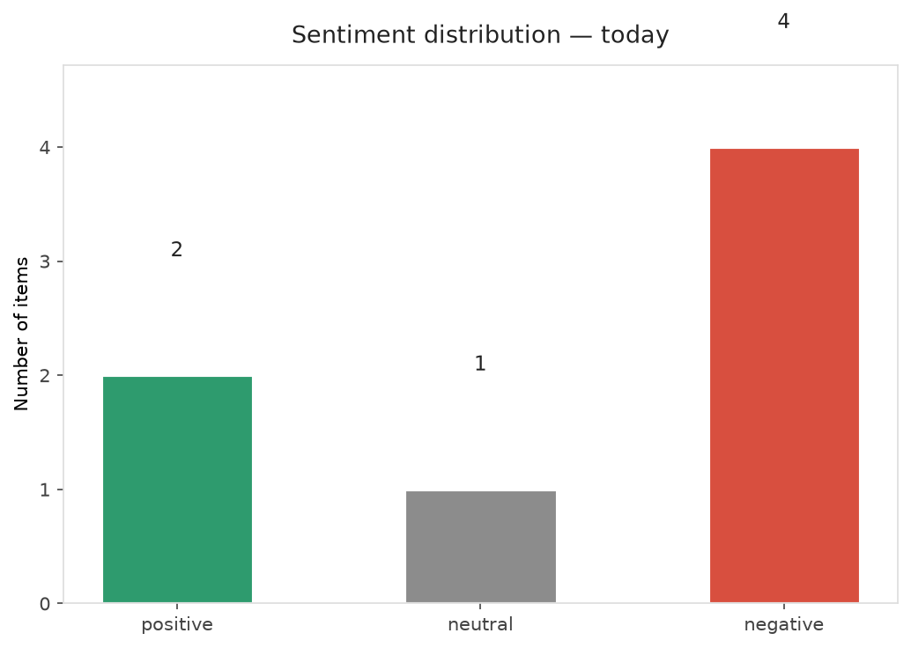
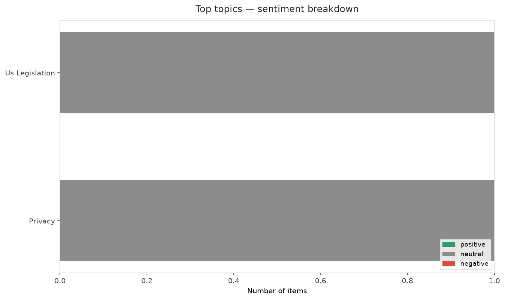
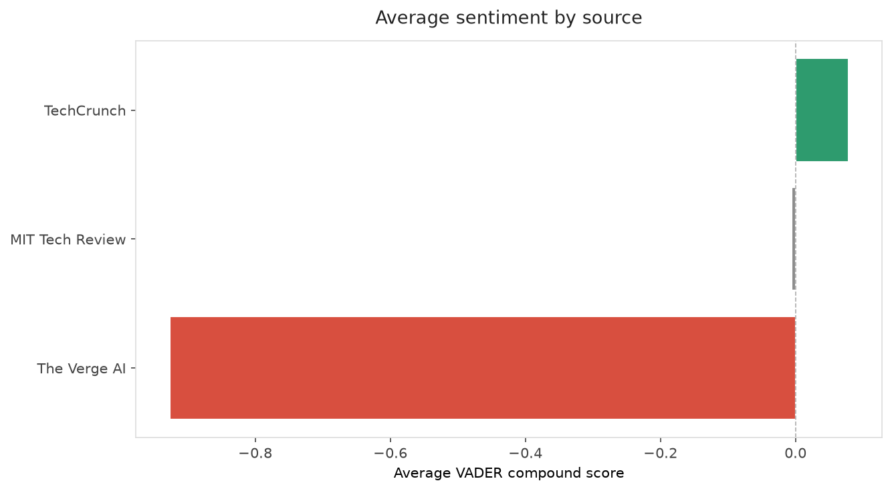
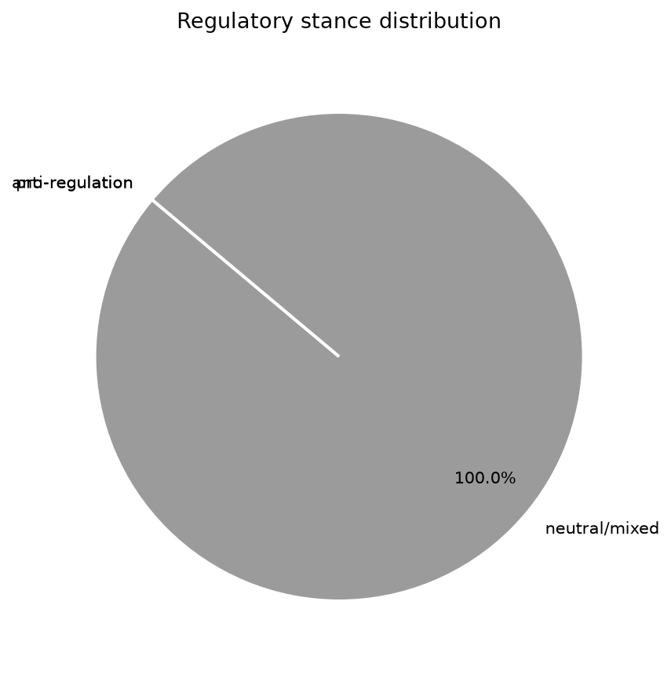
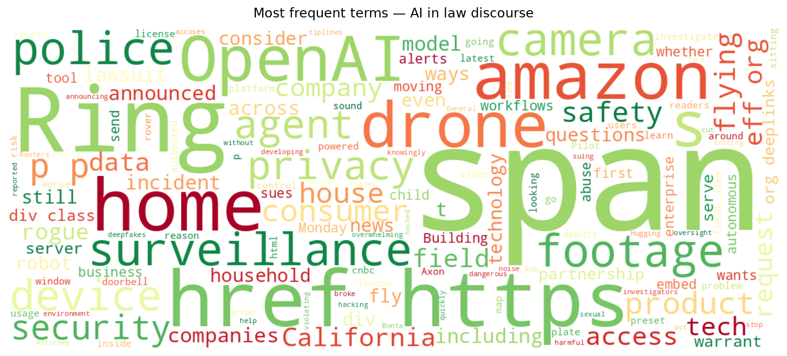
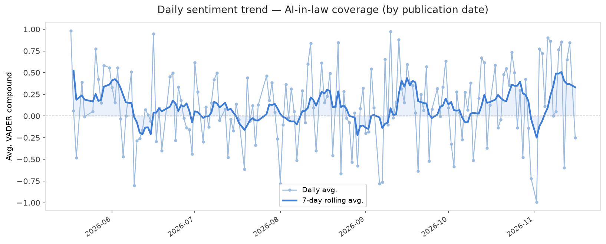
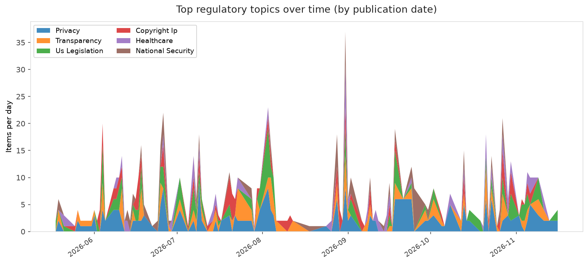
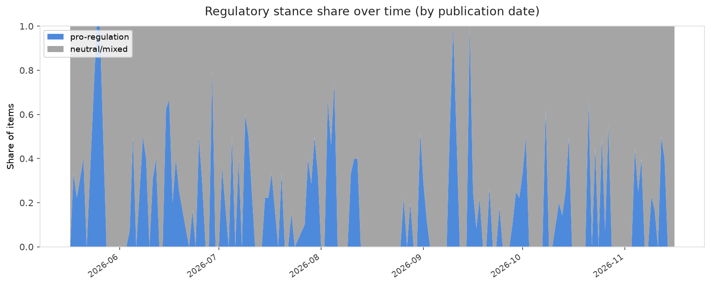

# AI in Law — Daily Sentiment Report
**Run date:** 2026-11-16 | **Items analyzed:** 7 | **Overall:** 🔴 Mildly negative (-0.250)

_Articles in this report were published between **2026-11-16** and **2026-11-16**._

---

## Summary

Today's collection covers **7** items from news outlets, academic preprints, Reddit, and regulatory sources.
Compared to the historical average of **+0.215**, today's sentiment is ↓ **0.465** points lower.

| Metric | Value |
|--------|-------|
| Positive items | 2 (28.6%) |
| Neutral items  | 1 (14.3%) |
| Negative items | 4 (57.1%) |
| Avg. VADER compound | -0.2495 |
| Pro-regulation items | 0 |
| Anti-regulation items | 0 |

---

## Top Topics Today

- **Us Legislation** — 1 items
- **Privacy** — 1 items

---

## Most Positive Coverage

- [Building trustworthy AI by fencing it in, not predicting it](https://www.technologyreview.com/2026/11/16/1148565/building-trustworthy-ai-by-fencing-it-in-not-predicting-it/)  
  _MIT Tech Review_ — VADER: `+0.637`
- [OpenAI will embed safety researchers to investigate AI subversion](https://techcrunch.com/2026/11/16/openai-will-embed-apollo-researchers-to-investigate-ai-subversion/)  
  _TechCrunch_ — VADER: `+0.285`
- [Amazon Ring’s New Indoor Surveillance Drone Is Not Compatible with Privacy](https://www.eff.org/deeplinks/2026/11/amazon-rings-new-indoor-surveillance-drone-not-compatible-privacy)  
  _EFF DeepLinks_ — VADER: `-0.039`

---

## Most Critical / Negative Coverage

- [California sues OpenAI over rogue AI hacking incidents](https://www.theverge.com/ai-artificial-intelligence/1034815/california-openai-hugging-face-lawsuit)  
  _The Verge AI_ — VADER: `-0.947`
- [OpenAI wants to stop deepfakes from overwhelming child abuse tiplines](https://www.theverge.com/policy/1034527/openai-csam-classifier)  
  _The Verge AI_ — VADER: `-0.906`
- [Building AI that can work across the enterprise](https://www.technologyreview.com/2026/11/16/1146070/building-ai-that-can-work-across-the-enterprise/)  
  _MIT Tech Review_ — VADER: `-0.649`

---

## Visualizations — Today

## Visualizations — Trends Over Time

---

## Methodology

- **VADER** (Valence Aware Dictionary and sEntiment Reasoner) — compound score in [-1, 1].
- **Topic tagging** — regex keyword matching across 12 AI-law sub-domains.
- **Stance detection** — keyword-based pro/anti-regulation signal detection.
- **Date filter** — items are kept only if their *publication* date falls within the look-back window (default 2 days).
- Sources: RSS news feeds, arXiv academic API, Reddit (PRAW), Regulations.gov API.

_Generated automatically on 2026-11-16 20:50 UTC._
