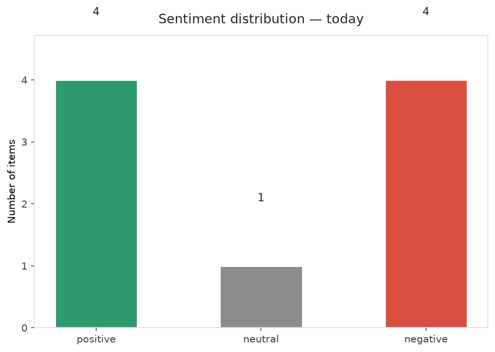
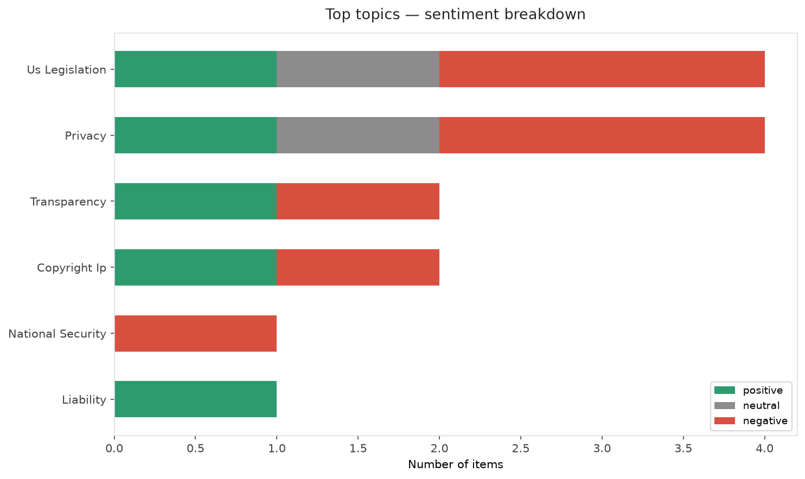
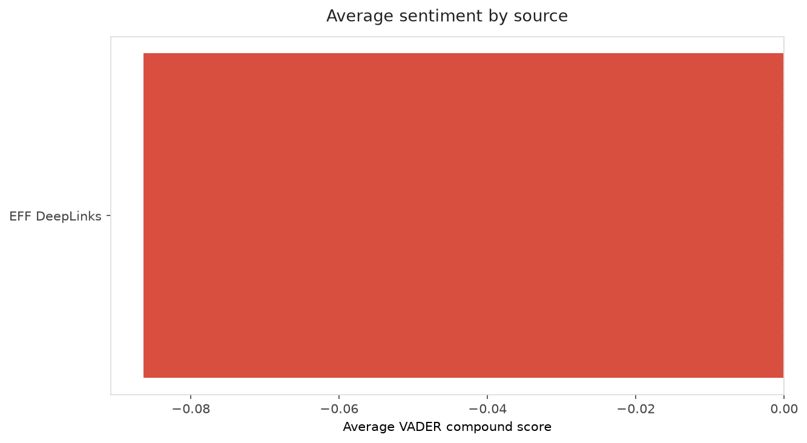
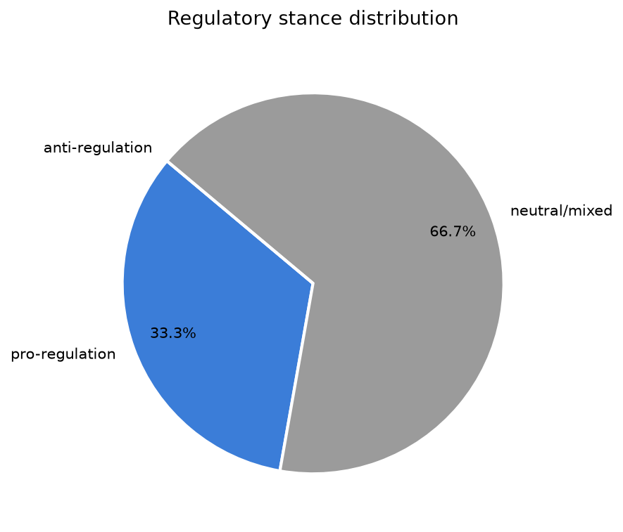
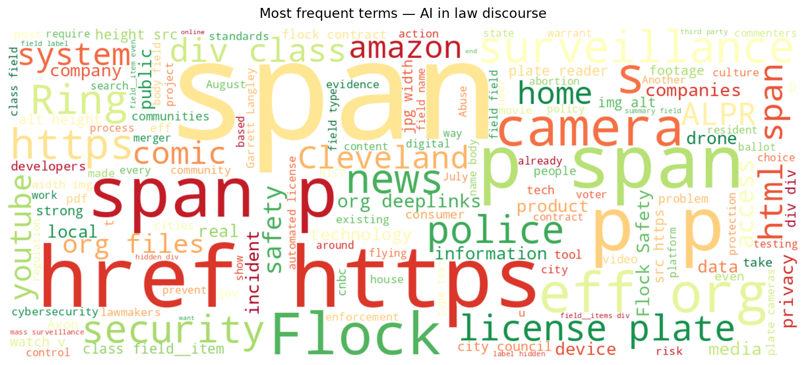
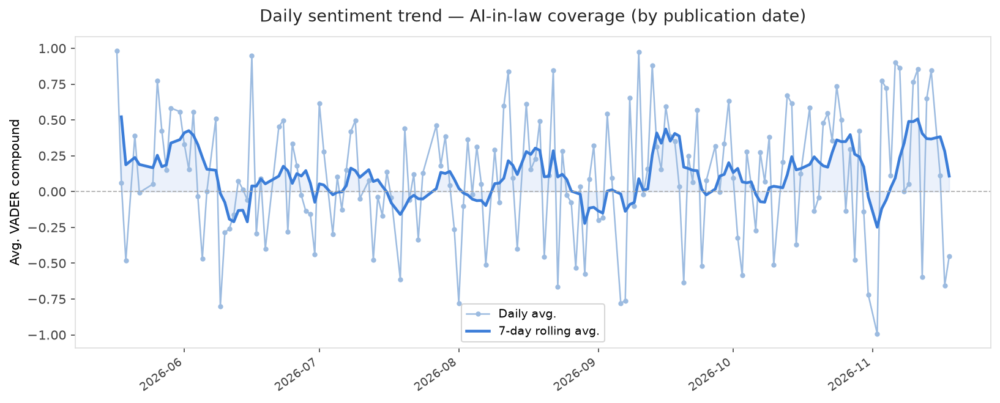
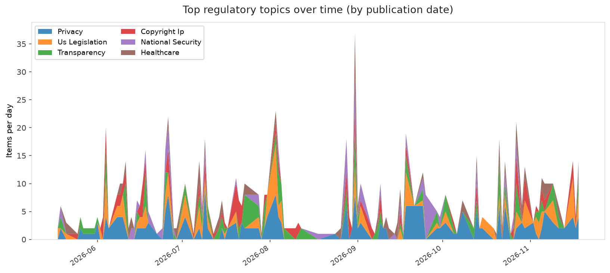
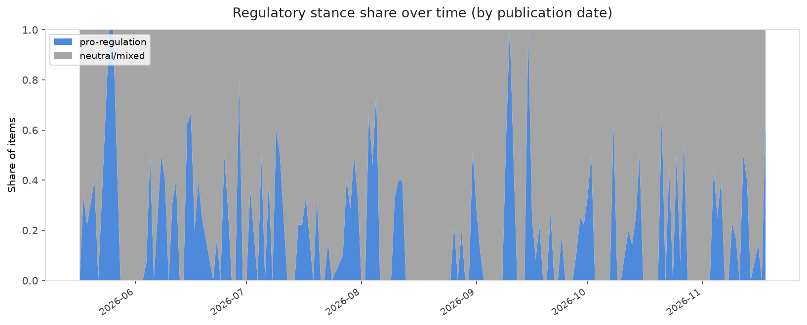

# AI in Law — Daily Sentiment Report
**Run date:** 2026-11-18 | **Items analyzed:** 9 | **Overall:** ⚪ Neutral / mixed (-0.029)

_Articles in this report were published between **2026-11-16** and **2026-11-18**._

---

## Summary

Today's collection covers **9** items from news outlets, academic preprints, Reddit, and regulatory sources.
Compared to the historical average of **+0.212**, today's sentiment is ↓ **0.241** points lower.

| Metric | Value |
|--------|-------|
| Positive items | 4 (44.4%) |
| Neutral items  | 1 (11.1%) |
| Negative items | 4 (44.4%) |
| Avg. VADER compound | -0.0286 |
| Pro-regulation items | 3 |
| Anti-regulation items | 0 |

---

## Top Topics Today

- **Us Legislation** — 4 items
- **Privacy** — 4 items
- **Transparency** — 2 items
- **Copyright Ip** — 2 items
- **National Security** — 1 items

---

## Most Positive Coverage

- [EFF’s AI Cybersecurity Policy Framework](https://www.eff.org/deeplinks/2026/11/effs-ai-cybersecurity-policy-framework)  
  _EFF DeepLinks_ — VADER: `+0.975`
- [Honest Brokers in AI Regulation: How Public Comments Introduce Evidence to Regulators](https://arxiv.org/abs/2611.21948v1)  
  _arXiv_ — VADER: `+0.927`
- [Building trustworthy AI by fencing it in, not predicting it](https://www.technologyreview.com/2026/11/16/1148565/building-trustworthy-ai-by-fencing-it-in-not-predicting-it/)  
  _MIT Tech Review_ — VADER: `+0.637`

---

## Most Critical / Negative Coverage

- [The Paramount-Warner Brothers Deal Could Usher in Another Age of Lost Media](https://www.eff.org/deeplinks/2026/11/paramount-warner-brothers-deal-could-usher-another-age-lost-media)  
  _EFF DeepLinks_ — VADER: `-0.923`
- [Surveillance Isn't Safety: A Comic About Organizing Against Flock and Other Foes](https://www.eff.org/deeplinks/2026/11/surveillance-isnt-safety-comic-about-organizing-against-surveillance)  
  _EFF DeepLinks_ — VADER: `-0.921`
- [Tech lawsuits defined 2026 — and lawmakers want more](https://www.theverge.com/policy/1036935/congress-forced-arbitration-deepfakes-defiance-act)  
  _The Verge AI_ — VADER: `-0.912`

---

## Visualizations — Today

## Visualizations — Trends Over Time

---

## Methodology

- **VADER** (Valence Aware Dictionary and sEntiment Reasoner) — compound score in [-1, 1].
- **Topic tagging** — regex keyword matching across 12 AI-law sub-domains.
- **Stance detection** — keyword-based pro/anti-regulation signal detection.
- **Date filter** — items are kept only if their *publication* date falls within the look-back window (default 2 days).
- Sources: RSS news feeds, arXiv academic API, Reddit (PRAW), Regulations.gov API.

_Generated automatically on 2026-11-18 19:17 UTC._
