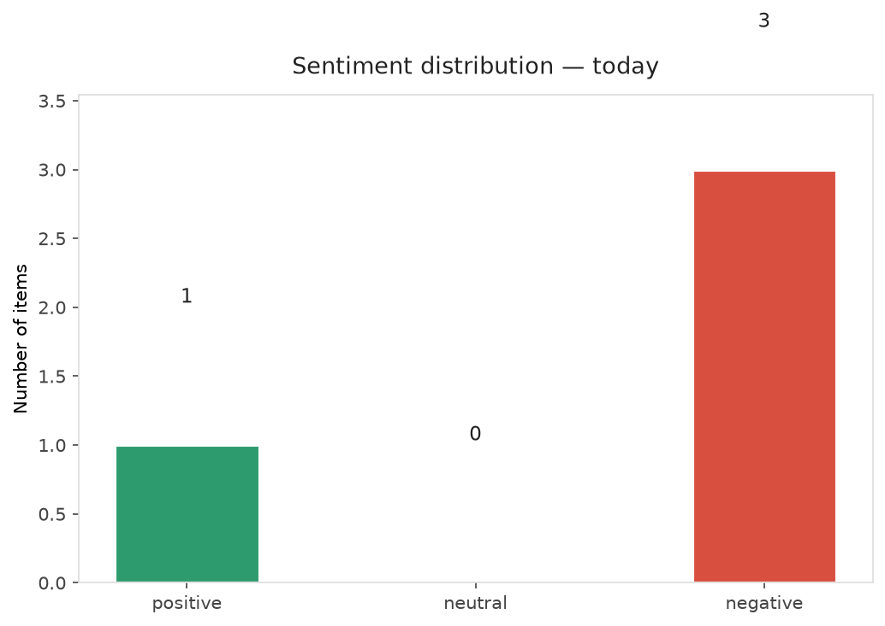
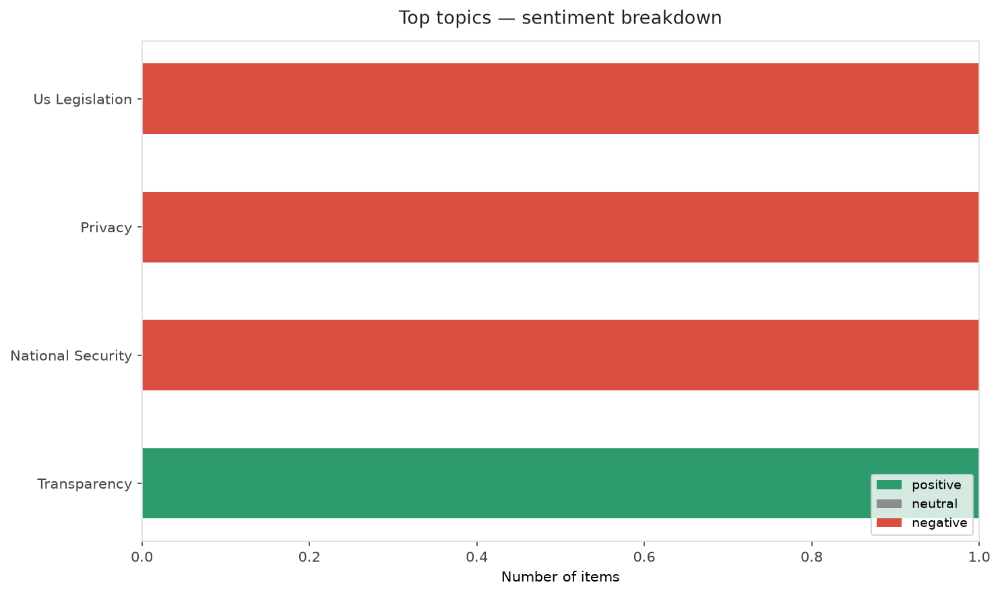
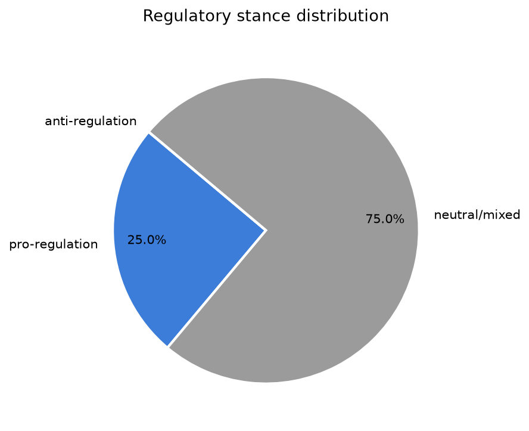
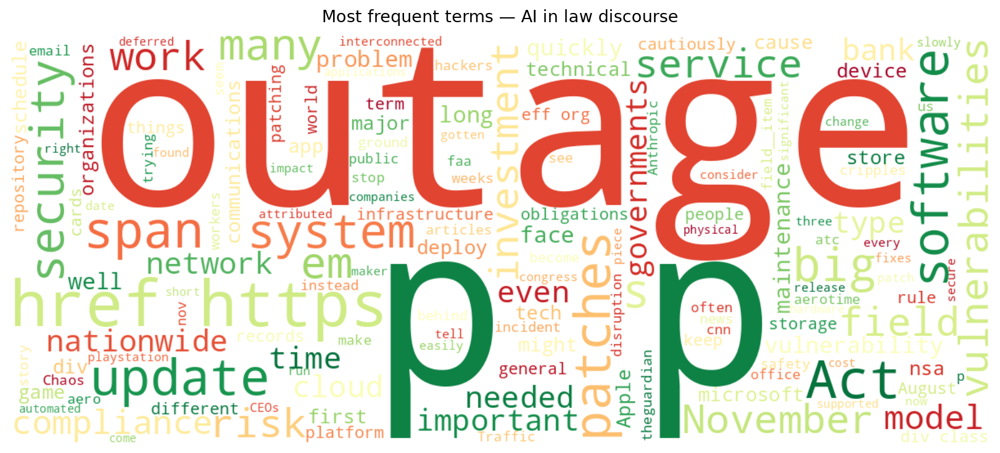
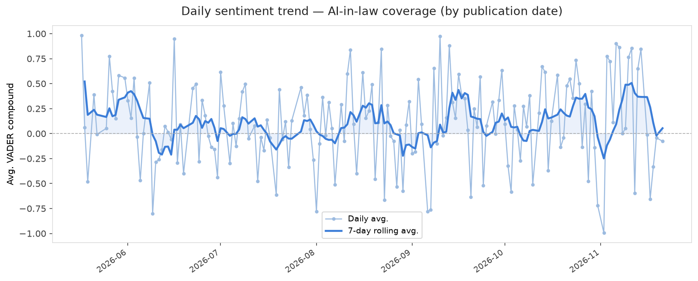
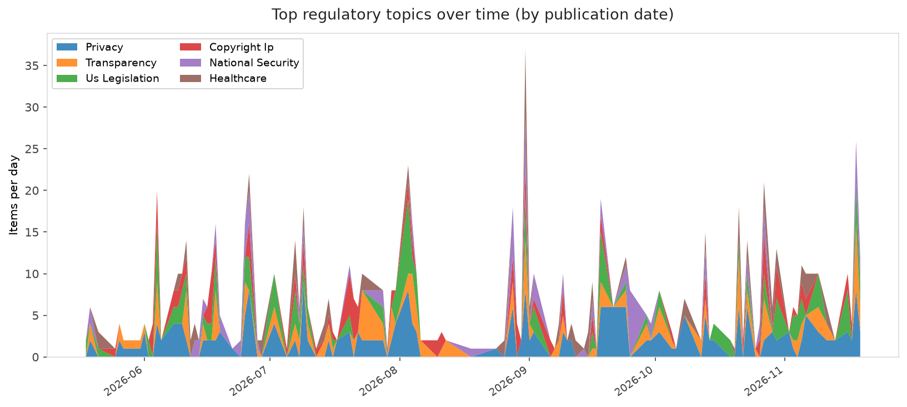
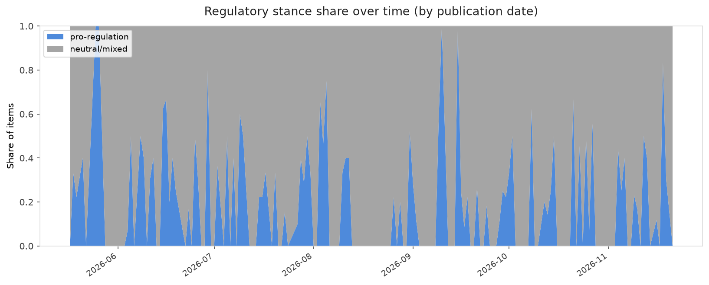

# AI in Law — Daily Sentiment Report
**Run date:** 2026-11-21 | **Items analyzed:** 4 | **Overall:** 🔴 Mildly negative (-0.116)

_Articles in this report were published between **2026-11-19** and **2026-11-21**._

---

## Summary

Today's collection covers **4** items from news outlets, academic preprints, Reddit, and regulatory sources.
Compared to the historical average of **+0.206**, today's sentiment is ↓ **0.323** points lower.

| Metric | Value |
|--------|-------|
| Positive items | 1 (25.0%) |
| Neutral items  | 0 (0.0%) |
| Negative items | 3 (75.0%) |
| Avg. VADER compound | -0.1164 |
| Pro-regulation items | 1 |
| Anti-regulation items | 0 |

---

## Top Topics Today

- **Us Legislation** — 1 items
- **Privacy** — 1 items
- **National Security** — 1 items
- **Transparency** — 1 items

---

## Most Positive Coverage

- [Studying AI Act Mentions: A first look at the impact of the European Union's AI regulation on Huggin](https://arxiv.org/abs/2611.26050v1)  
  _arXiv_ — VADER: `+0.959`
- [Can Anthropic afford to put safety first?](https://www.theverge.com/podcast/1038701/anthropic-ipo-ai-safety-openai-nvidia-structure)  
  _The Verge AI_ — VADER: `-0.076`
- [Traumatized teens sue school, cops after Doritos bag triggers AI gun alert](https://arstechnica.com/tech-policy/2026/11/traumatized-teens-sue-school-cops-after-doritos-bag-triggers-ai-gun-alert/)  
  _Ars Technica Tech Policy_ — VADER: `-0.421`

---

## Most Critical / Negative Coverage

- [Outage Chaos: Who Turned Off All The Computer?](https://www.eff.org/deeplinks/2026/11/outage-chaos-who-turned-all-computer)  
  _EFF DeepLinks_ — VADER: `-0.926`
- [Traumatized teens sue school, cops after Doritos bag triggers AI gun alert](https://arstechnica.com/tech-policy/2026/11/traumatized-teens-sue-school-cops-after-doritos-bag-triggers-ai-gun-alert/)  
  _Ars Technica Tech Policy_ — VADER: `-0.421`
- [Can Anthropic afford to put safety first?](https://www.theverge.com/podcast/1038701/anthropic-ipo-ai-safety-openai-nvidia-structure)  
  _The Verge AI_ — VADER: `-0.076`

---

## Visualizations — Today

## Visualizations — Trends Over Time

---

## Methodology

- **VADER** (Valence Aware Dictionary and sEntiment Reasoner) — compound score in [-1, 1].
- **Topic tagging** — regex keyword matching across 12 AI-law sub-domains.
- **Stance detection** — keyword-based pro/anti-regulation signal detection.
- **Date filter** — items are kept only if their *publication* date falls within the look-back window (default 2 days).
- Sources: RSS news feeds, arXiv academic API, Reddit (PRAW), Regulations.gov API.

_Generated automatically on 2026-11-21 17:54 UTC._
