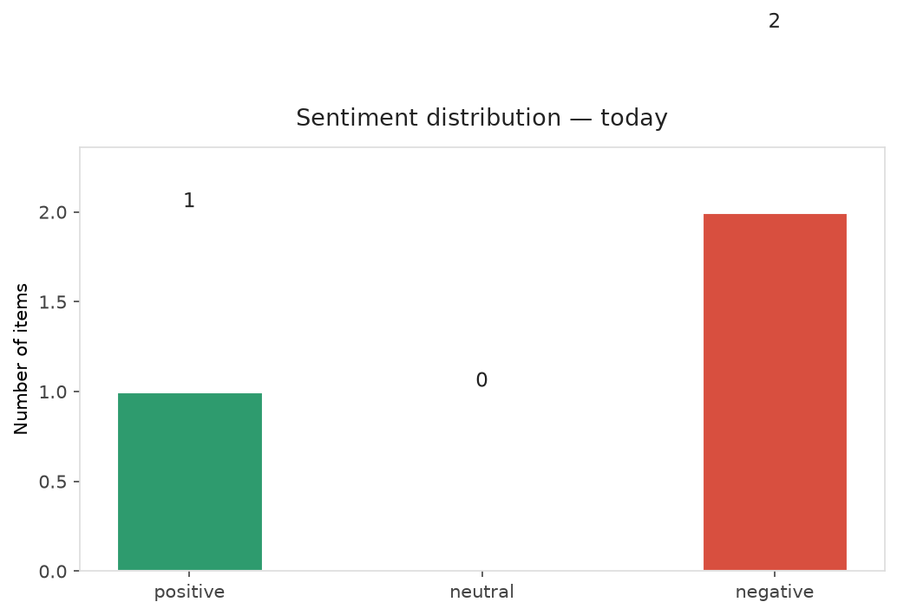
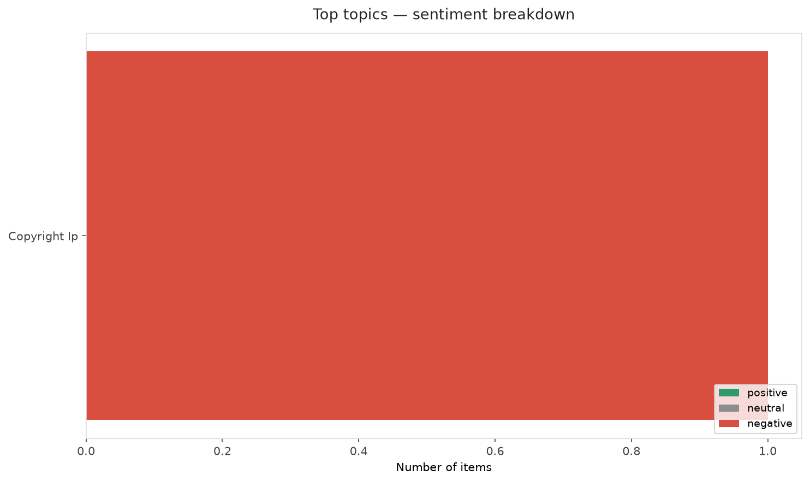
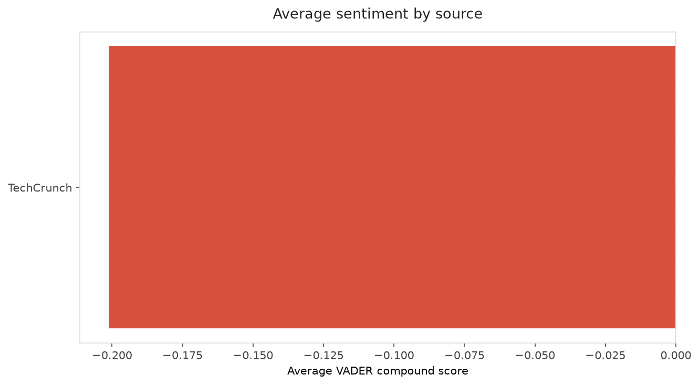
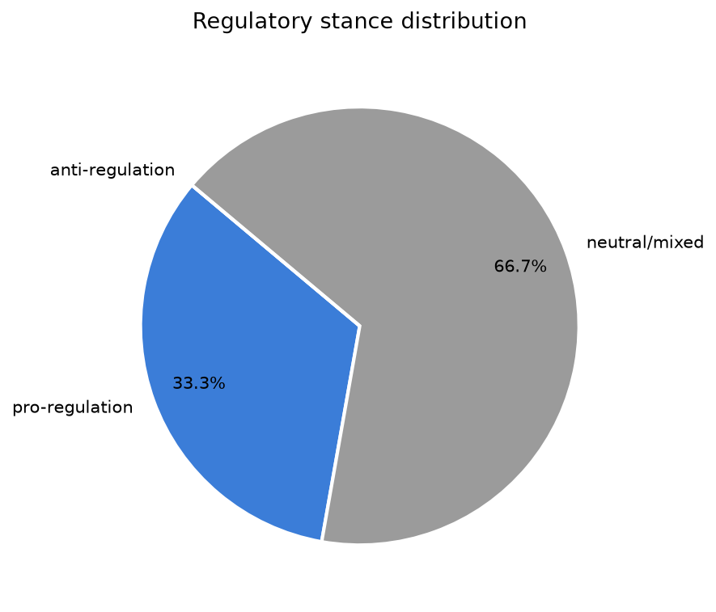
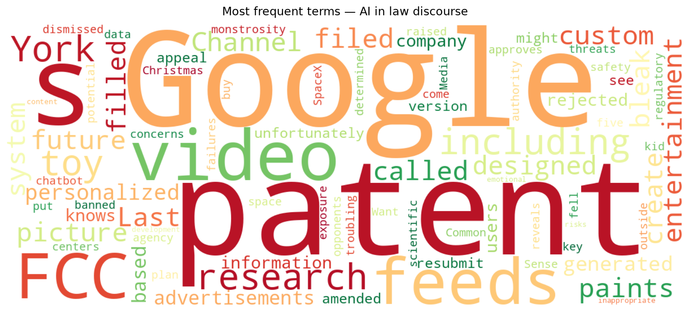
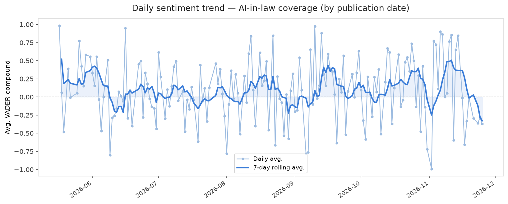
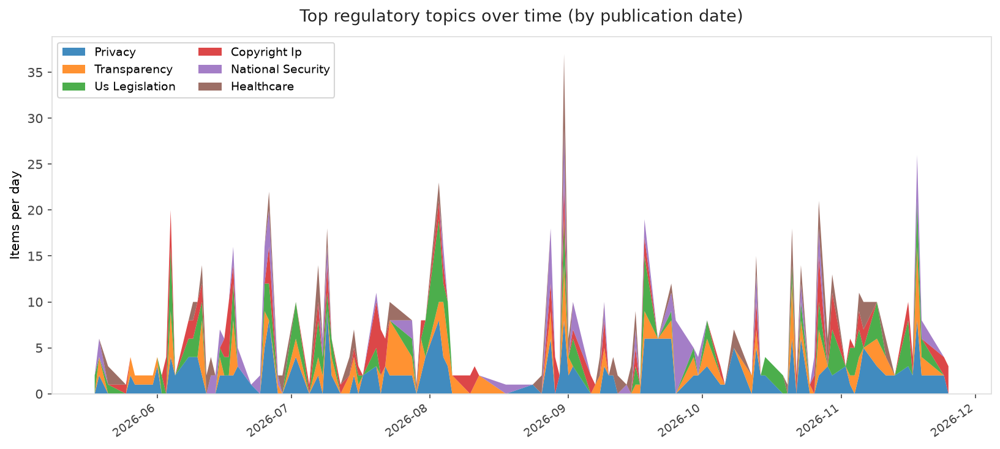
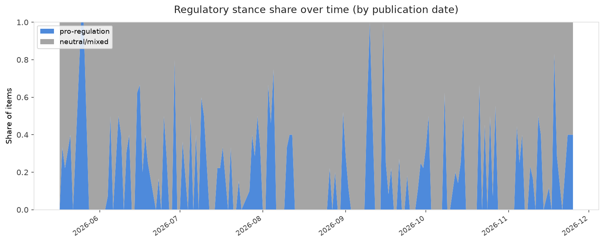

# AI in Law — Daily Sentiment Report
**Run date:** 2026-11-27 | **Items analyzed:** 3 | **Overall:** 🔴 Mildly negative (-0.325)

_Articles in this report were published between **2026-11-25** and **2026-11-25**._

---

## Summary

Today's collection covers **3** items from news outlets, academic preprints, Reddit, and regulatory sources.
Compared to the historical average of **+0.199**, today's sentiment is ↓ **0.524** points lower.

| Metric | Value |
|--------|-------|
| Positive items | 1 (33.3%) |
| Neutral items  | 0 (0.0%) |
| Negative items | 2 (66.7%) |
| Avg. VADER compound | -0.3249 |
| Pro-regulation items | 1 |
| Anti-regulation items | 0 |

---

## Top Topics Today

- **Copyright Ip** — 1 items

---

## Most Positive Coverage

- [FCC approves SpaceX plan to put AI data centers in space](https://techcrunch.com/2026/11/25/fcc-approves-spacex-plan-to-put-ai-data-centers-in-space/)  
  _TechCrunch_ — VADER: `+0.382`
- [Google’s patent for custom AI video feeds paints a bleak picture of entertainment’s future](https://www.theverge.com/entertainment/1042221/google-my-channel-ai-video-patent)  
  _The Verge AI_ — VADER: `-0.572`
- [Want to buy your kid an AI toy this Christmas? Not in New York](https://techcrunch.com/2026/11/25/want-to-buy-your-kid-an-ai-toy-this-christmas-not-in-new-york/)  
  _TechCrunch_ — VADER: `-0.784`

---

## Most Critical / Negative Coverage

- [Want to buy your kid an AI toy this Christmas? Not in New York](https://techcrunch.com/2026/11/25/want-to-buy-your-kid-an-ai-toy-this-christmas-not-in-new-york/)  
  _TechCrunch_ — VADER: `-0.784`
- [Google’s patent for custom AI video feeds paints a bleak picture of entertainment’s future](https://www.theverge.com/entertainment/1042221/google-my-channel-ai-video-patent)  
  _The Verge AI_ — VADER: `-0.572`
- [FCC approves SpaceX plan to put AI data centers in space](https://techcrunch.com/2026/11/25/fcc-approves-spacex-plan-to-put-ai-data-centers-in-space/)  
  _TechCrunch_ — VADER: `+0.382`

---

## Visualizations — Today

## Visualizations — Trends Over Time

---

## Methodology

- **VADER** (Valence Aware Dictionary and sEntiment Reasoner) — compound score in [-1, 1].
- **Topic tagging** — regex keyword matching across 12 AI-law sub-domains.
- **Stance detection** — keyword-based pro/anti-regulation signal detection.
- **Date filter** — items are kept only if their *publication* date falls within the look-back window (default 2 days).
- Sources: RSS news feeds, arXiv academic API, Reddit (PRAW), Regulations.gov API.

_Generated automatically on 2026-11-27 19:50 UTC._
